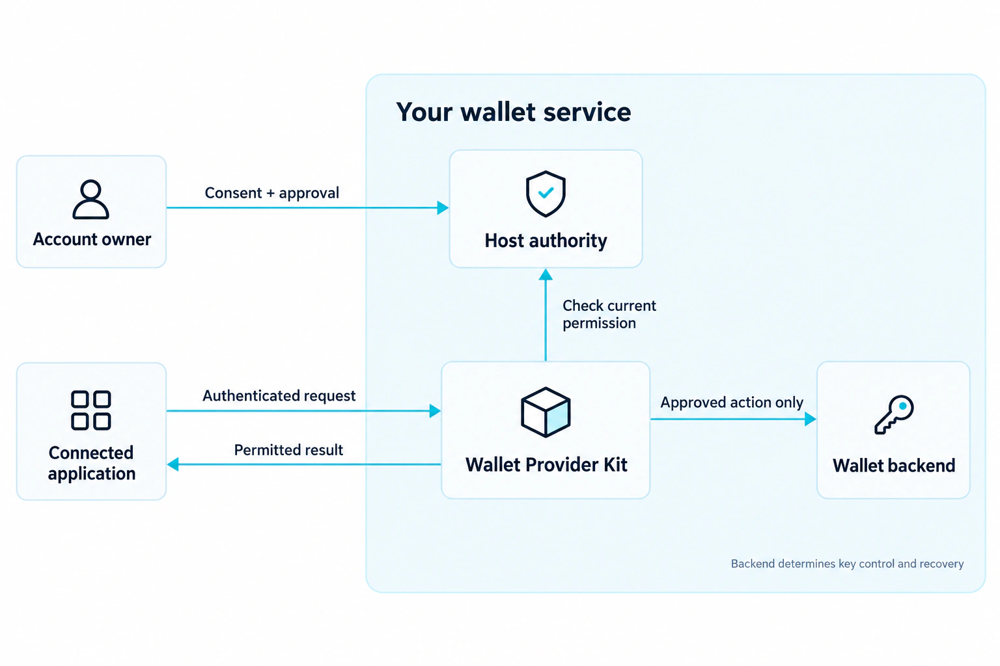
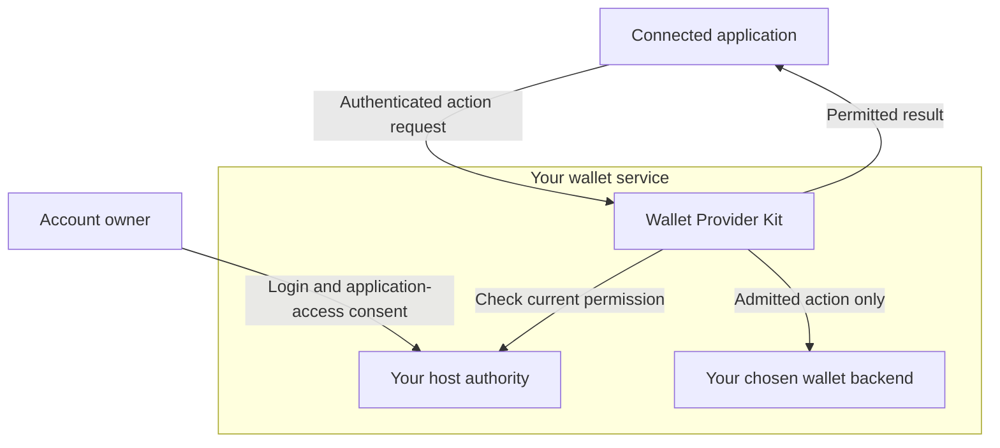
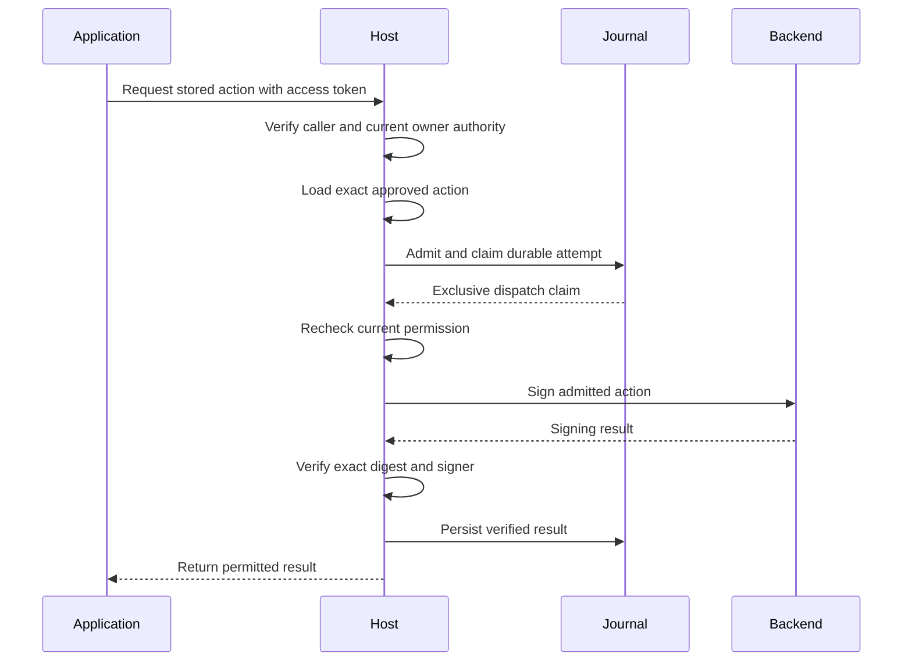

<a href="https://moovha.com/"></a>

# Moovha Wallet Provider Kit

**Build a blockchain wallet service that lets applications request transactions on behalf of your users.**

Wallet Provider Kit is a configurable wallet service and TypeScript toolkit for
teams building and operating blockchain wallets for their users. Rooted in Moovha's
work with blockchain payments and decentralised finance (DeFi), it makes access
to on-chain assets such as USDC and ZARP easier to integrate into everyday products.
It brings account creation,
user onboarding, application access and approved-action signing into one toolkit. You choose the system that
creates wallet accounts and signs approved actions, define who may use an account,
and retain responsibility for key control and recovery.

During onboarding, an application such as Moovha requests wallet access on the
user's behalf. The user signs in and grants application-access consent. After the
required identity verification (KYC) and provider acceptance, your service records
a limited, revocable access grant. The application then submits transaction
requests under that grant. Your service checks the stored grant, current identity
status, the exact approved action and provider policies before authorising signing.
Application-access consent is not requested again for each transaction. Your team
keeps control of its signing integration;
the application receives the results of permitted actions without receiving
private keys or seed phrases.

Connected applications are expected to cover the blockchain network fees, often
called **gas**, for the supported actions they request. When a provider connects
its wallets to Moovha with user approval, Moovha takes that sponsorship role for
admitted operations. Providers should be able to integrate without building their
own gas-funding rail or asking users to keep a separate gas-token balance.
The [assets and gas guide](docs/assets-and-gas.md) explains this project-supported
rail, the application's obligations and the current implementation boundary.

[Documentation](https://moovha.github.io/wallet-provider-kit/) ·
[Get started](docs/README.md) ·
[Operator wizard](docs/setup-wizard.md) ·
[Services and credentials](docs/operator-services.md) ·
[Deploy the export](docs/operator-deployment.md)

## Start with the graphical setup

Supported setups need **configuration, deployment and API consumption**. Operators
configure the supplied service through FormKit; they do not write policies in
code, authority callbacks, database adapters or signing journals. Custom adapters
and embedding the TypeScript library are advanced developer paths.

Use Node **24.22.0**, npm **11.11.1** and Git. From your operator workstation:

```sh
git clone https://github.com/Moovha/wallet-provider-kit.git
cd wallet-provider-kit
npm ci
npm run build
npm start -- setup
```

The command opens a temporary local wizard, or prints its private session URL.
Keep the terminal open. The wizard is bundled; it needs no FormKit Pro subscription.
The package is experimental and not published to npm; a registry install by name
is not available. See [getting started](docs/README.md) for installation help.


[Open full-size screenshot](docs/public/screenshots/export.webp)

_Example configuration only. Validation checks the configuration; it does not test
vendor services or certify readiness. Initial activation remains disabled._

1. **[Prepare services](docs/operator-services.md):** domain, wallet backend, login,
   application token issuer, identity vendor, reviewers and funding agreements.
   Each ID/secret is explained with its source. The [Auth0 recipe](docs/auth0-setup.md)
   gives a dashboard-based reference for login and compatible API tokens.
2. **[Configure the six screens](docs/setup-wizard.md):** Provider, Backend, Services,
   Policies, Deployment and Export. Enter secret **variable names**, not values.
   Download configuration, the empty variable template and deployment checklist.
3. **[Deploy and accept](docs/operator-deployment.md):** fill secrets privately,
   prepare persistent storage, initialize once, diagnose, add HTTPS, prove backend
   and recovery behavior, then explicitly activate. The wizard does not deploy.
4. **[Connect your product](docs/operator-deployment.md#hand-the-api-to-the-product-developer):**
   its developer consumes the HTTP API and integrates owner access/approval. The
   application separately arranges submission, gas and settlement.

The GUI's **API reference** uses bundled Swagger UI to show each supported endpoint,
required scope, configuration prerequisites, request/response schemas and illustrative
examples. Select an application, copy a cURL request or download the displayed OpenAPI.
Its **Try it out** handoff enables the deployed Swagger explorer and opens it on
your provider's HTTPS domain. [Test live API responses](docs/http-api.md#try-deployed-apis)
with public discovery or a short-lived application token after deployment.
The local preview sends no API calls; deployed requests have real effects and permission checks.

The [getting-started guide](docs/README.md) links every stage. Supported profiles
remain single-host and Base Sepolia EOA only; production custody acceptance is pending.

## Who takes part

<figure class="wallet-visual">
  
  <figcaption>The provider checks current authority; the connected application receives permitted results without receiving wallet keys.</figcaption>
</figure>

[View full-size diagram](docs/public/diagrams/service-boundary.webp)

Your team is the **wallet provider**: it operates the wallet service for its users.
The server application in which you run the toolkit is called the **host**.

| Term                      | What it means here                                                                                                                                                                                                                  |
| ------------------------- | ----------------------------------------------------------------------------------------------------------------------------------------------------------------------------------------------------------------------------------- |
| **Account owner**         | The user your service records as owning a wallet account. They sign in and approve application access. Also called the wallet owner; this doesn't by itself say who holds the private keys.                                         |
| **Connected application** | Software, such as Moovha, that requests access to an owner's account through your wallet service. In OAuth configuration and API authentication, its registration is called a **[client](docs/concepts.md#what-does-client-mean)**. |
| **Host authority**        | Your host's permission-checking code and stored records. Together they decide which owner and application may use an account, and which exact action is approved now.                                                               |
| **Wallet backend**        | The wallet engine or signing service your host connects to. It creates or locates accounts and signs approved actions; its key-control and recovery model determines custody.                                                       |

Your product may contain both a wallet service and an application that calls it;
the responsibilities still remain distinct. The [concepts guide](docs/concepts.md)
maps these names to configuration, API fields and the user's consent screen.

For your next step, follow the [operator getting-started guide](docs/README.md).
For unsupported integrations, use the [advanced adapter guide](docs/custom-adapters.md).

## A foundation for adopting teams

Operators can run `wallet-provider-kit setup` to configure supported deployments
through the [FormKit setup wizard](docs/setup-wizard.md), then export configuration
and a deployment checklist. No application code is needed for this setup path.

The standard path is **configure, deploy and consume the API**. Use one validated
JSON configuration for supported login, identity, wallet backends and SQLite storage.
The kit supplies consent, grants, account recovery, provider-authorized transfers
and durable signing coordination. Start with [service setup](docs/setup.md).
Custom backend adapters and embedded host composition are the advanced path.

The kit is for a team that wants to provide wallets as part of its own product,
or make its wallet service available to other applications. Your users interact
with your login, consent and approval experience. Your host decides which
connected applications can request access, which accounts they can use and which
actions they may perform.

You can start with the bundled onboarding profile for owner login, identity
review, consent and revocable application access. If your product already has
those systems, you can connect its existing authority and records through the
public interfaces. Both approaches leave the wallet backend and the business
rules under your team's control.

Deploy the configured provider service and connect your product through its API.
The toolkit can also be embedded as a Node.js package for advanced integrations.
Its OpenAPI contract also lets applications written in other languages use the implemented service routes.



Your team configures the authority and backend shown inside the service boundary.
For supported profiles, the kit supplies the permission checks and durable records.
The backend's control and recovery model determines custody; connecting an
application doesn't transfer the wallet's keys to it.

## How wallet access works

<figure class="wallet-visual">
  
  <figcaption>Authentication identifies the caller. Current authority, an exact approved action and a durable attempt are also required.</figcaption>
</figure>

[View full-size diagram](docs/public/diagrams/action-authority.webp)

The application starts an access request, and the user signs in to the provider
and grants application-access consent. Required identity checks and provider
acceptance establish eligibility for a stored access grant with specific
permissions and an expiry. An accepted user's identity can be reused when they
connect another application without repeating KYC, while that new application
still requires access consent. Subsequent transaction requests use the stored
grant without repeating application-access consent. The user can pause or revoke
access; reconnection, renewal or changed permissions require a new access request
and consent.

When an application requests an action, the host resolves the caller to the
account owner and checks current access, consent and identity-verification
status against stored records. These are provider checks, not fresh consent prompts.
For signing, it also loads the exact **approved action**: an instruction
stored by the host after authorising its exact content and limits. It records an
**attempt**, the identity of this execution that retries must preserve, before
the backend is called. The application references a stored action;
it doesn't submit arbitrary bytes for the service to sign.

In the bundled transfer profile, the user grants `transfers:request` delegation
during onboarding. The consent screen shows the token, recipients and limits.
The application requests transfers on the user's behalf; the provider authorises
and stores each exact action under that delegation and its current policies,
without another user approval prompt. Ordinary access or `operations:request`
grants do not confer this delegation. See the [configured transfer flow](docs/setup.md).

The **journal** is the private, persistent record of attempts, their state and
their results. The toolkit's journal wrapper coordinates the backend call,
verifies its result and saves it through that journal. An authorised retry can
then receive the saved result without repeating account creation or signing.
If a response is lost, the original attempt stays pending or unknown until the
host can establish what happened; this is called **reconciliation**. Current
permission is checked again before returning a stored success. Ordinary application
logs don't replace the journal. See [attempts and recovery](docs/concepts.md#actions-attempts-and-the-journal).

This separates the user's access consent, the host's authority and the backend's signing
responsibility. **OAuth scopes** are named permissions on an application's access
token. They allow a request to reach the host's policy checks. Spending authority
also requires the current account owner, the application's **grant** (its stored,
expiring access permission), Know Your Customer (**KYC**) status, user consent,
the unchanged approved action and the recorded attempt. The [provider guide](docs/provider-guide.md)
and [security model](docs/security-model.md) explain that contract.

The signing path below shows a new successful attempt. An authorised retry uses
the stored result; a pending or unknown attempt requires reconciliation.



## Where it fits in Moovha

<figure class="wallet-visual">
  
  <figcaption>Sponsorship and execution belong to the connected application; a signing result alone does not establish settlement.</figcaption>
</figure>

[View full-size diagram](docs/public/diagrams/assets-and-gas.webp)

Moovha's foundations are on-chain transfers, swaps and access to DeFi through
assets such as USDC and ZARP. These wallets hold blockchain assets and authorise
transactions involving token and vault contracts. A simple product experience
still needs to make the asset, network, approval and fees clear.

Within Moovha's architecture, this project supplies a portable wallet/provider
implementation for the signing foundation and independent-provider integration
work. It is intended to support access to independently controlled wallets while
keeping their keys with the wallet provider.

Learn about [Moovha](https://moovha.com/) and explore the
[Moovha GitHub organization](https://github.com/Moovha).

Moovha's business-operation API coordinates transaction intent,
sponsorship, execution and settlement. Device wallets, backup and recovery belong
to the separate device-wallet profile. The [architecture guide](docs/architecture.md#applications-and-wallet-control)
explains the provider boundary and application access.

Gas sponsorship is part of that integration design: the connected application
funds eligible network fees while the provider retains wallet control and checks
the user's authority. It does not require sharing keys with the application.

Non-custodial application access describes Moovha's relationship to the wallet's
keys. Exclusive end-user self-custody depends on who can actually control and
recover the chosen backend. Adopters must describe that model accurately to
their users.

## What is available today

The package includes a wallet service and signing interfaces, a journal-backed
provider wrapper, provider-hosted onboarding and access management, OAuth token
verification, generated OpenAPI and optional OpenTelemetry monitoring.

Experimental adapters connect [Coinbase CDP](docs/provider-guide.md#current-adapter-profile),
[Open Wallet Standard](docs/ows-adapter.md) and
[OpenZeppelin Relayer](docs/openzeppelin-relayer.md). Each has a documented account,
network, key-control and recovery profile. Relayer also offers a separate
library-only execution profile.

**Experimental · 0.1.0 · unpublished.** The default service stays unconfigured.
The bundled onboarding-only profile manages access and provisioning. The
configured service optionally supplies an exact provider-authorized ERC-3009 transfer
profile and financial journal on Base Sepolia; custom financial actions require
advanced host integration. The [built-in SQLite database](docs/storage.md)
stores onboarding, approvals, budgets and financial attempts on one persistent
POSIX host, with required current host-policy checks. The original file store
remains available for onboarding.

USDC and ZARP describe the wider project's asset use cases; they are not a claim
that this experimental profile supports every token or mainnet operation. Its
configured token contract and signing domain need independent verification.

Production custody acceptance remains pending. Mainnet, contract accounts,
WalletConnect and ERC-1271/4337/7702 are unsupported. The separate
[orchestration draft](spec/orchestration-draft.json) is a reference for Moovha's
business API; those orchestration, sponsorship and settlement routes aren't
implemented here. The sponsorship commitment belongs to the connected application's
execution rail; installing the kit or approving access does not activate it.
Use the [acceptance requirements](docs/conformance.md) to assess your integration.

## Developer learning: offline provider flow

Use Node **24.22.0** and npm **11.11.1**:

```sh
git clone https://github.com/Moovha/wallet-provider-kit.git
cd wallet-provider-kit
npm ci
npm run example:provider
```

The offline example walks through authentication, account provisioning, approved
signing, result replay, revocation, current-KYC denial and an uncertain outcome.
It uses ephemeral fixtures, opens no listener and requires no live credentials
or funds. Follow the [tutorial](docs/integration-example.md) to understand each
step and the production integrations you must supply.

To consume the toolkit in your own application, run `npm run pack:local` and
follow the [package installation guide](docs/package.md). npm publication remains
disabled. For a new provider, continue with the [operator wizard](docs/setup-wizard.md); for an existing embedded host,
start with the [API guide](docs/api.md) and [durable attempts](docs/durable-attempts.md).

## Build with us

The [documentation site](https://moovha.github.io/wallet-provider-kit/) takes you
from installation through backend integration, host authority, APIs and operations,
with grouped navigation and local search. The
[contributor guide](CONTRIBUTING.md#preview-and-publish-documentation) explains local
previews and how to publish reviewed documentation updates.

Contributions follow the [contributor guide](CONTRIBUTING.md),
[governance](GOVERNANCE.md) and [code of conduct](CODE_OF_CONDUCT.md).
Use [GitHub issues](https://github.com/Moovha/wallet-provider-kit/issues) for bugs
and integration questions.
Report vulnerabilities through [SECURITY.md](SECURITY.md). See the
[changelog](CHANGELOG.md) and [release process](docs/releases.md) for project
history and release requirements.

[Apache-2.0](LICENSE). See [NOTICE](NOTICE) and [provenance](docs/extraction.json).
