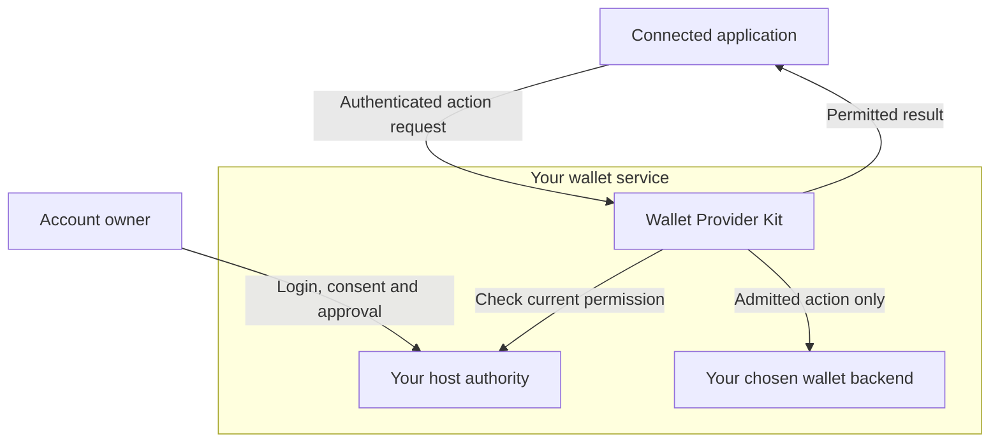
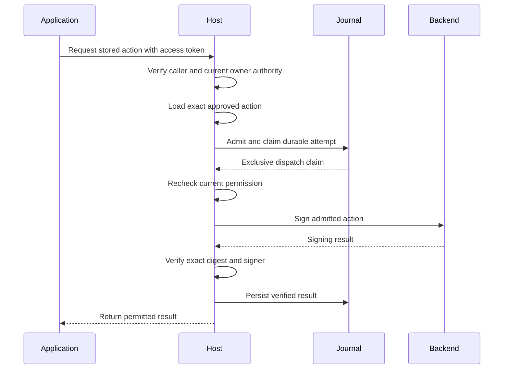

# Moovha Wallet Provider Kit

**Build a wallet service your users can authorise and other applications can access.**

Wallet Provider Kit is a TypeScript foundation for teams building and operating
wallets for their users. It brings account creation, user onboarding, application
access and approved-action signing into one toolkit. You choose the system that
creates wallet accounts and signs approved actions, define who may use an account,
and retain responsibility for key control and recovery.

An application such as Moovha can then work with those wallets through limited,
user-approved access. Your team keeps control of its signing integration;
the application receives the results of permitted actions without receiving
private keys or seed phrases.

[Documentation](https://moovha.github.io/wallet-provider-kit/) ·
[Get started](https://moovha.github.io/wallet-provider-kit/docs/package.html) ·
[Integration tutorial](https://moovha.github.io/wallet-provider-kit/docs/integration-example.html) ·
[API documentation](https://moovha.github.io/wallet-provider-kit/docs/api.html)

## Who takes part

Your team is the **wallet provider**: it operates the wallet service for its users.
The server application in which you run the toolkit is called the **host**.

| Term                      | What it means here                                                                                                                                                                          |
| ------------------------- | ------------------------------------------------------------------------------------------------------------------------------------------------------------------------------------------- |
| **Account owner**         | The user your service records as owning a wallet account. They sign in and approve application access. Also called the wallet owner; this doesn't by itself say who holds the private keys. |
| **Connected application** | Software, such as Moovha, that requests access to an owner's account through your wallet service. In OAuth configuration and API authentication, its registration is called a **client**.   |
| **Host authority**        | Your host's permission-checking code and stored records. Together they decide which owner and application may use an account, and which exact action is approved now.                       |
| **Wallet backend**        | The wallet engine or signing service your host connects to. It creates or locates accounts and signs approved actions; its key-control and recovery model determines custody.               |

Your product may contain both a wallet service and an application that calls it;
the responsibilities still remain distinct. The [concepts guide](docs/concepts.md)
maps these names to configuration, API fields and the user's consent screen.

## A foundation for adopting teams

The kit is for a team that wants to provide wallets as part of its own product,
or make its wallet service available to other applications. Your users interact
with your login, consent and approval experience. Your host decides which
connected applications can request access, which accounts they can use and which
actions they may perform.

You can start with the bundled onboarding profile for owner login, identity
review, consent and revocable application access. If your product already has
those systems, you can connect its existing authority and records through the
public interfaces. Both approaches leave the wallet backend and the business
rules under your team's control.

The toolkit can be embedded as a Node.js package or composed into a
provider-hosted HTTP service. Its OpenAPI contract also lets applications written
in other languages use the implemented service routes.



Your team supplies the authority and backend shown inside the service boundary.
The backend's control and recovery model determines custody; connecting an
application doesn't transfer the wallet's keys to it.

## How wallet access works

A user establishes an account with the wallet provider and approves an
application's access. The provider records that relationship, its permissions
and its expiry. The user can later pause or revoke access.

When an application requests an action, the host resolves the caller to the
account owner and checks current access, consent and identity-verification
status. For signing, it also loads the exact **approved action**: an instruction
stored by the host with the content and limits that were approved. It records an
**attempt**, the identity of this execution that retries must preserve, before
the backend is called. The application references a stored action;
it doesn't submit arbitrary bytes for the service to sign.

The **journal** is the private, persistent record of attempts, their state and
their results. The toolkit's journal wrapper coordinates the backend call,
verifies its result and saves it through that journal. An authorised retry can
then receive the saved result without repeating account creation or signing.
If a response is lost, the original attempt stays pending or unknown until the
host can establish what happened; this is called **reconciliation**. Current
permission is checked again before returning a stored success. Ordinary application
logs don't replace the journal. See [attempts and recovery](docs/concepts.md#actions-attempts-and-the-journal).

This separates the user's approval, the host's authority and the backend's signing
responsibility. **OAuth scopes** are named permissions on an application's access
token. They allow a request to reach the host's policy checks. Spending authority
also requires the current account owner, the application's **grant** (its stored,
expiring access permission), Know Your Customer (**KYC**) status, user consent,
the unchanged approved action and the recorded attempt. The [provider guide](docs/provider-guide.md)
and [security model](docs/security-model.md) explain that contract.

The signing path below shows a new successful attempt. An authorised retry uses
the stored result; a pending or unknown attempt requires reconciliation.



## Where it fits in Moovha

Within Moovha's architecture, this project supplies a portable wallet/provider
implementation for the signing foundation and independent-provider integration
work. It is intended to support access to independently controlled wallets while
keeping their keys with the wallet provider.

Moovha's DeFi project owns the business-operation API, transaction intent,
sponsorship, execution and settlement. Device wallets, backup and recovery belong
to the separate device-wallet profile. The [architecture guide](docs/architecture.md#applications-and-wallet-control)
explains the provider boundary and application access.

Non-custodial application access describes Moovha's relationship to the wallet's
keys. Exclusive end-user self-custody depends on who can actually control and
recover the chosen backend. Adopters must describe that model accurately to
their users.

## What is available today

The package includes a wallet service and signing interfaces, a journal-backed
provider wrapper, provider-hosted onboarding and access management, OAuth token
verification, generated OpenAPI and optional OpenTelemetry monitoring.

Experimental adapters connect [Coinbase CDP](docs/provider-guide.md#current-adapter-profile),
[Open Wallet Standard](docs/ows-adapter.md) and
[OpenZeppelin Relayer](docs/openzeppelin-relayer.md). Each has a documented account,
network, key-control and recovery profile. Relayer also offers a separate
library-only execution profile.

**Experimental · 0.1.0 · unpublished.** The default service stays unconfigured.
The bundled onboarding profile manages access and provisioning; signing requires
an exact-action authority and financial journal. The [built-in SQLite database](docs/storage.md)
stores onboarding, approvals, budgets and financial attempts on one persistent
POSIX host, with required current host-policy checks. The original file store
remains available for onboarding.

Production custody acceptance remains pending. Mainnet, contract accounts,
WalletConnect and ERC-1271/4337/7702 are unsupported. The separate
[orchestration draft](spec/orchestration-draft.json) is a reference for DeFi's
business API; those orchestration, sponsorship and settlement routes aren't
implemented here. Use the [acceptance requirements](docs/conformance.md) to assess your integration.

## Try the complete provider flow

Use Node **24.22.0** and npm **11.11.1**:

```sh
git clone https://github.com/Moovha/wallet-provider-kit.git
cd wallet-provider-kit
npm ci
npm run example:provider
```

The offline example walks through authentication, account provisioning, approved
signing, result replay, revocation, current-KYC denial and an uncertain outcome.
It uses ephemeral fixtures, opens no listener and requires no live credentials
or funds. Follow the [tutorial](docs/integration-example.md) to understand each
step and the production integrations you must supply.

To consume the toolkit in your own application, run `npm run pack:local` and
follow the [package installation guide](docs/package.md). npm publication remains
disabled. For a new provider, continue with [onboarding](docs/onboarding.md) and
[one typed configuration](docs/provider.config.example.ts); for an existing host,
start with the [API guide](docs/api.md) and [durable attempts](docs/durable-attempts.md).

## Build with us

The [documentation site](https://moovha.github.io/wallet-provider-kit/) takes you
from installation through backend integration, host authority, APIs and operations,
with grouped navigation and local search. The
[contributor guide](CONTRIBUTING.md#preview-and-publish-documentation) explains local
previews and how to publish reviewed documentation updates.

Contributions follow the [contributor guide](CONTRIBUTING.md),
[governance](GOVERNANCE.md) and [code of conduct](CODE_OF_CONDUCT.md).
Report vulnerabilities through [SECURITY.md](SECURITY.md). See the
[changelog](CHANGELOG.md) and [release process](docs/releases.md) for project
history and release requirements.

[Apache-2.0](LICENSE). See [NOTICE](NOTICE) and [provenance](docs/extraction.json).
