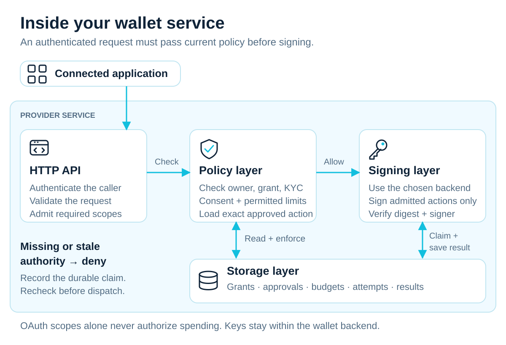
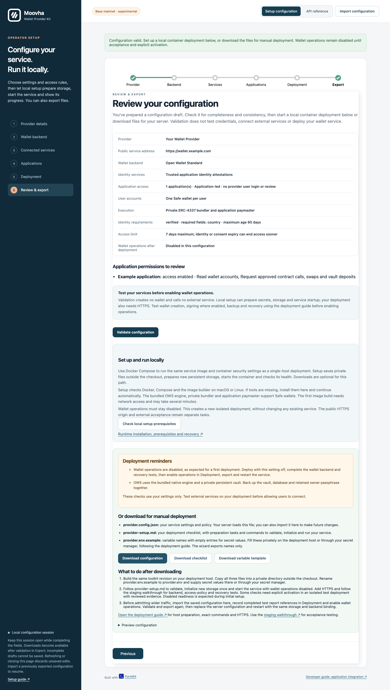
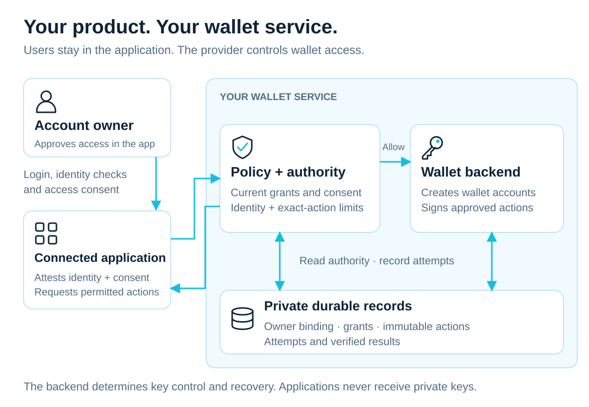
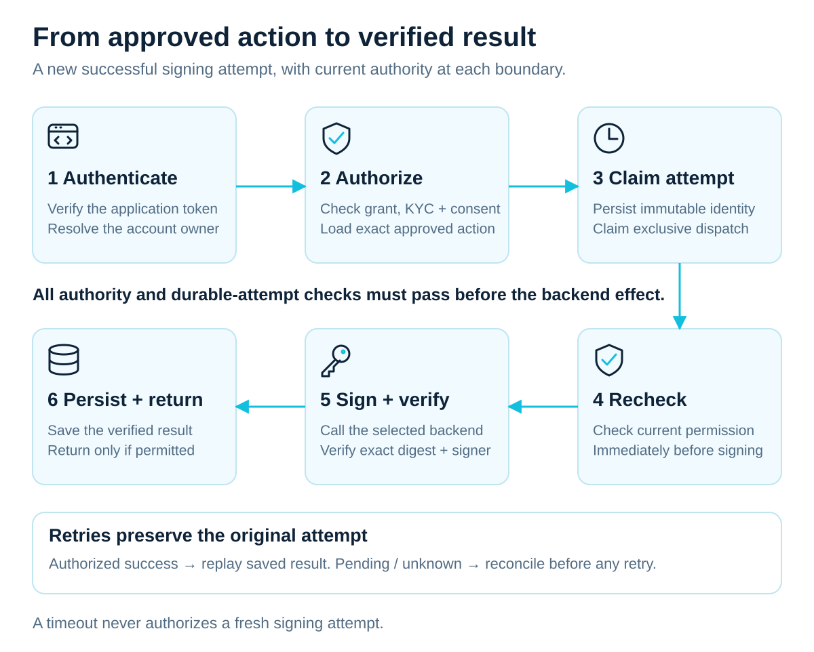

<a href="https://moovha.com/"></a>

# Moovha Wallet Provider Kit

**Build a blockchain wallet service that lets applications request transactions on behalf of your users.**

Wallet Provider Kit is a configurable wallet service and TypeScript toolkit for
teams building and operating blockchain wallets for their users. Rooted in Moovha's
work with blockchain payments and decentralised finance (DeFi), it makes access
to on-chain assets such as USDC and ZARP easier to integrate into everyday products.
It brings account creation,
application-led access, account provisioning and approved-action signing into one toolkit. You choose the system that
creates wallet accounts and signs approved actions, define who may use an account,
and retain responsibility for key control and recovery.

<figure class="wallet-visual">
  
  <figcaption>The HTTP API, policy, storage and signing layers work together to protect wallet operations. OAuth scopes alone never authorize spending.</figcaption>
</figure>

[View full-size architecture](docs/public/diagrams/service-composition.svg)

In the standard application-led flow, users remain in the connected application.
That application authenticates them, completes the required identity checks and
records their wallet-access consent. It requests access on their behalf using
its authenticated API client and a user assertion. Under an explicit trust agreement,
the provider checks identity evidence, consent, current policy and permission limits,
then stores a revocable grant. It does not require a second user login or routine
staff review. Applications never receive private keys or seed phrases.

Read the [application-led access contract](docs/application-access.md) for user
binding, evidence, permissions, revocation and limits. Required fields or an OAuth
scope alone do not establish identity or spending authority.

Connected applications are expected to cover the blockchain network fees, often
called **gas**, for the supported actions they request. When a provider connects
its wallets to Moovha with user approval, Moovha takes that sponsorship role for
admitted operations. Providers should be able to integrate without building their
own gas-funding rail or asking users to keep a separate gas-token balance.
The [assets and gas guide](docs/assets-and-gas.md) explains this project-supported
rail, the application's obligations and the current implementation boundary.

[Documentation](https://moovha.github.io/wallet-provider-kit/) ·
[Get started](docs/README.md) ·
[Operator wizard](docs/setup-wizard.md) ·
[Application management](docs/runtime-workspace.md) ·
[Services and credentials](docs/operator-services.md) ·
[Local preview](docs/local-preview.md) · [Run locally](docs/local-setup.md) · [Deploy the export](docs/operator-deployment.md)

## Start with the graphical setup

Supported setups need **configuration, deployment and API consumption**. Operators
configure the supplied service through FormKit; they do not write policies in
code, authority callbacks, database adapters or signing journals. Custom adapters
and embedding the TypeScript library are advanced developer paths.

Use Node **24.22.0**, npm **11.11.1** and Git. From your operator workstation:

```sh
git clone https://github.com/Moovha/wallet-provider-kit.git
cd wallet-provider-kit
npm ci
npm run build
npm start -- setup
```

The command opens a temporary local wizard, or prints its private session URL.
Keep the terminal open. The wizard is bundled; it needs no FormKit Pro subscription.
The package is experimental and not published to npm; a registry install by name
is not available. See [getting started](docs/README.md) for installation help.

The bundle includes an OAuth application token service, the OWS wallet
engine, SQLite and a saved Caddy automatic-HTTPS configuration. The wallet service starts a private Alto bundler and durable Valkey queues alongside OWS. Each user receives one Safe address; an application-owned paymaster covers gas through one application funding address. Configure application RPCs, action policies and funding before provisioning. See [self-hosted sponsorship](docs/self-hosted-sponsorship.md). EOA, relayer and pool execution configurations cannot start this service. See [the bundled setup](docs/bundled-setup.md).
After validation, choose **Set up and run locally**: review the plan, supply missing
secrets privately and watch setup save files, build the Docker image, initialize
new storage, diagnose and start the service. It uses the single-host container
security pattern and starts with wallet operations disabled. The wizard checks
Docker, Compose and the image builder, offers **Install local runtime and continue**
for missing components, then resumes setup. A working local Docker installation is
reused; otherwise setup uses Homebrew and a dedicated Colima VM on macOS or Linux.
Administrator prompts, when needed for Homebrew, stay in a terminal. See [local setup](docs/local-setup.md).

You can instead download `provider.config.json` (settings and policy),
`provider.env.example` (secret variable names) and `provider-setup.md` (deployment
checklist) for [manual deployment](docs/operator-deployment.md), including native deployments.
Existing deployments are updated through the reviewed maintenance process.
The [policy controls table](docs/application-access.md#configure-the-trust-policy)
explains which access rules you can customize in the GUI and how they are enforced.



[Open full-size screenshot](docs/public/screenshots/export-safe.png)

_Example configuration only. Validation checks the configuration; it does not test
vendor services or certify readiness. Initial activation remains disabled._

1. **[Choose your settings](docs/bundled-setup.md):** provider domain, bundled
   wallet engine and application registrations. Review which applications may attest user identity
   and consent, and the evidence your policy requires.
2. **[Configure the six screens](docs/setup-wizard.md):** Provider, Backend, Services,
   Applications, Deployment and Export. Application-led access is selected by default.
   Record application trust agreements and enter secret variable names, not values.
3. **[Run locally and accept](docs/local-setup.md):** let setup save private files,
   initialize new storage once and start a disabled container. Start the supplied HTTPS profile on the final host, test
   authority, backend and recovery behavior, then explicitly activate. Manual
   deployments follow the [deployment guide](docs/operator-deployment.md).
4. **[Connect your product](docs/application-access.md):** read access policy,
   submit current identity and consent evidence, receive a grant, create the wallet
   and revoke access when the user withdraws. Register
   [approved calls and optional operation adapters](docs/approved-contract-calls.md)
   for the [Safe execution flow](docs/self-hosted-sponsorship.md).
   [Execution latency and recovery](docs/execution-latency.md) explains account lanes,
   verified status and expired uncertain operations.
   Applications arrange sponsor funding; verified chain status is separate from
   business settlement.

The GUI's **API reference** uses bundled Swagger UI to show each supported endpoint,
required scope, configuration prerequisites, request/response schemas and illustrative
examples. Select an application, copy a cURL request or download the displayed OpenAPI.
Its **Try it out** controls enable the deployed Swagger explorer and open it on
your provider's HTTPS domain. [Test live API responses](docs/http-api.md#try-deployed-apis)
with public discovery or a short-lived application token after deployment.
Optional [operator token controls](docs/operator-tokens.md) obtain and renew tokens
in that GUI using server-held secrets and an explicit operator allowlist.
The wizard’s API reference preview sends no API calls; deployed requests have real effects and permission checks.

The [getting-started guide](docs/README.md) links every stage. The service uses
per-user Safe 1.4.1 accounts, ERC-4337 bundling and application-owned paymasters
on Base or Base Sepolia. Deployment remains single-host and production custody
acceptance is pending. See [execution latency](docs/execution-latency.md).

## Who takes part

Your team is the **wallet provider**: it operates the wallet service for its users.
The server application in which you run the toolkit is called the **host**.

| Term                      | What it means here                                                                                                                                                                                                                  |
| ------------------------- | ----------------------------------------------------------------------------------------------------------------------------------------------------------------------------------------------------------------------------------- |
| **Account owner**         | The user your service records as owning a wallet account. They sign in and approve wallet access within the connected application. Also called the wallet owner; this doesn't by itself say who holds the private keys.             |
| **Connected application** | Software, such as Moovha, that requests access to an owner's account through your wallet service. In OAuth configuration and API authentication, its registration is called a **[client](docs/concepts.md#what-does-client-mean)**. |
| **Host authority**        | Your host's permission-checking code and stored records. Together they decide which owner and application may use an account, and which exact action is approved now.                                                               |
| **Wallet backend**        | The wallet engine or signing service your host connects to. It creates or locates accounts and signs approved actions; its key-control and recovery model determines custody.                                                       |

Your product may contain both a wallet service and an application that calls it;
the responsibilities still remain distinct. The [concepts guide](docs/concepts.md)
maps these names to configuration, API fields and the user's consent screen.

For your next step, follow the [operator getting-started guide](docs/README.md).
For unsupported integrations, use the [advanced adapter guide](docs/custom-adapters.md).

The [approved contract-call guide](docs/approved-contract-calls.md) explains the general execution profile, automatic or existing smart-account bindings, separate consent, operation limits and verified outcome scopes.

## A foundation for adopting teams

Operators can run `wallet-provider-kit setup` to configure supported deployments
through the [FormKit setup wizard](docs/setup-wizard.md), then run automated local
container setup or export configuration and a deployment checklist. No application
code is needed for this setup path.

The standard path is **configure, deploy and consume the API**. Use one validated
JSON configuration for application trust, identity requirements, wallet backends and SQLite storage.
The kit supplies consent, grants, account recovery, provider-authorized transfers
and durable signing coordination. Start with [service setup](docs/setup.md).
Custom backend adapters and embedded host composition are the advanced path.

The kit is for a team that wants to provide wallets as part of its own product,
or make its wallet service available to other applications. Your users interact
with the connected application’s login, identity and consent experience. Your host decides which
connected applications can request access, which accounts they can use and which
actions they may perform.

The supplied service defaults to application-led access. Provider-hosted login,
consent and review remain an explicit [compatibility profile](docs/onboarding.md).
Existing hosted configurations retain their behavior; switching an occupied store
requires a reviewed ownership migration. Backend and business rules remain under
your team's control.

Deploy the configured provider service and connect your product through its API.
The toolkit can also be embedded as a Node.js package for advanced integrations.
Its OpenAPI contract also lets applications written in other languages use the implemented service routes.

<figure class="wallet-visual">
  
  <figcaption>The application handles the user experience; the provider service enforces access and keeps durable authority records.</figcaption>
</figure>

[View full-size relationship diagram](docs/public/diagrams/application-relationship.svg)

Your team configures the authority and backend shown inside the service boundary.
For supported profiles, the kit supplies the permission checks and durable records.
The backend's control and recovery model determines custody; connecting an
application doesn't transfer the wallet's keys to it.

## How wallet access works

The application reads the provider's access policy and submits its stable user ID,
accepted identity evidence and recorded consent for the current policy revision.
The provider grants access only to an explicitly trusted application when those
checks pass. Grants have specific permissions and an expiry. User IDs are scoped
to the application: matching names or IDs in different applications do not link
wallets. The application implements withdrawal and calls the grant-revocation API.
See [application-led access](docs/application-access.md).

When an application requests an action, the host resolves the caller to the
account owner and checks current access, consent and identity-verification
status against stored records. These are provider checks, not fresh consent prompts.
For signing, it also loads the exact **approved action**: an instruction
stored by the host after authorising its exact content and limits. It records an
**attempt**, the identity of this execution that retries must preserve, before
the backend is called. The application references a stored action;
it doesn't submit arbitrary bytes for the service to sign.

In the bundled transfer profile, the user grants `transfers:request` delegation
in the application for the exact transfer policy revision. The application must show the token, recipients and limits to the user.
The application requests transfers on the user's behalf; the provider authorises
and stores each exact action under that delegation and its current policies,
without another user approval prompt. Ordinary access or `operations:request`
grants do not confer this delegation. See the [configured transfer flow](docs/setup.md).

The **journal** is the private, persistent record of attempts, their state and
their results. The toolkit's journal wrapper coordinates the backend call,
verifies its result and saves it through that journal. An authorised retry can
then receive the saved result without repeating account creation or signing.
If a response is lost, the original attempt stays pending or unknown until the
host can establish what happened; this is called **reconciliation**. Current
permission is checked again before returning a stored success. Ordinary application
logs don't replace the journal. See [attempts and recovery](docs/concepts.md#actions-attempts-and-the-journal).

This separates the user's access consent, the host's authority and the backend's signing
responsibility. **OAuth scopes** are named permissions on an application's access
token. They allow a request to reach the host's policy checks. Spending authority
also requires the current account owner, the application's **grant** (its stored,
expiring access permission), Know Your Customer (**KYC**) status, user consent,
the unchanged approved action and the recorded attempt. The [provider guide](docs/provider-guide.md)
and [security model](docs/security-model.md) explain that contract.

The signing path below shows a new successful attempt. An authorised retry uses
the stored result; a pending or unknown attempt requires reconciliation.

<figure class="wallet-visual">
  
  <figcaption>Current authority and a durable dispatch claim protect signing. Retries preserve the original attempt and recheck permission.</figcaption>
</figure>

[View full-size signing diagram](docs/public/diagrams/approved-signing.svg)

## Where it fits in Moovha

<figure class="wallet-visual">
  
  <figcaption>Applications arrange sponsor funding and select an execution rail. The optional coordinator verifies chain status; a signature alone does not establish settlement.</figcaption>
</figure>

[View full-size diagram](docs/public/diagrams/assets-and-gas.webp)

Moovha's foundations are on-chain transfers, swaps and access to DeFi through
assets such as USDC and ZARP. These wallets hold blockchain assets and authorise
transactions involving token and vault contracts. A simple product experience
still needs to make the asset, network, approval and fees clear.

Wallet Provider Kit lets independent wallet providers connect their services to
applications such as Moovha. The provider checks access and signs approved actions
while keeping wallet keys within its chosen backend.

Learn about [Moovha](https://moovha.com/) and explore the
[Moovha GitHub organization](https://github.com/Moovha).

Moovha's business-operation API coordinates transaction intent,
sponsorship, execution and settlement. Device wallets, backup and recovery belong
to the separate device-wallet profile. The [architecture guide](docs/architecture.md#applications-and-wallet-control)
explains the provider boundary and application access.

Gas sponsorship is part of that integration design: the connected application
funds eligible network fees while the provider retains wallet control and checks
the user's authority. It does not require sharing keys with the application.

Non-custodial application access describes Moovha's relationship to the wallet's
keys. Exclusive end-user self-custody depends on who can actually control and
recover the chosen backend. Explain that control and recovery model to your users.

## What is available today

The package includes a wallet service and signing interfaces, a journal-backed
provider wrapper, application-led access management and optional hosted compatibility onboarding, OAuth token
verification, generated OpenAPI and optional OpenTelemetry monitoring.

Experimental adapters connect [Coinbase CDP](docs/provider-guide.md#current-adapter-profile),
[Open Wallet Standard](docs/ows-adapter.md) and
[OpenZeppelin Relayer](docs/openzeppelin-relayer.md). Each has a documented account,
network, key-control and recovery profile. Relayer also offers a separate
library-only execution profile.

The current version, **0.1.0**, is experimental and available from source rather
than npm. You can configure account access and provisioning, add delegated
ERC-3009 transfer signing, and optionally execute approved Safe contract calls,
swaps and vault deposits on the configured **Base mainnet or Base Sepolia** network. Start with the
[setup guide](docs/README.md); it follows the same six steps as the wizard.

Your first deployment stays disabled while you test your backend, application
permissions and recovery. The supported runtime uses one active POSIX host with
persistent [SQLite storage](docs/storage.md). Production custody acceptance and
funded mainnet acceptance remain pending. USDC and ZARP illustrate the wider project's
asset use cases; verify the exact network-specific token contract and signing domain before
configuring transfers.

## Configure your wallet service

The wizard brings the provider's setup decisions together in the order you make
them. Users authenticate, complete identity checks and consent within the
connected application. You decide which applications to trust and what their
requests must satisfy.

1. **[Provider](docs/setup-wizard.md#_1-provider)** — identify your service with its
   name, public HTTPS origin and privacy notice.
2. **[Backend](docs/setup-wizard.md#_2-backend)** — choose where accounts are
   created and approved actions are signed, then prepare that backend's
   credentials and recovery arrangements.
3. **[Services](docs/setup-wizard.md#_3-services)** — connect the token issuer that
   authenticates applications to your API.
4. **[Applications](docs/setup-wizard.md#_4-applications)** — register trusted applications,
   record identity and consent trust agreements and separate provider operators.
5. **[Deployment](docs/setup-wizard.md#_5-deployment)** — choose persistent storage,
   API tools and the prebundled execution engine. Keep initial activation off.
6. **[Export](docs/setup-wizard.md#_6-export)** — validate your settings, run a local
   deployment or download its files, then test and activate the service.

After connection, applications register their action payloads, billable service
credentials and gas sponsorship terms through protected APIs. The provider reviews
each application's resources, exposes its sponsor address and provisions its shared
Safe once gas is available. User assets remain in individual wallets. Follow the
[application setup sequence](docs/application-obligations.md#prepare-gas-sponsorship-and-the-shared-safe).

The [setup guide](docs/README.md) explains how to open the wizard. Each step links
to the relevant preparation, API and operating details. You can configure the
supplied service without writing policy callbacks, storage adapters or signing code.

## Connect and operate

After deployment, give your application developer the provider origin, token
registration and [HTTP contract](docs/http-api.md). Applications read your current
policy, submit identity and consent evidence, receive a revocable grant and
provision the wallet. Optional signing and execution need their own explicit
permissions and accepted policies. The [access guide](docs/application-access.md)
describes this sequence; the [staging walkthrough](docs/staging-walkthrough.md)
helps you test it with your own services.

An authorization signature, transaction submission, verified chain result and
business settlement describe different outcomes. The connected application
arranges gas funding through its accepted execution rail. For the supplied
coordinator, configure [execution](docs/execution.md) in Deployment. General calls
use explicitly bound Safe 1.4.1 accounts, including
[automatically provisioned Safes](docs/safe-provisioning.md) with the bundled
execution engine. Select Base mainnet or Base Sepolia and complete acceptance
for the selected chain. WalletConnect and ERC-1271/4337/7702 execution require
separate integration profiles. The separate
[orchestration draft](spec/orchestration-draft.json) describes business API routes
that this kit does not implement.

## Extend the service

If the supported configuration does not meet your requirements, use the
[developer API guide](docs/api.md) to choose an embedded integration or a
[custom adapter](docs/custom-adapters.md). The
[offline provider tutorial](docs/integration-example.md) demonstrates authentication,
provisioning, signing, replay and revocation with ephemeral fixtures and no funds.
These developer paths are optional; they are not prerequisites for wizard setup.

## Contribute

Use [GitHub issues](https://github.com/Moovha/wallet-provider-kit/issues) for bugs
and integration questions. Contributions follow the [contributor guide](CONTRIBUTING.md),
[governance](GOVERNANCE.md) and [code of conduct](CODE_OF_CONDUCT.md).
Report vulnerabilities through [SECURITY.md](SECURITY.md). See the
[changelog](CHANGELOG.md) and [release process](docs/releases.md) for version history.

[Apache-2.0](LICENSE). See [NOTICE](NOTICE) and [provenance](docs/extraction.json).
