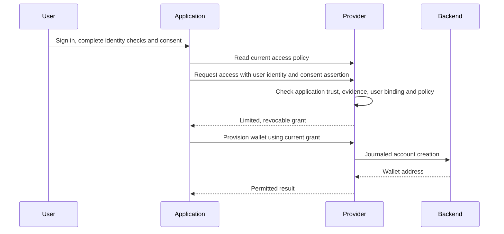

# Application-led wallet access

This is the standard deployment flow. The user signs in, completes identity checks
and approves wallet access in the connected application. The application calls the
provider on that user's behalf. The provider evaluates its configured policy and
stores a limited, revocable grant. There is no provider user-login redirect or
routine staff-review step.

The provider explicitly trusts each application's identity and consent attestations
under a reviewed agreement. An OAuth token authenticates the calling application;
it does not establish a user's identity or spending permission by itself. Required
fields alone are not proof of KYC. The application must perform the checks represented
by its attestation, retain supporting records and communicate withdrawals promptly.
The toolkit checks the asserted level, dates, fields, policy revisions and authority;
it does not independently contact an identity vendor in this flow.



## Configure the trust policy

Use the wizard's **Policies → Access flow → Application-led access (standard)**.
Set the required identity level and field names. In **Policies**, register each
application's exact issuer/client ID, allowed permissions and reviewed identity
and consent trust-agreement reference. Configure maximum identity age and access
duration. The [standard example](provider.config.example.json) uses `verified`,
requires `country`, accepts identity evidence for at most 90 days and caps access
at seven days. These are example requirements to review for your product.

The configuration uses:

- `policy.access.mode: "application"`.
- `policy.identity.application.verificationLevel` and `requiredFields`.
- `policy.applications[].assertionTrust.agreement` for every registered application.

The GUI supports these built-in policy controls:

| Wizard setting                                  | Scope and effect                                                                                                                                                                               |
| ----------------------------------------------- | ---------------------------------------------------------------------------------------------------------------------------------------------------------------------------------------------- |
| Policies → Required identity level              | All applications must attest this exact agreed level. The provider does not rank levels or perform the underlying verification itself.                                                         |
| Policies → Required identity fields             | All applications must submit nonempty values for these names. This checks presence, not country eligibility or other allowed-value rules.                                                      |
| Policies → Maximum age of identity checks       | A shared limit of 1–365 days from the asserted verification time. Expired evidence cannot support access.                                                                                      |
| Policies → Maximum access duration              | A shared limit of 1–365 days. Consent expiry must fit that period; identity expiry can shorten a grant further.                                                                                |
| Policies → Connected applications               | Each exact issuer/client ID has its own reviewed trust-agreement reference, allowed permissions and enabled switch. Disabling an application denies its current access.                        |
| Policies → Configure delegated transfer signing | Optional shared token, recipient allowlist, per-transfer and lifetime limits, and signature validity. Applications still need transfer permission and the user's consent to these exact terms. |
| Policies → Policy version                       | Your label for a reviewed policy. The service also derives a revision from policy content; keeping the label does not preserve grants when rules change.                                       |

These controls are configuration, not a general-purpose policy editor. Per-country
eligibility, risk scoring, arbitrary conditions and separate identity-age rules
per application require an advanced host integration. See the
[host authority guide](provider-guide.md). Required field names and a trust-agreement
reference do not implement or prove an application's KYC process.

Validate and export the configuration, then deploy it and restart the service to
apply the rules. The wizard does not update a running server. Policy changes
invalidate existing grants; applications must read `GET /v1/access-policy`,
present the current terms and obtain consent before requesting fresh access.

No `ownerLogin`, reviewers, identity-vendor credentials or vendor funding agreement
is needed. Optional API token controls require a separate **staff** login configuration;
that sign-in is not part of the user's wallet-access flow. Backend credentials,
private storage, HTTPS and deployment acceptance remain required.

## Request access

Authenticate with the application's short-lived RFC 9068 API token. First call
`GET /v1/access-policy` with `wallet:access:read`. The response supplies `flow`,
`policy_revision`, `verification_level`, `required_fields`, `max_identity_age_days`
and `max_access_days`. It reports `provider_login_required: false` and
`provider_review_required: false`. `owner_consent_required: true` means the application
must already have the user's consent; it does not request a provider browser step.

Obtain and record the user's permission in your application for the requested actions
and current provider terms. Then call `POST /v1/access-requests` with `wallet:access`
and a new UUIDv4 `Idempotency-Key`:

```json
{
  "mode": "create",
  "user": {
    "id": "your-stable-private-user-reference",
    "identity": {
      "reference": "your-identity-evidence-reference",
      "level": "verified",
      "verified_at": "2030-01-01T09:00:00.000Z",
      "fields": { "country": "ZA" }
    },
    "consent": {
      "reference": "your-recorded-consent-reference",
      "granted_at": "2030-01-01T10:00:00.000Z",
      "expires_at": "2030-01-02T10:00:00.000Z",
      "policy_revision": "aaaaaaaaaaaaaaaaaaaaaaaaaaaaaaaaaaaaaaaaaaaaaaaaaaaaaaaaaaaaaaaa"
    }
  },
  "authorization_details": [
    {
      "type": "https://moovha.com/wallet/account-access",
      "actions": ["account:read", "operations:request"]
    }
  ]
}
```

These are fictional values. Replace the revision with the returned policy revision,
the timestamps with actual UTC records, and every reference with your own record.
The identity field names must match the policy; omit other personal data. Neither
verification nor consent may be dated in the future. Identity evidence must remain
within the allowed age. Consent must be current and its expiry no later than its
grant time plus `max_access_days`. The resulting grant expires at the earliest
identity, consent or provider access limit.

If policy passes, the response contains `status: "granted"`, `request_id`,
`account_id`, `grant_id`, permissions and expiry. It contains no `consent_url`.
Malformed evidence is rejected with 422; untrusted, stale or conflicting authority
is denied with 403. A reused idempotency key with different input returns 409.
Save the receipt and original key. Read the request with
`GET /v1/access-requests/{requestId}` and `wallet:access:read`.

## User and wallet binding

The provider namespaces the stable user ID by application issuer and client ID.
It never treats a machine-token subject as the user, and never merges users by
name, email, document number or an application's claim about another client.
Repeated create requests for the same application user resolve to one account;
wallet creation is a separate journaled operation.

`mode: "connect"` requires `account_id` belonging to that same application-scoped
user. A second application using the same user ID does not gain access to the
first application's wallet. Cross-application wallet linking and migration require
a separately verified ownership integration; the standard flow does not implement it.
Identity evidence references cannot be reassigned to another user within the same
application. Suspended accounts cannot be reactivated by another access request.

## Create and use the wallet

Call `POST /v1/accounts/{accountId}/provision` with `wallet:provision`, an empty
JSON body and an idempotency key. Read details through
`GET /v1/accounts/{accountId}` with `wallet:account:read`. The same authenticated
issuer, client and caller must hold the current grant. The provider rechecks
policy, owner binding, identity age and revocation before wallet effects and
before returning a saved operation result. Preserve original attempt identities
when investigating timeouts; do not repeat an uncertain mutation with a new key.

Optional transfer signing also requires explicit `transfers:request` permission.
Present the exact configured token, recipients, limits and validity to the user
in your application. Read the exact `transfer_terms` and `transfer_policy_revision` from the access policy and
include that revision in `user.consent.transfer_policy_revision` when requesting
transfer delegation. Changing the transfer terms invalidates the old delegation.
The provider still authorizes each immutable transfer and journals every signing
attempt. Access or an OAuth scope alone does not authorize spending. Signing does
not submit a transaction, pay gas or establish settlement.

## Withdrawal, renewal and recovery

Your application must provide the user's access-management controls. On withdrawal,
call `POST /v1/access-grants/{grantId}/revoke` with `wallet:access`, the same caller,
an empty body and an idempotency key. Repeating revocation is safe. Grants superseded by another request are distinct from withdrawn consent. Revoking a grant also revokes any superseding grant based on that same consent record. Revocation
blocks current access and future signing; signatures already issued can remain
usable until their on-chain expiry. It does not erase the account or journal.

Renew through a new access request with current identity evidence, a new consent
reference and a consent grant time after the recorded withdrawal. Old consent cannot restore revoked
access. Replaying the original access request cannot create a fresh grant and may be denied once its evidence expires. Use the request-status endpoint to inspect the saved outcome.
Disable an application in provider policy to deny all of its current access.
Changing policy invalidates previous grants; users must consent to the new terms
in the application before requesting new access.

Keep stable application and user identifiers, backend bindings, storage and attempt
records across restarts. A changed application identity is not an automatic account
migration. Restore and reconcile using the [deployment guide](operator-deployment.md)
and [durable attempt guide](durable-attempts.md).

## Hosted compatibility and migration

[Provider-hosted access](onboarding.md) remains available by explicitly selecting
`policy.access.mode: "hosted"`. Existing configurations that omit `mode` retain
that legacy behavior. They are not silently upgraded. Hosted configurations require
their login, consent and reviewer setup. [Application-record evaluation](application-records.md)
is a hosted compatibility feature, not the standard attestation contract.

The configured service binds its access mode to its private store. Switching an
occupied hosted deployment to application-led access is rejected. Do not delete
that binding or reinitialize storage to bypass the check. Existing owner IDs and
grants need a reviewed mapping and migration; no automatic migration is supplied.
Use a new empty deployment for an independent evaluation, and retain recovery
records for any existing wallets. Do not downgrade an application-led store to a revision that predates this access mode. Use matching code and recovery records. The SQLite schema is unchanged: additive access
records use its existing transactional JSON collections.
