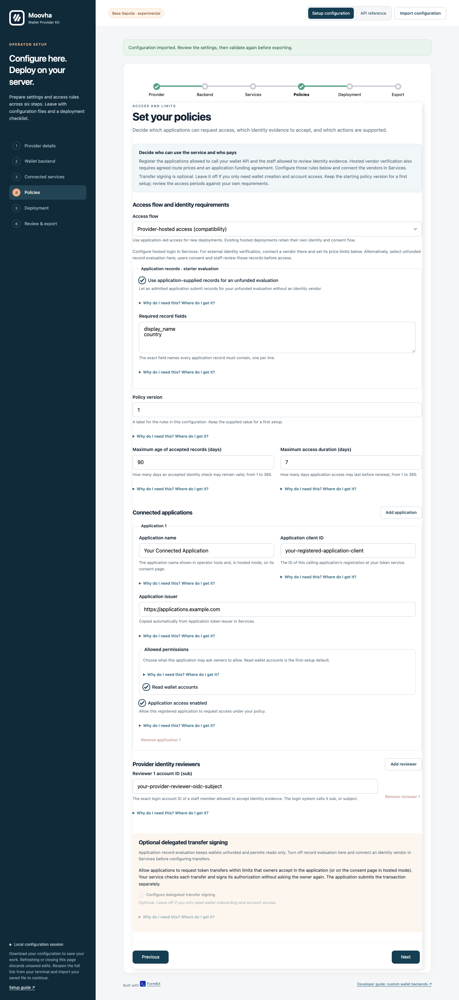

# Hosted application-record evaluation

This is an **unfunded hosted compatibility evaluation**, not the standard application-led access contract. It deliberately requires provider user login and staff review. For applications that already authenticate users and complete KYC, use [application-led access](application-access.md), including its explicit application trust agreement and consent evidence.

Hosted compatibility mode offers **application-record evaluation**. The standard wizard and CLI template use [application-led access](application-access.md). An
application you admit can discover your required fields and submit its records
without a KYC vendor account, API key, workflow or verification budget. Complete
records receive owner-consent requests; your staff review them before account
access and unfunded wallet creation.

This source accepts application assertions under your provider policy. It does
not establish externally verified KYC. Use fictional records, keep every wallet
unfunded and leave financial signing disabled. Select Didit or Sumsub instead
when your policy requires external verification. Existing vendor configurations
retain their selected source.

## Configure the starter workflow

Complete the normal [login, API and backend preparation](operator-services.md).
In FormKit **Policies**, first select **Provider-hosted access (compatibility)**,
then enable **Use application-supplied records for an unfunded evaluation**.
Under **Required record fields**, enter one name per line.
The initial fields are `display_name` and `country`; choose the minimum fields
needed for your evaluation.

Names use lower-case letters, digits and underscores, starting with a letter.
Choose 1–16 distinct names. Every required value must be a non-blank string of
at most 512 characters. The service retains only those fields and discards other
submitted attributes. A field such as `kyc_status` or `role` does not grant
authority.

Admit each calling application under **Policies**, with `account:read`, and
configure the separate reviewer login subjects. No vendor funding agreement is
needed for this source. The profile rejects operational/transfer permissions,
vendor adapters and financial signing together with application records.
Initial activation remains disabled.

Export all three files and use the [supplied deployment CLI](operator-deployment.md).
The [record template](provider.config.records.example.json) contains example
registrations and variable references, not credentials. The
[vendor template](provider.config.hosted.example.json) remains available for external
verification configurations.



## Submit records

Use the admitted application's server-held credentials to obtain its short-lived
API token, or use the deployed [Application tokens panel](operator-tokens.md).
The application needs `wallet:access:read` to read policy and `wallet:access`
to submit records.

1. Execute `GET /v1/access-policy`. Confirm `source: application_record`,
   `evaluation_only: true` and the returned `required_fields`.
2. Execute `POST /v1/access-records` with a new UUIDv4 `Idempotency-Key`.
   Supply up to 50 records in a body no larger than 512 KiB:

```json
{
  "records": [
    {
      "reference": "evaluation-owner-001",
      "fields": {
        "display_name": "Fictional Demo Owner",
        "country": "ZA"
      }
    },
    {
      "reference": "incomplete-example-002",
      "fields": {
        "display_name": "Fictional Incomplete Record"
      }
    }
  ]
}
```

Each result contains its zero-based `index` and `status`. A complete record is
`submitted` with its own access receipt and `consent_url`. A missing required
field or duplicate reference within the batch is `invalid`, with the required
field names. Malformed JSON, invalid field types or an oversized body reject the
HTTP request before submission.

References are opaque application record IDs, 1–128 letters, digits, full stops,
underscores, colons or hyphens, beginning with a letter or digit. A reference
accepted for one owner cannot be accepted for a different owner under the same
application registration.

Retain the exact batch and original idempotency key. Replay resumes the same
item requests after a partial response or restart. A changed batch conflicts
under that key; correct invalid records using a new batch/key. If you only need
one request, `POST /v1/access-requests` accepts the same object as
`identity_record`, alongside its usual mode and authorization details.
Neither submission route creates a wallet or calls an identity vendor.

## Obtain consent and review

Open each returned consent URL in the intended owner's browser. The owner signs
in through your configured login provider and chooses **Allow requested access**.
Submission and login do not grant account access.

In a separate reviewer session, open `/onboarding/review`. Inspect the
application name, record reference, required field values and authenticated
owner identity. Match the record to that owner and explicitly accept it under
your evaluation policy with **Accept submitted record**, or decline it.
The record form does not label application data as vendor-verified evidence or
ask you to invent an external verification date.

Poll the original access request as the submitting application. After it is
`granted`, provision with `POST /v1/accounts/{accountId}/provision`, an empty
body and a new retained idempotency key. Read the account through
`GET /v1/accounts/{accountId}`; it identifies
`identity_source: application_record` and `evaluation_only: true`.
Confirm the native test-network balance is zero through a read-only lookup.

Reconnection uses a fresh record submission, owner consent and provider review;
the existing wallet is retained. Revocation, natural expiry, caller isolation,
policy revisions and durable replay still apply. Follow the
[staging walkthrough](staging-walkthrough.md) for those checks and backup/recovery.
Changing required fields changes policy authority and invalidates old access;
restart with the reviewed export rather than editing stored records.

## Select external verification

Turn off **Use application-supplied records for an unfunded evaluation** in
Policies, then connect **Use Didit** or **Use Sumsub** in Services. Set the vendor
route price limits and application funding agreements in Policies.
Prepare that vendor's real workflow/level, credentials, agreed price and
application funding as described in [identity preparation](operator-services.md#prepare-identity-verification).
Obtain fresh consent and the required identity evidence under the new policy.
An application-record acceptance is never promoted to vendor verification.
