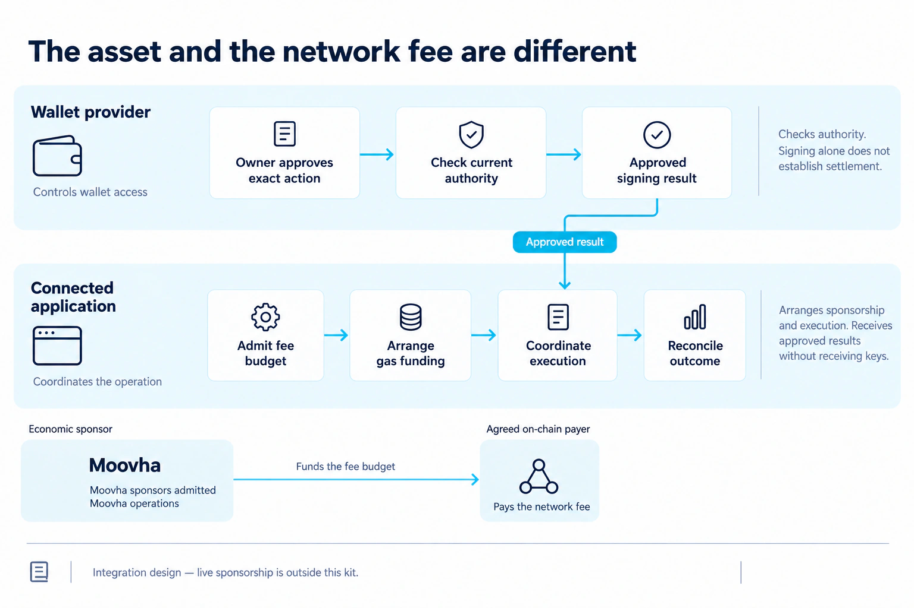

# Blockchain assets and gas sponsorship

Wallet Provider Kit supports blockchain wallets for payments and decentralised
finance (DeFi).
It helps teams make blockchain wallets usable through familiar login, consent
and approval experiences. The assets and transactions still live on a blockchain;
the simpler experience should make them easier to understand.

## Assets people recognise

USDC and ZARP are examples of blockchain assets used in the wider Moovha project.
Connected applications can use wallet access to offer supported transfers, swaps
and DeFi operations. Each operation still needs the owner's approval and a tested
asset, network and execution path. The provider kit supplies account access and
approved-action signing; the connected application's business API coordinates
the financial operation.

An asset's symbol is its display name, not its technical identity. Integrations
must bind the actual chain, token contract, decimals and signing domain. Show
people the asset and network in their approval experience, and use exact integer
base units in API requests. Vault shares and the assets they represent are
different tokens with different units; a share balance must not be presented as
the same amount of its underlying asset.

The current configured financial profile is an experimental **Base Sepolia**
test-network transfer authorization for an independently verified ERC-3009 token.
It signs the approved instruction; it does not submit a transaction or establish
settlement. USDC, ZARP, swaps and vaults explain the project's use cases, rather
than a list of production capabilities included in this profile. See
[configured financial policy](setup.md#supported-financial-policy) and
[backend profiles](backend-guide.md#choose-an-integration).

## The application covers gas

<figure class="wallet-visual">
  
  <figcaption>The sponsor funds eligible network fees; the provider retains wallet authority. Live sponsorship is outside this kit.</figcaption>
</figure>

[View full-size diagram](public/diagrams/assets-and-gas.webp)

**Gas** is the blockchain network fee for executing a transaction. It is separate
from the asset being sent and from any disclosed product, swap or payout fee.

Gas sponsorship is a project-supported part of the wallet integration design.
Connected applications are expected to fund eligible network fees for the
supported operations they request. **When Moovha is the connected application,
Moovha is the sponsor.** A provider whose users approve Moovha access should be
able to rely on that rail, without building a separate gas-funding service or
requiring users to buy and maintain a gas token for those operations.

| Participant           | Responsibility                                                                                                                                                                       |
| --------------------- | ------------------------------------------------------------------------------------------------------------------------------------------------------------------------------------ |
| Account owner         | Approves application access and the exact financial action.                                                                                                                          |
| Wallet provider       | Keeps its wallet-control and recovery model, checks current authority and returns the approved signing or submission result.                                                         |
| Connected application | Arranges sponsorship, admits the operation's fee budget, coordinates execution and reconciles eligible network costs. Moovha takes this role for Moovha operations.                  |
| On-chain payer        | Pays the network transaction fee through the agreed execution path. It may be the application's relayer or a wallet funded for that exact step; it need not be the economic sponsor. |

Approving application access does not itself approve a spend or release gas
funding. The exact operation must pass current owner, grant, consent, identity,
capability and sponsor-budget checks before financial effects.

## What providers should expect from the rail

Before enabling a sponsored operation, the application and provider must agree
on the supported network/account path, who submits, fee limits, expiry and how
pending or uncertain results are reconciled. The application owns the funding
obligation; the provider integrates the agreed signing/submission path.

For Moovha's operation design:

- Sponsorship covers all admitted steps, including required approvals, eligible
  failed calls and replacements, and source/destination steps where applicable.
  Activated network fee components are included in the budget.
- Coverage is independent of the user's existing gas-token balance. An ordinary
  account call receives a bounded full step grant; personal ETH is not deducted
  from the sponsor's obligation.
- A relayer can pay directly for supported authorised calls. Where the wallet
  submits, funding must be confirmed before dispatch. A grant to an ordinary
  externally owned account is spendable native currency; its possible retention
  after rejection is disclosed and bounded.
- Funding retries preserve the original operation and attempt. Lost responses
  require reconciliation before another dispatch; eligible shortfalls are made
  good once against the existing credit.
- Unsupported paths or unavailable budgets are explicit before execution.
  A compliant mined operation cannot silently be charged to the user because a
  sponsor budget ran out. Calls edited outside the admitted terms do not gain an
  unrestricted funding entitlement.

Native currency being transferred as the transaction's principal and disclosed
business fees remain separate from sponsored gas. Sponsorship also leaves
private-key control, recovery and owner approval with their existing holders.

## Implementation and activation

The toolkit implements provider onboarding, access and approved-action signing.
Its optional Relayer execution integration is a separate library profile; it does
not by itself implement Moovha's sponsorship promise.

Moovha's business-operation API owns the sponsorship and execution rail. The
packaged [orchestration draft](../spec/orchestration-draft.json) describes that
separate contract; its sponsorship routes are not implemented by this package.
Installing the kit, configuring a backend or approving a grant does not activate
gas funding. The Moovha sponsorship rail still requires implementation and
acceptance before providers can use it for live operations.

Other connected applications carry the same expectation for their admitted
operations and must supply their own accepted sponsorship integration; the kit
does not automatically fund their transactions. Record the actual sponsor,
submission path and activation evidence in your deployment profile. Validate
zero and existing personal gas balances, multi-step costs, rejection, budget
exhaustion and uncertain funding before advertising gas coverage. Continue with
[provider integration](provider-guide.md) and [acceptance checks](conformance.md).
