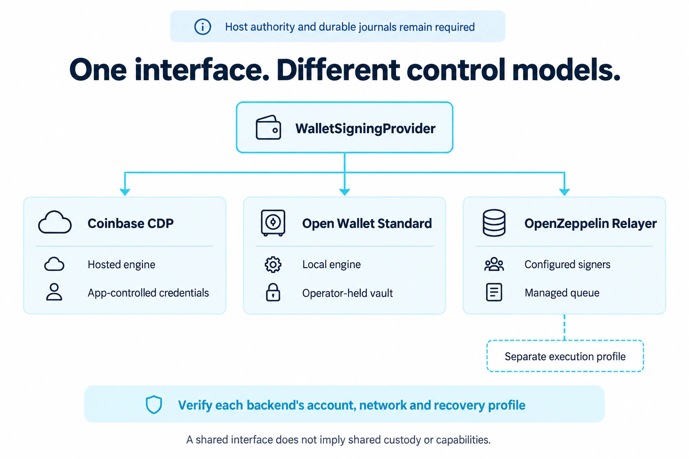

# Extend the configured service

> Historical integration reference. New configured deployments use
> [per-user Safe wallets, ERC-4337 bundling and application paymasters](self-hosted-sponsorship.md).
> The legacy execution exports and separate executor CLI are unavailable in the
> configured service. Retain existing journals and reconcile uncertain work before migration.

Use a custom adapter when the built-in choices in
[Backend](setup-wizard.md#_2-backend) cannot connect your wallet engine. The adapter
replaces account creation and signing mechanics while the configured service
retains application access, grants, financial policy and durable journals. This
is a developer extension; start with the [wizard](README.md) when a supported
backend meets your needs.

## Versioned startup module

<figure class="wallet-visual">
  
  <figcaption>A custom backend implements the same narrow signing boundary; it must establish its own capability and recovery evidence.</figcaption>
</figure>

[View full-size diagram](public/diagrams/backend-selection.webp)

Set `backend` in your deployment configuration:

```json
{
  "kind": "custom",
  "binding": "your-stable-wallet-environment",
  "module": "./adapters/company-wallet.mjs",
  "options": { "environment": "sandbox" }
}
```

Only a local absolute path or `./` path relative to the configuration file is
accepted. The service loads this module at trusted startup; HTTP clients cannot
select modules. `validate` and `doctor` do not execute it. Run custom code only from
a reviewed artifact. It executes with the service's privileges and secret access.

Export the version and factory:

```ts
import type { WalletBackendAdapterV1 } from '@moovha/wallet-provider-kit/deployment';

export const adapterVersion = 1;
export const createWalletBackend: WalletBackendAdapterV1['createWalletBackend'] =
  async ({ options, secret }) => {
    const credential = secret('COMPANY_WALLET_CREDENTIAL');
    // Return your implementation of WalletSigningProvider using options/credential.
    return yourRawWalletBackend;
  };
```

This is an interface example; `yourRawWalletBackend` is your reviewed implementation.
The factory must return a **raw** `WalletSigningProvider`, not an already-journaled
backend. The configured service owns attempt coordination, so wrapping it again
would create competing attempt authorities. Keep secret values out of `options`.

Implement a stable provider name, `createAccount`, read-only `findAccount` and
`signTypedData`. Preserve opaque account/attempt IDs, bind stable addresses, sign
only the supplied exact Base Sepolia EOA action, and sanitize errors with
`WalletProviderError` plus `not_dispatched`, `rejected` or `unknown`. Never retry
ambiguous mutations, export keys or broadcast through this interface.

## Acceptance

Use the [provider flow](integration-example.md), [backend requirements](provider-guide.md#signing-backend-contract)
and [conformance requirements](conformance.md) to exercise creation/recovery,
exact digest/signer checks, concurrent dispatch, restart/replay, current-grant
revocation and unknown outcomes. The configured service always rechecks its own
current authority; an adapter cannot confer spending permission from OAuth scopes.
Declare and test who controls keys and recovery before activation. Runtime interface
validation checks the returned interface, not the adapter's full behavior.
`doctor` leaves custom conformance pending without executing the module; complete
the integration checks separately.

CDP, OWS and OpenZeppelin Relayer are selectable through [built-in configuration](setup.md#select-a-built-in-backend).
Their journals are wired by the service. Do not return the already-wrapped OWS or
Relayer factories directly from this raw-backend extension interface.

For custom storage, action types, approval mechanisms or Relayer execution,
compose the existing library interfaces in a trusted host. Those capabilities are
not configured-service profiles until their complete authority and recovery
integration is supplied and tested by the kit.
