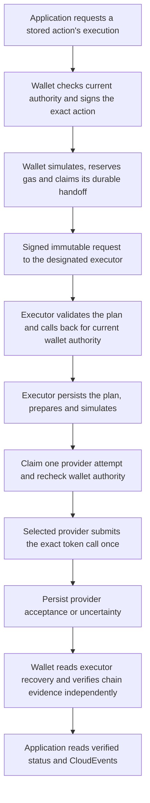

# Deploy a designated execution service

A designated executor separates transaction submission and sponsor credentials
from wallet signing. Choose it under [Deployment](setup-wizard.md#_5-deployment)
when your service should dispatch approved actions through a separately operated
submission service. This guide prepares that service and connects it back to the
wallet. Each service has its own durable journal. The wallet retains user
authority, signing and independent chain verification; applications request
execution by stored action ID.

Select `approved-evm-executor-v1` revision 1 for [approved general EVM operations](approved-contract-calls.md), or `erc3009-executor-v1` revision 1 to use this boundary. The direct
`erc3009-relayer-v1` profile remains available for existing deployments. The transfer profiles support exact ERC-3009 token transfers with EOA signatures on Base Sepolia. The general profile supports explicitly bound Safe 1.4.1 generic calls and native transfers, with separately selected optional operation adapters on that chain. The service is experimental: offline conformance
does not establish live vendor acceptance, production custody suitability or a
completed enterprise security assessment.

## Responsibilities and flow

| Component                     | Responsibility                                                                                                                                                                                                         |
| ----------------------------- | ---------------------------------------------------------------------------------------------------------------------------------------------------------------------------------------------------------------------- |
| Wallet service                | Current owner, application grant, KYC, consent and immutable approval; durable signing, gas admission and handoff identity; independent receipt/finality verification.                                                 |
| Execution service             | Authenticated immutable handoff, a separate durable provider attempt, application sponsor policy and budget, fresh wallet authority callbacks, provider selection and read-only recovery.                              |
| Configured execution provider | Submit the approved token call, manage its upstream transaction/nonce behavior and expose read-only transaction lookup. OpenZeppelin Relayer is built in; reviewed custom modules use the versioned adapter interface. |
| Connected application         | Obtain current delegated access, request the exact transfer, arrange sponsor funding, consume status/events and reconcile its business records.                                                                        |



There are two durable boundaries. The wallet's handoff journal is not the
executor's provider journal. A lost HTTP response does not establish whether
handoff or provider submission occurred. Every replay keeps the original
execution ID, action, plan hash, sponsor and selected provider revision.

## Prepare the two deployments

Use a reviewed source checkout with Node 24.22.0 and npm 11.11.1. Build the kit
using the [installation guide](README.md). Provision two private persistent local
data directories: one for the wallet service and one for the executor. Keep a
single active authoritative copy of each. They may run as separate processes on
the same host; independent writable clones and network-filesystem SQLite are
unsupported.

Before configuration, prepare:

- An HTTPS origin for each service and private authenticated connectivity between
  them. The executor must reach the wallet's authority callback; the wallet must
  reach executor capabilities, dispatch and recovery. An unavailable callback
  denies dispatch.
- An independent ES256 P-256 signing key pair for each service. Store private
  keys as PKCS8 PEM and verification keys as SPKI public PEM in your secret
  manager or private environment files. The executor receives the wallet's public
  key; the wallet receives the executor's public key. Owner signing keys are not
  shared with the executor.
- The application's pre-existing funded sponsor, its gas agreement and accepted
  limits. No toolkit endpoint creates a sponsor or funds gas.
- Independently accepted token/domain, genesis and runtime code hashes, and two
  independently operated RPC sources for each service. Sources must support
  historical receipts/code, authorization logs and safe/finalized block tags.

Use separate secret names for owner signing, service authentication and sponsor
submission. Never put PEM values, RPC credentials or API keys in exported JSON,
UI fields, command arguments, logs or public deployment records.

## Configure and run the executor

Create its disabled configuration:

```sh
node dist/main.js executor init executor.config.json
node dist/main.js executor validate --config executor.config.json
```

Replace the placeholders in [executor.config.example.json](executor.config.example.json).
The example hashes, token, bindings and fee values are illustrative and are not
accepted network settings or fee recommendations. The configuration schema is
[execution-service.config.schema.json](../spec/execution-service.config.schema.json).

| Setting             | Meaning                                                                                                                                                 |
| ------------------- | ------------------------------------------------------------------------------------------------------------------------------------------------------- |
| `origin`, `binding` | Stable HTTPS identity and deployment binding. An occupied store cannot be rebound to another service.                                                   |
| `storage.directory` | Separate private local executor database directory.                                                                                                     |
| `signing`           | Executor key ID and environment reference to its private PEM.                                                                                           |
| `callers`           | Pinned wallet origins, accepted public key IDs/references and the provider IDs each wallet may use. These registrations alone never authorize spending. |
| `providers`         | Operator-owned provider IDs and explicit revisions, provider kind/configuration, accepted token/RPC pins and application sponsor policies.              |
| `activation`        | Disabled initially. Activation requires provider, recovery and authentication acceptance evidence references. Validation does not verify those reports. |

For the built-in provider, choose `kind: openzeppelin-relayer` and configure its
HTTPS origin/API key reference plus complete Relayer/signer bindings. Its current
wire target is the OpenZeppelin Relayer 1.8.0 profile. The gas limit and fee policy
must meet the [execution requirements](execution.md#configure-and-accept-execution).

Copy [executor.env.example](executor.env.example) to an ignored private `executor.env`,
set its permissions to 0600 and supply the named PEM/credential/URL values through
your secret-management process. Node environment files support quoted multiline
PEM values. Initialize only a new dedicated store, then run behind your HTTPS ingress:

```sh
node dist/main.js executor init-storage --config executor.config.json
node --env-file=executor.env dist/main.js executor run --config executor.config.json
```

The service listens on loopback port 8081 unless overridden by `http`. For a container, set `http.host` to `0.0.0.0` and `http.port` to 8080,
use the reviewed toolkit image with command `node --env-file=/secrets/executor.env
dist/main.js executor run --config /config/executor.json`, and mount separate
private configuration, secrets and persistent executor storage. Apply the
[container security controls](operator-deployment.md) and HTTPS ingress used by
the wallet deployment. The image does not bundle a custom provider module.

Its
`/health/live` endpoint reports process liveness. `/health/ready` remains HTTP 503
while dispatch is disabled. `/docs/` shows the separate executor API; it is not
the wallet API explorer. The executor exposes three service operations:

| Endpoint                           | Purpose                                                                 |
| ---------------------------------- | ----------------------------------------------------------------------- |
| `GET /v1/executor-capabilities`    | Authenticated provider ID/revision discovery for the registered wallet. |
| `POST /v1/dispatches`              | Authenticated immutable dispatch or replay of its original attempt.     |
| `GET /v1/dispatches/{executionId}` | Read-only provider/chain recovery for the stable identity.              |

Read the [generated executor HTTP reference](executor-http-reference.md) and
[OpenAPI contract](../spec/execution-api.json). Service requests need signed proofs;
application OAuth tokens and ordinary Swagger bearer tokens are insufficient.

## Connect the wallet service

In the wizard's **Deployment** screen, enable transfer execution and choose
**Designated execution service**. Enter its HTTPS origin, provider ID/revision,
the wallet service signing key ID/private-key environment reference, and the
executor's public verification key IDs/references. The wizard configures the
wallet connection; executor deployment/configuration is a separate operator task.

Read [where gas sponsorship happens](assets-and-gas.md#where-sponsorship-happens-in-the-implemented-flow) for the application’s funding and reconciliation responsibilities. Configure matching application sponsor policies on both sides. The wallet's
sponsor binding contains its address and binding revision; vendor-specific
Relayer/signer IDs belong only in the executor's provider configuration. The
account UUID, client ID, funding agreement, gas limits, fee limits, L1 reserve and
lifetime gas budget must match. The executor enforces an independent sponsor
admission budget shared across its registered wallet callers. Reservations on
both services are retained after failure and uncertainty; neither is a guarantee
that actual L1 or vendor recovery costs can never exceed the reservation.

The application's flow remains the [standard transfer flow](execution.md):
request an authorization, then call `/execute` with both `wallet:execute` and
`wallet:sign`, `{}`, a UUIDv4 idempotency key and these headers:

```http
Execution-Profile: erc3009-executor-v1
Execution-Profile-Revision: 1
```

Read `/execution` and `/execution-events` with `wallet:execute:read` and the same
profile selection. The wallet keeps the existing owner, grant, identity, consent,
exact approval and attempt checks. A header selecting another implemented profile
is rejected; the service does not substitute an executor or provider.

## Signed request contract

Service authentication uses a versioned application profile of
[JWT/JWS](https://www.rfc-editor.org/rfc/rfc7519.html), with explicit typing,
algorithm pinning, issuer/audience validation and separately configured keys as
recommended by [RFC 8725](https://www.rfc-editor.org/rfc/rfc8725.html). This is not an
OAuth access token, DPoP implementation or RFC 9421 HTTP Message Signatures profile.
Application OAuth authentication remains separate.

The caller sends `Authorization: Bearer <proof>`. Request proofs use ES256 and
`typ: wpk-service-request+jwt`; response proofs use
`typ: wpk-service-response+jwt` in the `Execution-Service-Proof` header.
Protected headers contain only `alg`, `kid` and `typ`. No token-supplied key URLs
or embedded keys are accepted. The key ID must match a pinned verification key
for the registered issuer.

Each proof binds `iss`, a single exact `aud`, `iat`, `exp`, `jti`, `purpose`,
`method`, `path` and `content_hash`. Purpose is one of `capabilities`, `dispatch`,
`status` or `authority`. Lifetime is at most 30 seconds, with two seconds of clock
tolerance. Responses additionally bind the original `request_jti` and HTTP
`status`. A proof cannot authenticate another method, path, body, destination,
purpose or response. HTTPS, matching clocks and pinned public keys are required.

The content hash is lowercase hexadecimal SHA-256 of UTF-8
[RFC 8785 canonical JSON](https://www.rfc-editor.org/rfc/rfc8785.html). POST requests
and signed JSON responses use that canonical representation on the wire. GET
proofs hash JSON `null`. Duplicate property names, noncanonical encodings, invalid
Unicode and nonfinite numbers are rejected. Native/token amounts remain decimal
strings. Requests are bounded to 32 KiB, responses to 64 KiB and transport calls
to 12 seconds, with redirects and automatic mutation retries disabled.

A replayed exact request within the proof lifetime can only join the same durable
execution. It does not authorize another action or provider effect. This profile
does not promise single-use JWT IDs; its replay protection for financial effects
comes from exact request binding, fresh wallet authority and both durable journals.

## Current authority and the handoff lease

Immediately before handoff, the wallet records the verified original caller and
a 30-second handoff lease on the exact execution. No OAuth token is persisted.
The executor calls the wallet's authenticated
`POST /v1/internal/execution-authority` using its own signed service proof.

The callback must match the configured executor, selected provider ID/revision,
action ID, execution ID, plan hash and original wallet attempt hash. The wallet
requires an unexpired handoff lease and the original pending/unknown attempt. It
rechecks current owner, grant, KYC, consent, immutable approval, signing expiry,
active policy and observed-effect fences. The executor performs that check before
admission, after preparation and claim, and immediately before provider effects.
A signed service request, valid owner signature or cached approval is insufficient.

Status polling and background observation never renew the original handoff lease
or repeat its provider dispatch. With an explicitly pinned replacement policy,
the default executor worker obtains separate short-lived wallet authority for
each durable fee-only proposal; see [automatic replacements](automatic-replacements.md).
An explicit authorized `/execute` retry can renew the original handoff lease
while the action remains valid. The executor's journal still prevents another
provider dispatch if that effect is pending, accepted, failed or unknown.
Revocation cannot invalidate an owner signature already usable on chain, and no
distributed check can recall an upstream request already in flight.

## Durable recovery

| Failure                                            | Required behavior                                                                                                                                |
| -------------------------------------------------- | ------------------------------------------------------------------------------------------------------------------------------------------------ |
| Request lost before executor acceptance            | An authorized retry resumes the same handoff ID/plan under a fresh lease. Concurrent or late arrivals share the executor journal.                |
| Executor accepted, HTTP response lost              | Read the executor's stable ID. The wallet reconciles its unknown handoff to the exact signed durable acceptance without another provider effect. |
| Provider response lost after possible submission   | The executor records unknown and never submits that attempt again. Read-only exact authorization-log/receipt searches can recover the transfer.  |
| Executor crashes before claiming provider dispatch | A fresh authorized handoff replay can prepare and claim the original stored execution.                                                           |
| Executor crashes after claiming provider dispatch  | Lease expiry becomes unknown. It never becomes permission for a new claim.                                                                       |
| RPC sources disagree or are unavailable            | The wallet preserves uncertainty and does not claim verified finality. Executor acceptance alone is not settlement.                              |
| Finalized evidence is contradicted                 | Fence the execution for operator investigation; no public reset or automatic resubmission.                                                       |

The executor's status contains dispatch acceptance and optional transaction-hash
hints. The wallet independently verifies exact calldata, token effects, canonical
receipt blocks and finality through its own configured RPC quorum. It never
promotes a reported hash, service signature or provider `confirmed` status into
settlement without that evidence.

Back up both databases with SQLite-aware backup tools and keep signatures and
plans on encrypted private storage. Fence the old dispatchers and their provider
network access before restoring a replacement. Reconcile effects in each backup
loss window across both journals and the chain before admitting new work. An
executor record cannot manufacture wallet authority missing from a stale wallet
backup. Resynchronize event consumers after restore, including overlapping
sequence ranges; do not rely solely on a cursor-ahead error to detect rollback.
See [single active host recovery](execution.md#single-active-host-recovery-and-failover).

## Provider adapters and configuration changes

The service supports `kind: custom` with a server-owned relative or absolute
module path. It must export `adapterVersion = 1` and `createExecutionProvider`
implementing [ExecutionProviderAdapterV1](api-reference.md#executionprovideradapterv1).
Options and secret access come from operator configuration. HTTP callers cannot
choose a module or supply adapter options. A custom configuration uses address
and binding revision without invented Relayer IDs.

`prepare` must be read-only. `submit` receives the immutable approved-action plan and stable
execution context; it must call `context.authorizeEffect` immediately before its
actual upstream mutation, use the configured sponsor, enforce the exact configured outer target,
zero outer native value and fee limits, disable automatic mutation retries and return a
durable opaque UUID. A vendor with different identifiers needs a reviewed durable
mapping or stable client-reference lookup. `transactionHash` must be read-only. Providers with a native durable client-reference
lookup can also implement `recover`: bind lookup to the supplied execution ID and
request hash, and return the exact accepted opaque UUID as `transactionId` plus
optional hash evidence. That read-only result can reconcile the original unknown
attempt; it must never submit or generate a replacement identity.
Adapter construction must have no provider effects. Trusted modules have process
privileges and require their own review and conformance evidence.

Provider revisions, destinations, token identity, sponsor bindings and economic
policy remain pinned. Keep prior provider ID/revision entries registered for read-only recovery while adding a new revision; entries are unique by ID and revision. The store retains a provider revision manifest and rejects
reusing an ID/revision for a different provider policy or destination. Changing them is a reviewed migration, not a retry strategy.
A new provider configuration cannot reinterpret an existing unknown execution.
Key registrations and signing key IDs can rotate without rebuilding financial
plans. Add accepted public keys first, restart services with the new signing keys,
verify both directions, then remove retired verification keys. Superseded service
configurations are fenced in their active stores; stop old processes as part of
rotation. Secret values are loaded at startup and are not hot-reloaded.

Before activation, test the actual TLS ingress, service keys, callback revocation,
provider wire behavior, gas budget exhaustion, two-store crash/recovery and host
fencing. Record the reviewed evidence in both activation configurations. Offline
fixtures cover these internal contracts and backup replay; they do not prove
external fencing, power-loss durability or live provider acceptance. The
[enterprise v1 gates](v1-standards.md) still apply.

See [durable Safe queues and sponsor pools](safe-queue-and-sponsor-pools.md) for concurrent request admission, per-Safe ordering, pool configuration and recovery limits.
