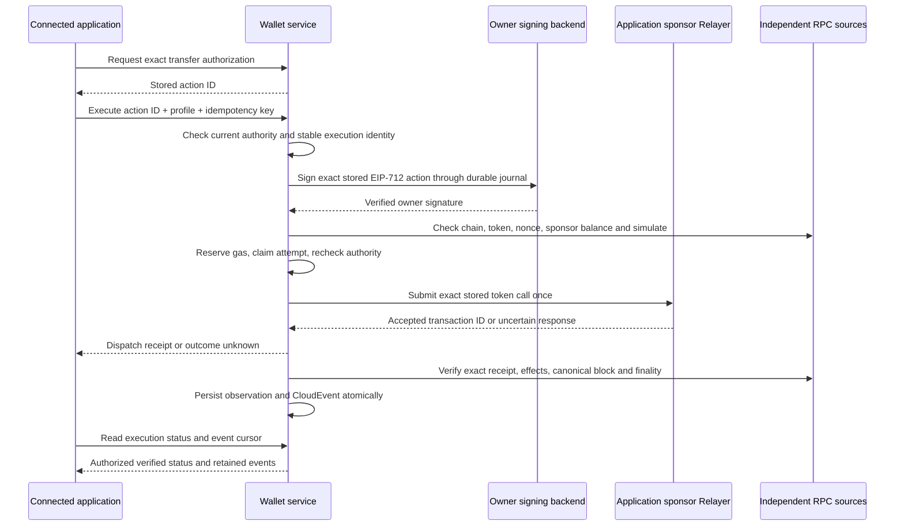

# Coordinate transfers and verify their status

The optional execution profiles coordinate one approved Base Sepolia EOA token
transfer through a dedicated application sponsor. Use `erc3009-executor-v1` for
the [separately deployed designated service](execution-service.md), or retain
`erc3009-relayer-v1` for direct OpenZeppelin Relayer compatibility.
It keeps the existing owner, application grant, identity, consent, immutable
approval and durable attempt checks. Execution is disabled unless configured and
explicitly accepted. Offline fixtures exercise the contract; live execution,
operational recovery and production custody acceptance remain pending.

General contract calls, swaps and vault deposits use the same execution and recovery foundation through `approved-evm-executor-v1`. They require separate contract delegation and explicitly bound Safe accounts; see [approved contract calls](approved-contract-calls.md). The steps below describe the ERC-3009 transfer operation.

## Standard application flow

1. Read the access policy, establish the owner's delegated `transfers:request`
   grant and provision the wallet through the [application access API](application-access.md).
2. Read `GET /v1/execution-capabilities`. Select the configured profile and
   revision explicitly. A discovery readiness flag describes service activation;
   it does not promise that the next transfer will pass simulation or funding checks.
3. Request `POST /v1/transfer-authorizations`. The service stores the exact token,
   recipient, amount, nonce and expiry under the current delegated policy.
4. Send `POST /v1/actions/{actionId}/execute` with `{}`, a UUIDv4
   `Idempotency-Key`, the selected `Execution-Profile` and
   `Execution-Profile-Revision: 1`. The token needs both `wallet:execute` and
   `wallet:sign`. The service chooses the application's configured sponsor;
   callers cannot supply calldata, a signature, a sponsor or a replacement nonce.
5. Poll `GET /v1/actions/{actionId}/execution` with the same profile headers and
   `wallet:execute:read`. Respect `next_poll_after_ms`. Distinguish dispatch
   acceptance, chain inclusion, safe status and finality. Only a matching finalized
   receipt produces `settlement: succeeded` or `settlement: reverted`.
6. Consume `GET /v1/actions/{actionId}/execution-events?after=0` for durable
   observation changes. Store the event ID and sequence after processing.
   Application reports can still enter through `/transaction-events`; they remain
   unverified hints and never establish settlement.

## Signing, submission and settlement are separate

`POST /v1/actions/{actionId}/sign` returns an owner signature for the exact stored
ERC-3009 authorization. It neither broadcasts nor pays gas. Use it when an
application operates its own accepted execution rail. The optional `/execute`
route performs that signing step internally and submits the stored call through
the configured direct provider or designated service. Applications should choose one execution owner for an
action. A signature already returned to an application remains usable on chain
until its token-contract expiry, even after API access is revoked.

The Relayer's accepted UUID or `confirmed` status is not settlement evidence.
The observer checks each configured RPC source for chain ID 84532, the accepted
genesis hash, exact transaction and receipt identity, token target, zero native
value, exact calldata and canonical receipt block. A successful receipt must
contain exactly one matching `AuthorizationUsed` and `Transfer` effect. Sponsor
transactions must also match the EIP-1559 transaction type, gas limit and fee caps.
Every source must agree; the slowest source determines safe/finalized progress.
Base's [finality stages](https://docs.base.org/specifications/transactions/transaction-finality)
are preserved rather than replaced with an arbitrary confirmation count.

`verification: rpc-quorum` means agreement of trusted RPC operators. It is not a
cryptographic light-client proof. Distinct origins do not prove independent
operators: your acceptance process must establish that independence. The token
runtime hash catches changed bytecode, but a proxy's hash does not pin its
implementation or governance. Review the token's upgrade controls and monitor
implementation changes separately. Simulation uses current state and can become
stale before inclusion; it cannot guarantee success.

ERC-3009 permits another party to relay a copied valid authorization. An exact
successful transfer found independently is recorded as `execution_origin:
external`; it still consumes the same authorization nonce. An untrusted reported
revert cannot declare the action failed. A verified revert belongs to the
service's own accepted sponsor transaction. This profile verifies the token
transfer, not a swap, deposit, exchange credit or accounting obligation.

## Durable execution and uncertain responses

Each stored action has one execution identity, one stable signing key, one
immutable execution plan and one dispatch attempt. Different HTTP idempotency
keys do not create another execution. The existing SQLite journal reserves
`gasLimit × maxFeePerGas + l1FeeReserveWei` atomically at dispatch claim. Accepted,
failed and unknown attempts retain that reservation. There is no automatic budget
refund, attempt reset, replacement authorization or resubmission after a timeout.
The application's lifetime gas budget does not reset on configuration revisions.

A lost submission response returns HTTP 503 with `outcome: unknown`. The
designated-service profile can resume the same authenticated handoff identity
under fresh wallet authority; its separate provider journal still forbids another
dispatch after an uncertain upstream effect. Retry the
same action to obtain its current dispatch receipt, then read status; never
request a fresh action as a blind retry. The observer can recover the exact
transfer from authorization logs even if the provider transaction ID was lost.
It stores a bounded scan cursor and advances only through finalized history.
After a long outage, several polls may be needed to scan the gap. Known transaction
hashes are verified directly while scanning continues. Background polling rotates
batches of at most four unfinished actions; it performs no signing or dispatch.

Status and event reads require current access, consent, identity and delegation,
but may continue after the signing expiry. No new execution may begin after that
expiry. An observed successful effect permanently prevents another dispatch.
A contradiction to recorded finalized evidence fences that execution and returns 503. Investigate node identity, token behavior and canonicality using operator
evidence; there is no public reset or reconciliation mutation.

## Configure and accept execution

In the wizard's **Deployment** screen, enable **Configure transfer execution and
RPC verification** after enabling delegated transfer signing in **Policies**.
For the designated service, follow its [two-service configuration guide](execution-service.md).
For direct Relayer compatibility, supply these deployment-specific values:

- A private HTTPS Relayer origin and API key environment variable, with a
  pre-existing dedicated Base Sepolia EVM sponsor signer for each application.
  Sponsor accounts must be separate from owner wallet signers. Signer creation
  and gas funding are operator/application responsibilities.
- Two independently operated HTTPS RPC sources, supplied as complete URLs in
  separate environment variables. URL userinfo, query parameters and fragments
  are rejected; use path credentials if your vendor requires them. Secret values
  stay outside the configuration, API discovery, logs and events.
- Independently accepted genesis and token runtime hashes. The token domain name,
  version and address must match the financial policy and contract.
- An explicit gas funding agreement, fixed gas limit, integer wei fee caps,
  positive L1 fee reserve and lifetime admission budget. Relayer gas estimation
  must be disabled and its normal gas price cap must not exceed the approved cap.
- An observation interval of 5–300 seconds and bounded log batch of 100–10,000
  blocks. RPC sources must support receipt history, log queries, historical token
  code and `safe`/`finalized` block tags.

The setup wizard supplies editable Base Sepolia evaluation defaults, described in
[automatic replacements](automatic-replacements.md). Measure each exact call and
network costs during staging acceptance; starter values are not gas estimates. The gas reservation is an
admission control, not an absolute cap on actual L1 data fees or vendor recovery
and cancellation transactions. OpenZeppelin documents
[recovery behavior and gas policies](https://docs.openzeppelin.com/relayer/1.8.x/evm).
Use dedicated restricted sponsor accounts, vendor controls and operational
monitoring to contain those costs. The toolkit has no gas funding endpoint.

Activation additionally requires `activation.executionAcceptance`, identifying
your acceptance evidence. Validate authorization denial, wire compatibility,
quorum disagreement, reorgs, lost responses, depleted budgets and recovery with
your actual services before setting it. Configuration validation alone does not
perform these checks. This profile does not extend the supported network beyond
Base Sepolia or establish production financial readiness.

## Event delivery contract

Execution observations use [CloudEvents 1.0](https://github.com/cloudevents/spec/blob/v1.0.2/cloudevents/spec.md)
envelopes with type `com.moovha.wallet-provider.execution.observed.v1`. The `data`
contains the receipt for the explicitly selected execution profile revision.
The source identifies the provider origin through a fingerprint; events contain
no signatures, calldata, OAuth tokens or private RPC URLs. CloudEvents specifies
an envelope, not proof of authenticity or transaction finality.

The service commits an observation and its event together. Repeated reads of
unchanged evidence do not emit another semantic event. The pull feed retains the
last 64 transitions per execution. A consumer can receive the same event again:
deduplicate by `(source, id)` and save the monotonically increasing `sequence`
cursor only after processing. Do not use this feed as the sole financial ledger.

`history_truncated: true` explicitly reports a retention gap; read current verified
status and reconcile with your durable application records before advancing the
cursor. A cursor ahead of the restored store returns 409, which also requires
reconciliation. Backup restoration can replay old event IDs. There are no outgoing
webhooks, delivery acknowledgements or external archive in this profile. Archive
required records in your own protected audit system; current permission checks
apply to every feed read, including previously generated events.

## Single active host recovery and failover

The supported deployment is one active host using local SQLite, with a tested
passive recovery target. Two processes can coordinate against the same local
journal, but independent writable copies and network-filesystem SQLite are
unsupported. A database revision fences superseded configurations on the same
store; it cannot fence another host holding a cloned database.

1. Fence the failed host outside the application before activating its replacement:
   revoke its network access to signing and Relayer services, stop its workers and
   ensure it cannot resume. Document who can prove that fence.
2. Restore a SQLite-aware backup to private encrypted local storage on the passive
   host, using the same provider/backend bindings. Keep application ingress and
   all signing/submission egress fenced during inspection. Check catalog integrity
   offline and preserve the original attempt and authorization IDs. Changing the
   activation configuration invalidates stored action authority; do not toggle
   it as a substitute for a recovery fence when preserving pending actions.
3. Reconcile every possible effect in the backup-loss window against signing
   provider, Relayer and independent chain evidence. An attempt absent from the
   backup is not proof it never happened. Do not synthesize replacement actions,
   clear reservations or treat an unexpired signature as revoked.
4. With signing/submission still fenced, retest read-only status recovery and
   event cursors using the original accepted configuration. Resolve uncertain
   authority/effects and record operator acceptance. Open effect and application
   access only after the old host is fenced and the loss window is accounted for.
   Resume requests using the same logical action identities. If recovery required
   a changed policy/configuration, follow its authority migration process rather
   than reviving denied actions.

Offline tests restore an online backup after dispatch and preserve execution ID,
signature, reservation and event IDs without another submission. They do not
prove external host fencing, power-loss durability or recovery from effects missing
from a stale backup. Set and drill your recovery-time and recovery-point targets
on the actual platform. See [storage recovery](storage.md#recovery-backup-and-operations)
and the [v1 standards and release gates](v1-standards.md).
