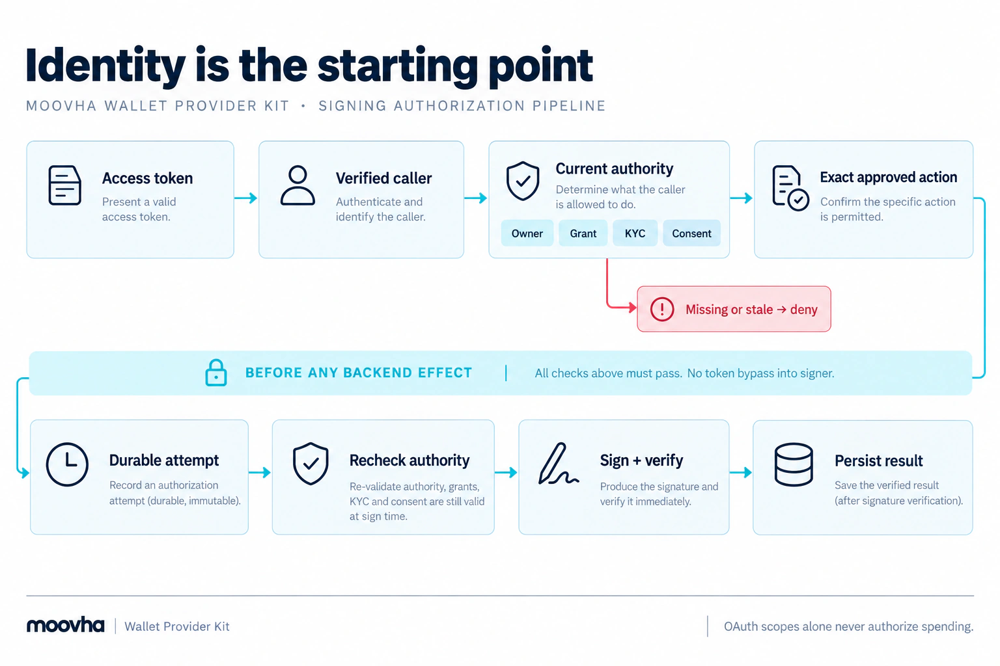

# Use the provider HTTP API

This is the toolkit’s **provider-operated** API. Standard access is application-led. Use a base URL chosen by the
wallet provider operating the service. It is distinct from Moovha's planned
business-operation API; see [the application/provider boundary](architecture.md#applications-and-wallet-control). The
[generated schema reference](http-reference.md) records all implemented request
and response schemas. Swagger UI is available at `/docs/` in the inspection
service; configured deployments disable it by default. See [service setup](setup.md)
for configuration and API consumption without a custom host implementation.

The local [setup wizard's API reference](setup-wizard.md#explore-the-provider-api)
provides bundled Swagger schemas, example requests/responses and configuration
prerequisites without sending calls. It is separate from deployed `/docs/` and
works whether or not deployment documentation is enabled. Both explorers list all
documented JSON provider API operations by default,
including advanced profiles. **Not enabled** identifies a missing configuration
prerequisite; showing an endpoint does not enable it. The local search filters
the displayed reference and its download. Browser login/review pages, health
probes and explorer controls remain separate from this application API.

## Try deployed APIs

Use **API reference → Try it out · real service responses** in the local wizard.
The **Open deployed Try it out** link opens `<your-service-HTTPS-origin>/docs/`
in a new tab. It uses your configured provider origin, not your workstation's
listen port. The wizard keeps your draft and sends no tokens or test requests.

### Enable and deploy the explorer

1. Import your saved configuration into the wizard. Choose **Enable deployed API
   explorer in draft**, or check **Enable deployed API explorer and Try it out**
   in Deployment. This sets `http.documentation: true`; it does not enable activation.
2. Validate and download configuration again. Follow the
   [deployment instructions](operator-deployment.md), replacing the service's
   configuration and restarting it with its existing private storage and binding.
   There is no hot reload. Use a toolkit build that supports `http.documentation`.
3. Open the link on your real HTTPS domain. A 404 normally means documentation is
   disabled in the running configuration or ingress is not forwarding `/docs/`
   and its assets. Check the running config and restart; exporting alone changes
   nothing on the server. A TLS or connection error requires fixing ingress/DNS/service
   availability first. Do not paste a token into an untrusted or incorrect domain.

The deployed explorer is public when enabled; its API calls still enforce normal
authentication, scopes, owner grants and readiness. Restrict `/docs` at ingress
if your operator access policy requires it. You can disable the checkbox, export
and restart after testing. `/openapi.json` remains the full implemented contract;
configured `/docs/json` retains every documented operation and adds availability
labels. **Configured** means the profile is present, not that the service is
activated or the caller has permission. Readiness and current authorization still
apply, and unavailable endpoints continue to deny calls. The local application's
permission preview does not
carry over as proof of live access.

### First test: no credential or code needed

1. Expand **Discovery → GET /v1/capabilities**.
2. Choose **Try it out**, then **Execute**. Merely opening the page sends no
   operation request. The explorer sends the call directly to its own origin.
3. Read **Server response** for the actual HTTP status, response body, headers
   and request duration. The schemas and examples below it are documentation,
   not a response from your deployment.

A 200 response with `configured: false` is expected before activation/readiness;
it proves that discovery responds, not that authentication, vendors, recovery or
signing work. A configured service also lists its action profiles. Follow your
[acceptance and activation process](operator-deployment.md#acceptance-and-explicit-activation)
before testing protected flows in an isolated staging deployment.

### Authenticate a calling application

If you enable [integrated application tokens](operator-tokens.md), use the deployed
**Application tokens** panel: sign in as a configured token operator, choose an
application/scopes and **Get token**. **Renew token** and renewal before Execute
remove the manual copy/paste step. Secrets remain in deployment variables;
operator login, scope limits and ordinary API authority are enforced. The panel
uses server-side client credentials; it does not turn operator login into an
application or owner token.

The manual alternative below remains available when integrated tokens are disabled.

An **application access token** is the short-lived JWT issued to a registered
calling application for this API. It is not the login client's secret, an owner
ID token, a vendor API key or the wizard's local session token.

Use the [Auth0 application registration recipe](auth0-setup.md#_4-register-each-calling-application)
or your compatible issuer. With Auth0, open your registered API's **Test** tab,
select the authorized Machine to Machine application, and use its access-token test facility
([Auth0 dashboard token instructions](https://auth0.com/docs/quickstart/backend/golang/interactive)); the same tab provides the client-credentials
request for your application's developer. Token issuance uses that application's
client ID, its private client secret, the API Identifier as audience and granted
scopes. Keep client secrets in the caller's private environment; Swagger needs
only the resulting `access_token`. Confirm the issuer's RFC 9068 profile and
600-second maximum lifetime as described in the recipe. Never upload tokens to a
public JWT decoder. If your issuer has no dashboard token facility, your identity
administrator or application developer supplies the short-lived token.

In the deployed explorer, choose **Authorize**, paste only the token (without
`Bearer `), authorize and close the dialog. Each operation states its required
scope. The client must also match an enabled Policies registration and hold the
necessary current owner-bound grant. Scopes alone cannot authorize spending.
The token stays in page memory; **Logout** removes authorization and a page reload
also clears token and response state. The explorer omits browser cookies and
refuses cross-origin requests and redirects. The manual Authorize control does not obtain or refresh tokens.

### Test protected flows and understand failures

Use real IDs returned by this deployment. First read `GET /v1/access-policy`,
then submit the application's stable user reference, accepted identity evidence
and recorded consent for its returned policy revision. Expect a grant when policy
passes, with no provider user-login redirect or staff-review step. Provision the
wallet separately. Use the grant-revocation endpoint when the user withdraws access.
See [application-led access](application-access.md) for payloads, evidence freshness,
user binding, renewal and delegated transfer terms.

Hosted compatibility deployments instead return consent URLs and use the separate
[hosted browser flow](onboarding.md). Staff login in optional token controls does
not establish user authority.

Every distinct POST needs a fresh UUIDv4 `Idempotency-Key` (generate one with
`node -p "require('node:crypto').randomUUID()"`). Record that key with the intended
request and reuse it for retries of that same request. Provisioning and signing
use `{}` bodies. Test with vendor-approved identities and test-network accounts;
POSTs can create durable records, charge identity budgets or issue signatures
that authorize later effects. There is no automatic rollback or sandbox simulation.
Do not replace a timed-out request's key to force another attempt; reconcile its
stored outcome first.

| Actual result   | What to check                                                                                                |
| --------------- | ------------------------------------------------------------------------------------------------------------ |
| 401             | Missing, expired or invalid token; issuer, audience, RFC 9068 profile and signing algorithm                  |
| 403             | Required scope, enabled client registration, permissions and current owner/grant/identity/approval authority |
| 400 / 422       | Required inputs, UUIDs, integer base-unit amounts and configured recipient/token limits                      |
| 409             | Existing durable attempt or conflicting request; preserve the original key and reconcile                     |
| 429             | Rate limit; wait before retrying                                                                             |
| 503             | Activation/readiness or unavailable dependency; inspect the problem code and `outcome` before retrying       |
| Fetch/TLS error | Browser connectivity or ingress; there may be no HTTP response. A mutation may still have reached the server |

Keep test evidence private. Responses and generated cURL can contain account
identifiers, identity details, bearer tokens or executable signatures. A 200 from
one endpoint does not certify end-to-end provider behavior or settlement.

For a complete runnable request sequence without credentials, use the
[integration example](integration-example.md). The snippets below show a real
integration's request shape; their tokens and IDs are placeholders.

The **wallet provider** operates this service. A **connected application** calls
it on behalf of an **account owner**, the user recorded as owning the account.
That application's OAuth registration is the **client** mentioned in token and
access configuration. Your server application, the **host**, checks current
permission before calling the **wallet backend**, the account/signing engine.
A **journal** stores attempt states and results across retries. See
[roles and terms](concepts.md) for their code and configuration names.

A **grant** is stored application access permission; **consent** is the owner's
approval. **KYC** means Know Your Customer, the identity acceptance required by
your provider policy.

## Authentication and profiles

<figure class="wallet-visual">
  
  <figcaption>HTTP authentication reaches the policy boundary; scopes alone never authorize spending.</figcaption>
</figure>

[View full-size diagram](public/diagrams/action-authority.webp)

Send `Authorization: Bearer <access-token>` for protected routes. Use a dedicated
provider audience and the configured trusted issuer. Scopes admit the request to
host policy; current owner/grant/consent/KYC and exact-action authority still apply.

The checked token's `client_id` identifies the connected application's registration.
`createAuthenticator` exposes it to host code as `VerifiedPrincipal.clientId`.
Its `sub` identifies the caller's user or service identity and may differ from the
account owner. The host resolves the application's stored access grant to the
owner. For bundled onboarding, the issuer and client ID must match an allowed
`policy.applications[]` entry; its `name` identifies it in operator tools (and the hosted consent screen when selected). The
optional `ownerLogin.clientId` configures staff login or hosted compatibility, not a standard user-access requirement.

| Method and path                                  | Required scope        | Required configured profile                                                                                |
| ------------------------------------------------ | --------------------- | ---------------------------------------------------------------------------------------------------------- |
| `GET /v1/capabilities`                           | None                  | None; `configured` reflects readiness                                                                      |
| `POST /v1/accounts/{accountId}/provision`        | `wallet:provision`    | Financial host or accepted onboarding/enrollment host                                                      |
| `POST /v1/actions/{actionId}/sign`               | `wallet:sign`         | Configured provider-authorized transfer profile or advanced financial host; onboarding-only denies signing |
| `POST /v1/transfer-authorizations`               | `wallet:actions`      | Configured provider-authorized transfer profile                                                            |
| `GET /v1/transfer-authorizations/{actionId}`     | `wallet:actions:read` | Configured provider-authorized transfer profile                                                            |
| `POST /v1/actions/{actionId}/transaction-events` | `wallet:events`       | Configured transfer profile and current owner-bound transfer delegation                                    |
| `GET /v1/actions/{actionId}/transaction-events`  | `wallet:events:read`  | Configured transfer profile and current owner-bound transfer delegation                                    |
| `POST /v1/access-requests`                       | `wallet:access`       | Onboarding                                                                                                 |
| `GET /v1/access-requests/{requestId}`            | `wallet:access:read`  | Onboarding                                                                                                 |
| `POST /v1/access-grants/{grantId}/revoke`        | `wallet:access`       | Standard application-led withdrawal, same caller, current application trust                                |
| `POST /v1/access-requests/{requestId}/identity`  | `wallet:access`       | Hosted compatibility only: owner consent and agreed vendor policy                                          |
| `GET /v1/accounts/{accountId}`                   | `wallet:account:read` | Onboarding with current `account:read` grant                                                               |
| `POST /v1/enrollments`                           | `wallet:enroll`       | Lower-level enrollment                                                                                     |
| `POST /v1/enrollments/{enrollmentId}/identity`   | `wallet:enroll`       | Lower-level enrollment                                                                                     |
| `GET /v1/enrollments/{enrollmentId}`             | `wallet:enroll:read`  | Lower-level enrollment                                                                                     |

Optional routes appear in OpenAPI even when unavailable. Choose onboarding or
enrollment, not both. Hosted `/onboarding/*` login/consent/review pages are
browser interactions described in the [onboarding guide](onboarding.md), not
service-token signing shortcuts.

## Provision an account

The account ID must already be reserved and bound to the owner by your host.
Send an empty JSON object, not an address, user status or key material:

```http
POST /v1/accounts/10000000-0000-4000-8000-000000000001/provision HTTP/1.1
Authorization: Bearer <provider-audience-access-token>
Content-Type: application/json
Idempotency-Key: 10000000-0000-4000-8000-000000000002

{}
```

A successful response is 200 with `account_id` and `address`. Both first success
and authorized replay use 200. It doesn't grant permission to sign or spend.
For uncertain creation, look up the same reserved account through the host's
read-only backend recovery; this HTTP profile has no generic recovery endpoint.
An absent lookup result isn't proof that the first effect never happened.

## Sign an approved stored action

The host must already have stored and approved the immutable action, exact
account/payload/revisions, current consent and durable attempt. The caller supplies
only its action ID:

```http
POST /v1/actions/10000000-0000-4000-8000-000000000003/sign HTTP/1.1
Authorization: Bearer <provider-audience-access-token>
Content-Type: application/json
Idempotency-Key: 10000000-0000-4000-8000-000000000004

{}
```

A successful 200 response contains `signature`, a 65-byte EOA hex signature
including its `0x` prefix. The journal wrapper verifies the returned signature
against the exact digest/account before completing. The HTTP route itself doesn't
create or approve actions, broadcast transactions, fund gas or settle an operation.
Do not put returned signatures into application logs.

## Signing and transaction submission

| Operation                                        | Result                                                                                                                      |
| ------------------------------------------------ | --------------------------------------------------------------------------------------------------------------------------- |
| `POST /v1/transfer-authorizations`               | Stores the exact provider-authorized ERC-3009 transfer under current delegated authority.                                   |
| `POST /v1/actions/{actionId}/sign`               | Returns a verified signature for that stored authorization; no broadcast.                                                   |
| `GET /v1/execution-capabilities`                 | Discovers the optional execution profile, revision and activation state without exposing private sponsor/RPC configuration. |
| `POST /v1/actions/{actionId}/execute`            | Signs internally and coordinates one durable submission through the application's configured gas sponsor.                   |
| `GET /v1/actions/{actionId}/execution`           | Reads independently verified receipt, canonicality and finality; current authority is required.                             |
| `GET /v1/actions/{actionId}/execution-events`    | Reads retained CloudEvents observation transitions with a resumable sequence cursor.                                        |
| `POST /v1/actions/{actionId}/transaction-events` | Stores an application's **unverified** report; no settlement decision.                                                      |

Execution routes require `Execution-Profile: erc3009-relayer-v1` and
`Execution-Profile-Revision: 1`. The execute route requires both `wallet:execute`
and `wallet:sign`, a UUIDv4 `Idempotency-Key` and an empty `{}` body. Reads require
`wallet:execute:read`; event reads accept `?after=0` and return explicit cursor-gap
metadata. OAuth scopes never replace current financial authority checks.

Execution is optional and disabled by default. Signing-only applications use their
own accepted submission rail. Neither a signature, a Relayer acceptance ID nor a
reported confirmation establishes settlement. Read the
[execution and recovery contract](execution.md) before integrating. The separate
orchestration reference remains an unimplemented business API draft.

## Report transaction submission and confirmation

The configured transfer profile exposes:

| Method and path                                  | Scope                | Purpose                                                            |
| ------------------------------------------------ | -------------------- | ------------------------------------------------------------------ |
| `POST /v1/actions/{actionId}/transaction-events` | `wallet:events`      | Record an application's submitted, confirmed or failed observation |
| `GET /v1/actions/{actionId}/transaction-events`  | `wallet:events:read` | Read the reports in server recording order                         |

Register these scopes at your token issuer and, if used, in the operator token
panel's application scope allowlist. Scopes alone do not authorize reporting.
The action must be an authorized transfer stored for the same application and
caller. The provider rechecks current owner binding, accepted identity, transfer
delegation, consent and policy. Revoked access or superseded policy denies both
writes and reads, including replay. Signing authorization may have expired;
late reports do not renew it. Reports do not require a succeeded signing journal
entry: an uncertain signing response must remain uncertain until independently
reconciled, and even an unsigned action can receive an unverified observation.

```http
POST /v1/actions/<action-uuid>/transaction-events
Authorization: Bearer <application-access-token>
Idempotency-Key: <uuid-v4>
Content-Type: application/json

{
  "event": "submitted",
  "chain_id": "eip155:84532",
  "transaction_hash": "0x1111111111111111111111111111111111111111111111111111111111111111",
  "observed_at": "2026-10-16T12:00:00.000Z"
}
```

Replace the example ID, hash and UTC observation time with your application's
records. Use `confirmed` or `failed` for subsequent observations with their own
idempotency keys. Hashes must be lowercase `0x`-prefixed 32-byte hex values on
Base Sepolia. UTC observation times use seconds and optional three-digit
milliseconds, with no more than 60 seconds of future clock skew. Extra fields,
free-form messages, signatures and arbitrary payloads are rejected.

A successful POST returns 200 with the submitted fields, `action_id`,
`report_id`, server `recorded_at` and `verification: unverified`. Exact retries
with the same caller and key return the original report, including after restart.
Changing its action or body returns 409. GET returns `{ action_id, events }`;
an empty list is not proof that nothing was submitted.

Up to 32 reports are retained per action; a new report beyond that bound returns
409, while exact retries still work. Reports are appended in recording order,
may refer to different hashes and may arrive late, out of order or in conflict.
The service does not turn them into a single authoritative transaction status,
fetch chain receipts or verify that a hash executed the authorized transfer.
It does not change approvals, reconcile attempts, release budget reservations,
authorize retries or mark an operation settled. Applications must verify chain
receipts, exact transfer effects, reorg handling and finality independently.

Reports are stored privately as additive fields of the existing transfer records;
no database schema migration is required. They are distinct from
[OTLP request metrics and traces](operations.md#use-your-existing-monitoring),
which the service exports to a collector. The wallet service is not an OTLP
collector and does not accept arbitrary monitoring payloads.

## Idempotency and validation

All documented POSTs require a lowercase UUIDv4 `Idempotency-Key`; path IDs use
the same UUIDv4 syntax. Keep the same key for the same request. Your host binds it
to environment, issuer/client, owner, method and resource, then preserves the
provider attempt ID across retries. Reusing a key for different work conflicts.
A new key cannot override a pending/unknown action or bypass resource uniqueness.

Provision/sign bodies must be `{}`; additional fields are rejected. Other route
bodies are defined in the generated reference. JSON validation doesn't coerce
types, fill defaults or discard unrecognized fields. The default body limit is
1 KiB; enrollment identity submission has its own bounded limit.

## Problems and application decisions

Errors use `application/problem+json`:

```json
{
  "type": "about:blank",
  "title": "Service Unavailable",
  "status": 503,
  "code": "wallet_provider_unavailable",
  "request_id": "<server-generated-correlation-id>",
  "outcome": "unknown"
}
```

`outcome` is optional. HTTP/auth/schema failures may omit it. It describes dispatch
certainty, not settlement. `request_id` is a troubleshooting correlation field,
not an attempt ID or permission. Keep it in controlled diagnostics rather than
logging request bodies, authorization headers or raw URLs.

| Status          | Typical code                                               | What to do                                                                                                  |
| --------------- | ---------------------------------------------------------- | ----------------------------------------------------------------------------------------------------------- |
| 400 / 413 / 415 | `invalid_request`                                          | Fix schema, body size or content type                                                                       |
| 401             | `invalid_token`                                            | Obtain an appropriate access token from the trusted issuer                                                  |
| 403             | `insufficient_scope`, `wallet_authorization_denied`        | Obtain required delegation or policy authorization; don't retry a denied spend automatically                |
| 409             | `wallet_attempt_conflict`, `wallet_attempt_pending`        | Correct request identity or inspect the original pending attempt; don't generate a fresh financial identity |
| 422             | `wallet_provider_input`, `wallet_identity_invalid`         | Correct host action/evidence/profile compatibility                                                          |
| 429             | `rate_limited`                                             | Respect service quotas; financial budget/admission remains separate                                         |
| 500             | `internal_error`                                           | Investigate host/storage failure; don't infer that no effect occurred                                       |
| 503             | `service_unavailable` or a provider/attempt/identity error | Inspect readiness and `outcome`; reconcile unknown work read-only                                           |

The server maps even an explicit `wallet_provider_rejected` failure to 503 with
`outcome: rejected`. Don't treat every 503 as a transient error eligible for an
automatic mutation retry. Error middleware preserves no raw upstream error text.

## Health and discovery

- `/health/live`: 200 means the process is running.
- `/health/ready`: 200 means the supplied dependency check passed; otherwise 503
  with `status: unconfigured`. Fixture readiness is not production acceptance.
- `/v1/capabilities`: public `profile: provider-signing-preview`,
  `status: experimental` and `configured`. It isn't a per-account capability matrix.
- `/openapi.json`: the implemented OpenAPI 3.0.3 contract, including optional-profile
  routes. The separate orchestration draft isn't served as implemented routes.

Health/docs routes are hidden from the generated application OpenAPI. Disabling
Swagger UI doesn't disable `/openapi.json`. Application API responses use `cache-control: no-store`. The service doesn't trust arbitrary forwarded IP headers; place
it behind a reviewed TLS and ingress boundary for a real deployment.
