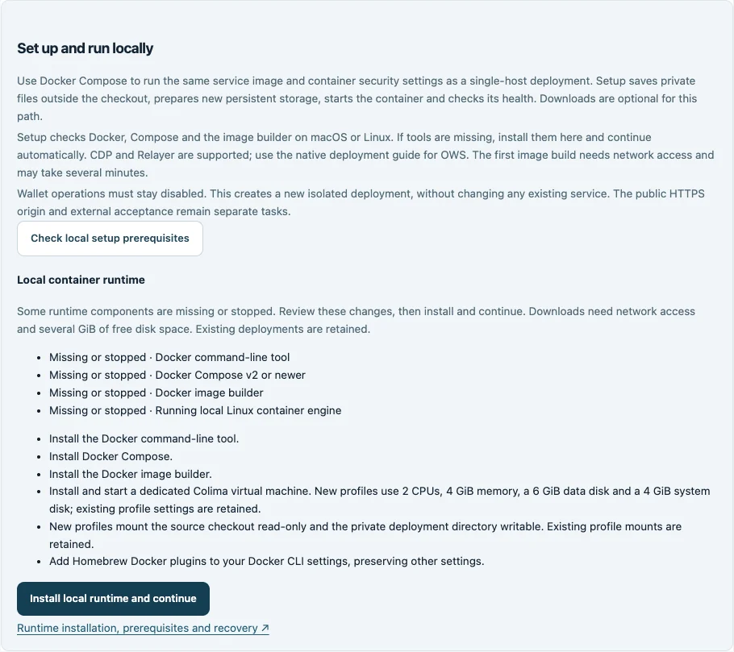
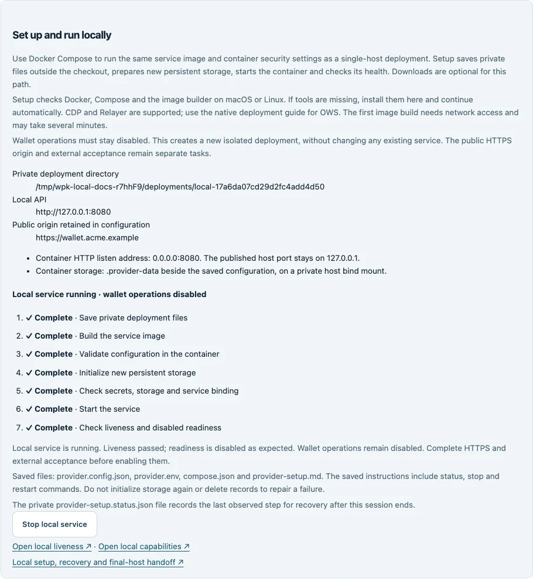

# Install the local runtime and run your service

At [Export](setup-wizard.md#_6-export), choose **Set up and run locally** to turn
your validated CDP or Relayer configuration into a running Docker Compose service.
This guide explains the runtime preparation, private secret entry, progress and
saved commands you will encounter. Setup starts with wallet operations disabled
so you can complete deployment acceptance before activation.

This is the recommended local evaluation path for CDP and Relayer. It builds the
same repository Dockerfile used by the single-host container deployment: pinned
Node base image, production dependencies, unprivileged user, read-only filesystem,
private persistent SQLite storage and read-only configuration. Docker manages the
service independently of the browser with an `unless-stopped` restart policy. See
[Compose in production](https://docs.docker.com/compose/how-tos/production/) for
the single-host model. Local startup does not establish production acceptance.

## Prepare the machine

Use a built source checkout, Node 24.22.0 and npm 11.11.1, as an unprivileged macOS
or Linux account (ARM64 or x64). Setup checks the Docker CLI, Compose v2 or newer,
Buildx image builder and a running Linux container engine. Detection does not
install packages, write settings or create containers.

If something is missing or stopped, review **Install local runtime and continue**:

- A healthy local Docker installation is reused. Installed Docker Desktop can be
  started instead of installing another engine; complete its first-run prompts
  in Docker Desktop if requested.
- Otherwise, setup installs missing Docker CLI, Compose, Buildx and Colima packages
  through [Homebrew](https://brew.sh/). On Linux it also installs QEMU if missing.
  Homebrew verifies its package downloads. Runtime packages use Homebrew's available
  stable versions; the toolkit's image and application dependency pins are separate.
- If Homebrew is missing, setup downloads a revision-pinned installer, checks its
  SHA-256 digest, then opens a terminal for installation. Complete the installer's
  permission prompts there; the wizard resumes automatically. The CLI uses its
  current terminal when interactive. A Linux desktop needs `x-terminal-emulator`
  for browser-launched installation; otherwise use the CLI in an interactive terminal.
  Linux hosts must meet [Homebrew's prerequisites](https://docs.brew.sh/Homebrew-on-Linux#requirements),
  including compiler tools and any required virtualization permissions.
- Homebrew's Docker plugin directory is added to your Docker CLI settings. Existing
  settings, including registry authentication, are preserved; symlinked, malformed
  or unsafe settings are rejected. No credentials are shown in progress.
- A dedicated **wallet-provider-kit** Colima VM provides the missing engine: 2 CPUs,
  4 GiB memory, a 6 GiB data disk and a 4 GiB system disk. macOS uses Virtualization.framework
  and virtiofs; Linux uses QEMU and 9p. The checkout is mounted read-only and the
  private deployment directory writable. An existing profile is started with its
  existing resources and mounts; setup does not rewrite them.

Allow several GiB of free disk space, enough host memory for the VM, and network
access for packages, the VM image and the service build. Progress shows each stage;
these downloads can take several minutes. Setup leaves the selected Docker context
unchanged and pins its local Unix-socket daemon for subsequent service commands.
Remote engines and `DOCKER_HOST` overrides are rejected. It does not enable a system
Docker service, change Docker group membership or configure startup at login.
Docker administrators can access container secrets; use a trusted machine.

Prepare isolated backend credentials and application trust settings through
[services and credentials](operator-services.md). Setup does not create vendor
accounts or issue credentials. OWS uses a separate native vault and engine omitted
from the reference image; use the [native deployment path](operator-deployment.md).



_Offline example with missing tools. The installation action applies the displayed
machine changes; the screenshot does not establish live installation acceptance._

## Review and start

1. Complete the six wizard steps. Leave **Enable wallet operations in this
   configuration** off and choose an unused service port in Deployment.
2. In Export, choose **Validate configuration**, then **Check local setup prerequisites**.
   If runtime components are missing, review the machine changes and choose
   **Install local runtime and continue**. Follow its progress and any terminal
   prompts. The deployment plan opens automatically when the runtime is ready.
3. Review the private directory, local API address and container settings. The saved
   config uses `0.0.0.0:8080` internally and `.provider-data` storage. Your selected
   port is published only on `127.0.0.1`; policies and the public HTTPS origin are
   retained. Manual downloads preserve the original form settings.
4. Supply missing secret values. Referenced secrets already in the wizard process
   environment are copied into the private file. Values entered here are sent to
   the authenticated loopback API and saved as plaintext in owner-only `provider.env`.
   They are cleared from the form after submission, excluded from downloads and
   progress, and never saved in browser storage.
5. Choose **Start local setup** to authorize the displayed build, private file
   creation, new database initialization and container start. Follow the statuses;
   the first build can take several minutes.

Runtime installation does not start a wallet deployment. The reviewed deployment
plan and private secret entry are the next stage; **Start local setup** authorizes
that stage. Wallet activation remains a separate acceptance decision.

The executor saves files, builds the image, validates in a container, initializes
new storage once, runs diagnostics, starts the container and checks health. Commands
are fixed and run without a shell or user-supplied scripts. Only missing secret names
in the reviewed plan are accepted. Runtime-control names such as `NODE_OPTIONS`
cannot be secret references for this path.

Node loads the mounted environment file directly; Compose does not interpolate
secret contents. Multiline values are preserved. Values containing carriage returns,
NULs or all three quote styles need the manual secret-manager path. The file is not
encrypted; protect host storage and backups. Never paste secrets into commands or
public reports.

## Use the CLI instead

From the same built checkout, inspect or install the runtime:

```sh
npm start -- runtime check
npm start -- runtime install
```

`runtime check` exits unsuccessfully when prerequisites are missing and prints the
proposed actions without applying them. `runtime install` explicitly authorizes
those actions and shows progress. A ready runtime is reused without installation.

For configuration and deployment together, first supply every referenced secret
through your process environment or a private Node environment file. Keep that file
outside the checkout with owner-only permissions. Then run:

```sh
node --env-file=/absolute/private/provider.env dist/main.js local-setup --config provider.config.json --install-runtime
```

This command checks configuration eligibility and secret presence, installs missing
runtime components, then saves private files, builds, initializes a new store and
starts the disabled service. It prints each stage and the saved operating instructions.
Omit `--install-runtime` to require an already-working runtime. Never pass secret
values as command arguments. The same command cannot resume an interrupted database
initialization; use the saved recovery instructions instead of creating another store.

## Understand the result

**Local service running · wallet operations disabled** means startup completed,
liveness returned **200** and readiness returned **503**, as expected before
activation. Checks run inside this project's container, so an unrelated host
listener cannot supply a successful response. The screen periodically checks
whether Docker still reports the service running.

Open local liveness or capabilities from the result. The API reference remains a
contract preview; authenticated requests and deployed Swagger use the configured
HTTPS origin. Local HTTP alone does not complete that connection.

The private directory under `~/.wallet-provider-kit-deployments/` contains:

| File or directory            | Purpose                                                                   |
| ---------------------------- | ------------------------------------------------------------------------- |
| `provider.config.json`       | Normalized container configuration, with activation disabled.             |
| `provider.env`               | Actual secret values, mode 0600; keep private.                            |
| `compose.json`               | Service definition, mounts, loopback port and restart policy.             |
| `provider-setup.md`          | Status, stop, restart, diagnosis and acceptance instructions.             |
| `provider-setup.status.json` | Last observed setup step, including failures or an interrupted action.    |
| `.provider-data/`            | Persistent private records; never erase to repair an uncertain operation. |

Closing the browser or wizard does not stop the container. Docker must remain
running. Start Docker Desktop or `colima start wallet-provider-kit` after reboot,
as applicable; automatic runtime startup depends on your host settings. Use
**Stop local service** or the saved Compose command to stop deliberately. Stopping
retains files and records. Setup never activates wallet operations automatically.

## Recover without repeating initialization



_Fictional settings and offline executor responses. This screenshot demonstrates
progress and controls; it is not evidence of a deployed or accepted wallet service._

Runtime installation stops on its first failure and retains installed packages.
Resolve network, disk, terminal permissions or host prerequisites, then choose
**Check local setup prerequisites** again. Only still-missing components are installed
on the next attempt. Runtime installation never initializes wallet storage.
A private `~/.wallet-provider-kit-runtime.lock` prevents competing installers.
A timeout or interrupted process retains that lock because installation may still
be running. If a lock remains, confirm no other wizard or CLI
installation is running before removing the empty lock directory. Existing Colima
resources and Docker settings are not removed to recover a failure.

Deployment setup stops on the first failed step. It attempts to remove its project containers
without deleting host data and reports unconfirmed cleanup. It never automatically
reruns initialization or overwrites an existing deployment.
Read the private status file after interruption. A step recorded as running has an
uncertain outcome; investigate it before retrying. Saved operation commands pin
the local Docker daemon selected during setup.

For image failures, check Docker, network access and disk space. For diagnosis or
startup failures, check secrets, permissions, port availability and optional
staff/hosted login reachability. Use the saved status and diagnosis commands. If
files could not be saved, correct directory permissions first. Do not share raw logs
that could contain credentials or personal data.

Reopen the complete private URL printed in the terminal to return to an execution
within its one-hour setup session. Saved instructions remain usable after expiry.
A new session does not attach to existing containers. Existing deployments use
their saved commands and the reviewed [maintenance process](operator-deployment.md).

## Carry the pattern to the final host

Reuse the reviewed revision, image and container security pattern on one persistent
final host. Supply that environment's separate secrets, origin, backend binding and
private storage. Add HTTPS ingress, monitoring and encrypted backups. Do not clone
the local database to create a second authoritative provider.

Follow [deployment](operator-deployment.md) and the [staging walkthrough](staging-walkthrough.md)
for application authority, backend and restore tests. Record actual evidence before
explicit activation. Setup does not provision wallets or sign actions to test
credentials. Health checks do not validate token issuance, KYC assertions, vendor
credentials, signing, sponsorship or settlement.
