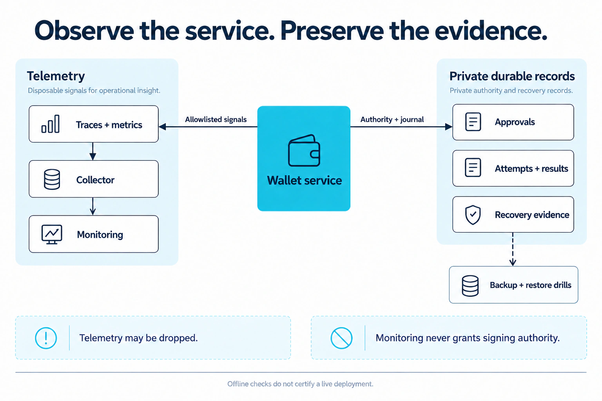

# Run and monitor the service

For the configured service, start with [deployment and supervision](operator-deployment.md).
For an embedded host, complete [backend integration](backend-guide.md),
[host composition](provider-guide.md) and [acceptance checks](conformance.md).
This guide covers monitoring and the optional local development stack. Your
deployment controls financial readiness and recovery.

You can send traces and metrics to your existing OpenTelemetry collector using
OTLP/HTTP. For local development, the optional Grafana `otel-lgtm` image bundles
a collector, metric and trace stores, and Grafana. You can explore the data in
Grafana without a cloud subscription or a custom dashboard. Plan production
availability and retention separately.

## Local Grafana

<figure class="wallet-visual">
  
  <figcaption>Telemetry can be dropped. Durable authority, financial journals and recovery records remain separate.</figcaption>
</figure>

[View full-size diagram](public/diagrams/operations-and-evidence.webp)

You'll need Docker Engine and Compose. Then run:

```sh
cp .env.example .env
# Edit .env locally and set a unique GRAFANA_ADMIN_PASSWORD.
docker compose --env-file .env -f ops/compose.yaml up --build -d
```

Open Grafana at `http://127.0.0.1:3000`, user `admin`, using the password from your
local file. Anonymous access and sign-up are disabled. Swagger is at
`http://127.0.0.1:8080/docs/`. In Grafana Explore select the provisioned Prometheus
source, find `http.server.requests` / `http.server.request.duration` (typically
normalized with underscores), and filter `service_name="wallet-provider-kit"`.
For traces select Tempo and search service `wallet-provider-kit`. Call
`/v1/capabilities` or `/health/live` to produce signals. Metrics export every 15
seconds. Default signing is unavailable; no wallet credentials are needed.

All published ports bind loopback. The compose profile opts into insecure HTTP
**only inside this development network**. The API is nonroot, drops capabilities,
uses a read-only filesystem and a writable temporary mount. The all-in-one
monitoring container needs writable internal storage. Its persistent volume can
consume local disk: inspect usage and stop it when unused. Use
`docker compose --env-file .env -f ops/compose.yaml down` to stop; adding `-v`
deletes local observability history and is an explicit operator choice.

For your deployment, test container startup, Grafana access, restart and volume
behavior on a Docker host. CI's container build and local OTLP transport tests
do not establish those runtime properties.

## Use your existing monitoring

Set `OTEL_EXPORTER_OTLP_ENDPOINT` to a trusted HTTPS collector base URL; the SDK
adds `/v1/traces` and `/v1/metrics`. Export is disabled when unset. Use a local
sidecar/collector for authentication, tenant routing, TLS and retry/buffering; do
not embed credentials in endpoint URLs. Do not use the development HTTP override
in production. Do not set `NODE_TLS_REJECT_UNAUTHORIZED=0`.

Instrumented data is an allowlist: service name/version, registered route template,
normalized method, status and duration. The kit does not auto-instrument request
headers, queries, bodies, customer IDs, account addresses, signatures or process
environment. Unmatched routes are labeled `unmatched`. Access-token contents and
provider exceptions are not logged. Keep reverse-proxy and collector policies
consistent; avoid adding request/body logging downstream. Traces are independent
server spans, not an assertion of end-to-end parent context propagation.

Monitoring data can be dropped, so authorization and financial correctness must
never depend on it. Export timeouts are bounded. Your host must keep business
audit and attempt records separately, with access control, tamper evidence,
retention and recovery rules. Grafana access must not grant signing permission.

Terminate TLS at a trusted edge, restrict inbound clients, configure the IdP and
current-grant policy, enforce deployment-specific timeouts/quotas and disable docs
with `API_DOCUMENTATION=false` when appropriate. Fastify does not trust arbitrary
forwarded client IP headers. The local in-process rate limiter is an abuse guard,
not a distributed financial budget. Configure shared edge quotas for replicas;
prove durable host admission independently.

Readiness stays false until your integration supplies a service, authenticator
and successful dependency check. Liveness tells you the process is running;
it doesn't establish financial readiness. The default container lets you explore
the API. Environment variables alone won't turn it into a production signer.
SIGTERM drains HTTP and flushes telemetry within a bounded shutdown.

Plan collector retention, deployment capacity, vendor requests and egress for
your own operating budget. Reuse existing observability capacity where suitable
and measure costs under your expected workload.

[Official Grafana OTEL LGTM development image](https://github.com/grafana/docker-otel-lgtm)
provides the local stack; operators own production authentication and retention.
