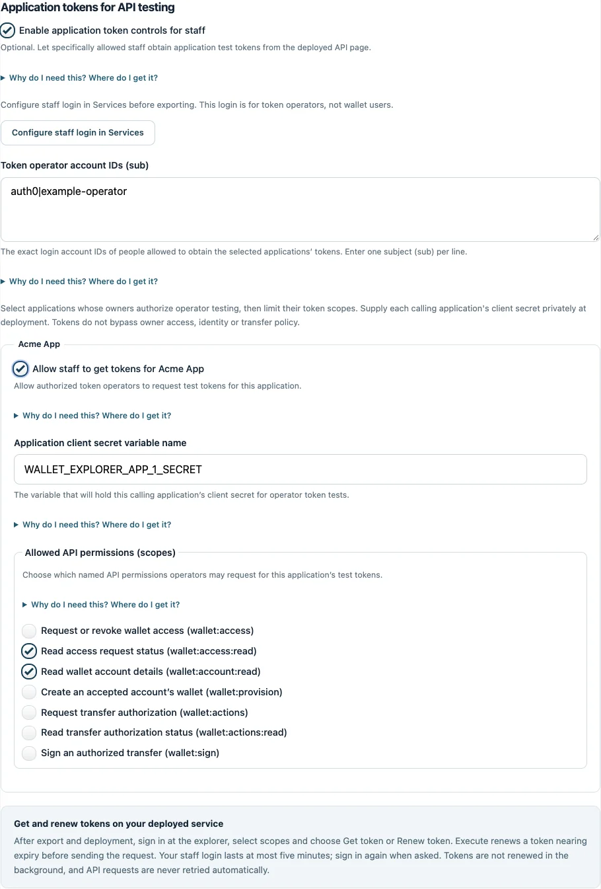
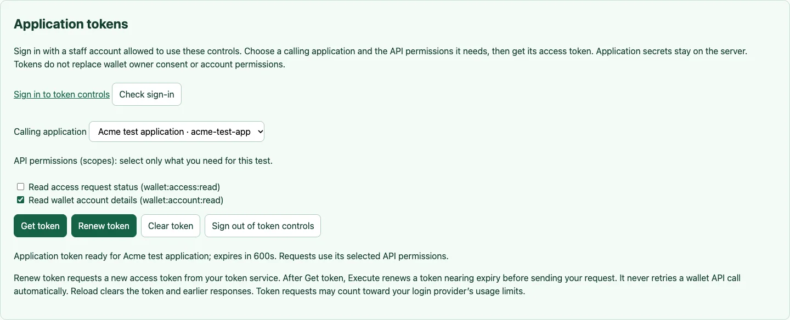

# Get and renew application tokens in the GUI

The optional **Application tokens** panel in deployed Swagger lets an authorized
operator obtain a short-lived calling-application token, renew it and use it for
Try it out without copying tokens between tools. The provider server exchanges
an environment-held application secret with your configured OAuth issuer.

This supports **Machine to Machine applications using client credentials and
client_secret_post**, including the Auth0 reference setup. It obtains a token for
the selected application, not for the signed-in operator or a wallet owner.
The supplied exchange sends the configured API audience using the `audience`
parameter, as in the Auth0 recipe. Issuers requiring another token request or
client authentication method can use manual Authorize or advanced host composition.

A token still needs the API's required scopes and the application's current owner
access grant, identity and other authority. Enabling this panel does not activate
wallet operations or give operators owner/spending consent.

## Prepare a client and token operator

1. Follow the [Auth0 registration guide](auth0-setup.md) or use your compatible
   issuer. Register the wallet API with the exact configured audience, RFC 9068
   access-token profile, RS256/ES256 signing and a maximum 600-second lifetime.
2. Register a **Machine to Machine Application**, authorize it for that API and
   grant only the wallet scopes you intend to test. Its **Client ID** identifies
   the caller; its **Client Secret** is the private password used by the server
   to authenticate that caller to the issuer. Find both in the application's
   Settings. The secret is distinct from the owner-login client's secret and
   from wallet/identity vendor credentials. Enable client-credentials grants
   and client_secret_post authentication; do not use a public SPA/mobile client
   or a client that requires private_key_jwt/mTLS with this supplied panel.
3. Add the exact Client ID and issuer to the wizard's **Policies** application
   registration. Keep it enabled. Prefer an isolated staging application with
   approved test identities and its own owner access grants. The application's
   owner must authorize sharing its secret with the provider's token broker.
4. Create or select the operator's account at the **owner-login issuer**. Copy its
   exact user `sub` (Auth0 User Management → Users → User ID). This is a user
   identifier, not an email, client ID or secret. That person will sign in through
   the existing provider login registration and callback. Do not register a new
   Swagger OAuth callback or put a client secret in the browser.

The operator allowlist is separate from **Reviewers**. Reviewer status alone
cannot obtain application tokens. A listed token operator can obtain tokens for
all clients explicitly selected for this panel, up to each configured scope limit.
Choose those subjects and limits accordingly.

## Configure without writing code

In the local wizard, import your saved configuration and open **Deployment**:

1. Check **Enable application token controls for staff**. It also enables the deployed explorer.
2. In **Token operator account IDs (sub)**, enter one exact subject per line from the
   owner-login issuer. At least one is required.
3. For each intended application, check **Allow staff to get tokens for …**. Enter its
   **Application client secret variable name**. The suggested name is
   `WALLET_EXPLORER_APP_1_SECRET`, numbered by the wizard's application list.
   This is only the deployment variable's name; do not enter the secret value.
4. Select **Allowed API permissions (scopes)**. These are the maximum scopes the
   GUI may request, and must also be granted at your issuer. Read scopes are
   initially selected. Add mutation/signing scopes only for the intended tests.
   A scope is API admission, not owner consent or permission to bypass policy.
5. Validate and export again. The variable template now lists each selected
   application's secret variable. Supply the actual secret privately through
   your deployment's environment/secret store, then follow the
   [deployment and restart guide](operator-deployment.md). Files are not hot-reloaded. Token settings participate in the service configuration
   revision fence; follow the restart guide and reconcile any pending attempts
   before reconfiguration.

Validation rejects unregistered/disabled clients, duplicate clients, empty operator
or scope lists, unsupported scopes, plaintext secrets and tokens configured while
documentation is disabled. If you rename or remove an application client, remove
its old token selection and select the new registration before exporting.
Keep `/docs/`, its assets and `/docs/operator/*` forwarded to the provider service,
along with the existing `/onboarding/callback`. Preserve the configured public
Host header through ingress; forwarded host headers are not trusted. Restrict documentation at ingress
according to your operator access policy. Use your real HTTPS origin.

## Get a token and send a request

Open the wizard's **Open deployed Try it out** link, or your provider's HTTPS
origin followed by `/docs/`. The local setup wizard remains an offline editor;
token issuance happens only on the deployed provider.

1. In **Application tokens**, choose **Sign in to token controls**. Complete
   your configured login/MFA. The existing login flow returns you to Swagger.
   If you signed in elsewhere, **Check sign-in** checks the current session.
2. Select the **Calling application**, then select only the required scopes.
   Choose **Get token**. The panel shows the application and expiry countdown;
   it does not display the token or require a paste operation.
3. Expand the desired endpoint, choose **Try it out**, supply its real IDs/inputs
   and idempotency key where required, then **Execute**. The managed token is
   attached to protected provider requests. Public discovery needs no token.
   See the [live API testing guide](http-api.md#try-deployed-apis) for the first
   request, owner/reviewer flow, actual responses and safe retry handling.

Changing the application/scopes clears the previous token. Managed token controls
also clear Swagger's manual bearer authorization to avoid mixing callers.
POST calls have real effects, including durable records, vendor charges and
signatures that may authorize later transactions. This panel is not a simulator.

These interface screenshots use an offline fixture, invented identities and no
real application secret or valid API token. They illustrate the controls without
establishing compatibility with your identity provider or wallet backend.

## Renew, expire and sign out

Choose **Renew token** to obtain a fresh token with the selected client and scopes.
Client credentials does not use a refresh token: renewal makes a new grant request
using the server-held secret. Once you have chosen Get token, **Execute** also
renews a token with 30 seconds or less remaining before sending a protected request.
It does not renew indefinitely in the background and never automatically replays
an API request after a 401, timeout or unknown outcome.

Each issuance rechecks the operator session and limits before contacting the
issuer, and checks the operator/configuration again before returning the token. Provider login requires
fresh authentication and its operator session lasts at most five minutes. If it
expires, sign in again; a failed renewal prevents that API request from being sent.
Tokens are valid for at most ten minutes and can continue to work until expiry
under their normal API authority checks. Renewal can count toward your issuer's
machine-to-machine token usage; issuance is limited to five attempts per minute
per source IP. Several operators behind one ingress may share that limit because
the service does not trust forwarded client-IP headers.

**Clear token** removes managed authorization from future requests. Earlier
response/cURL blocks can still contain request tokens; reload to clear that page
state. Reload also clears managed tokens and
API response state; no token or secret is stored in localStorage/sessionStorage.
**Sign out of token controls** clears this browser's provider login cookie and the managed
token; it does not sign out your central identity provider or revoke already-issued
JWTs. Those expire normally. Browser sessions are used only for operator controls;
API requests continue to omit browser cookies. Do not share screenshots or copied
cURL that contain bearer tokens, personal data or signatures.

To disable the feature, uncheck operator token controls, export and restart.
Manual **Authorize** remains available for an existing application access token.
Choose **Clear token** first when switching from managed tokens to manual
authorization; a managed token takes precedence while active. This also supports
public-client integrations outside this supplied M2M broker.

## If it fails

- **No Application tokens panel:** confirm your toolkit build supports `apiExplorer`,
  enable it in validated configuration with documentation enabled, then restart.
- **Sign-in loop / access denied:** check the exact operator subject and owner-login
  issuer, HTTPS/cookies, the callback and your existing short ID-token lifetime and
  fresh authentication settings. A reviewer account is not automatically a token operator.
- **Could not obtain a token:** check the selected application's secret variable,
  enabled registration, issuer discovery, dedicated API audience, client-credentials/
  client_secret_post support, granted scopes and RFC 9068/600-second token settings.
  The service verifies the resulting token through the normal API authenticator
  and rejects wrong clients, unexpected extra scopes or incompatible JWTs.
- **Rate limited:** wait before requesting another token. Do not repeatedly click renew.
- **Token ready but API returns 403/503:** follow the live guide's authority/readiness
  checks. Token issuance does not prove provider acceptance or create owner grants.

The server does not expose vendor error bodies, secrets, refresh tokens or arbitrary
issuer URLs through these controls. Configured issuers and secret references are
provider-controlled; the browser cannot choose another token endpoint or an unconfigured client.
