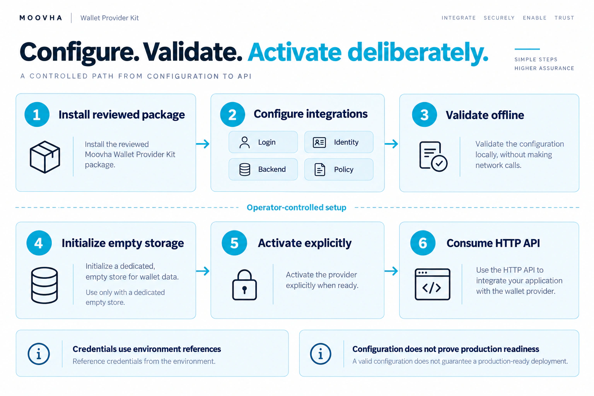

# Install and use the package

The toolkit is a **Node.js ESM package** for backend applications. Use Node
24.22.0 and npm 11.11.1. Importing the wallet library into a browser, CommonJS builds
and other runtimes aren't supported. The package includes a separate bundled
FormKit browser wizard served by its local Node.js setup command. TypeScript declarations accompany every JavaScript entry point.
Version 0.1.0 is experimental and unpublished; `private: true` keeps npm
publication disabled.

Before choosing an integration, read [roles and terms](concepts.md) for the account
owner, connected application (OAuth client), host authority, wallet backend and journal.

## Build an installable tarball

<figure class="wallet-visual">
  
  <figcaption>Installing the package starts the integration path; it does not activate a wallet backend.</figcaption>
</figure>

[View full-size diagram](public/diagrams/service-setup.webp)

From a reviewed checkout of this repository:

```sh
git clone https://github.com/Moovha/wallet-provider-kit.git
cd wallet-provider-kit
npm ci
npm run pack:local
```

This builds the library and writes `moovha-wallet-provider-kit-0.1.0.tgz` in the
repository root. In your own application directory, install that file:

```sh
npm install /absolute/path/to/moovha-wallet-provider-kit-0.1.0.tgz
```

Keep the reviewed tarball in your own artifact store and record its source commit
and checksum for repeatable installs. GitHub CI also uploads a `release-candidate`
artifact containing the package and SBOM; these are short-lived build candidates,
not approved releases. The package is not available from the npm registry;
install a built tarball. Installing directly from a Git branch isn't supported:
compiled files aren't committed and there is intentionally no install-time build.

The repository disables npm lifecycle scripts in `.npmrc`. `pack:local` builds
explicitly, so it also works under that policy. A bare `npm pack` packages whatever
is already in `dist`; run `pack:local` to create a fresh candidate.

## Operators: launch the wizard

After installing the tarball, run:

```sh
npx --no-install wallet-provider-kit setup
```

Follow [getting started](README.md), [service/credential preparation](operator-services.md),
[the wizard screens](setup-wizard.md) and [deployment](operator-deployment.md).
The examples and import guides below are developer learning material, not required
operator implementation work.

## Run your first example

From your application, after installing the tarball:

```sh
node node_modules/@moovha/wallet-provider-kit/examples/inspect-api.mjs
```

Expected output:

```text
{ live: 200, ready: 503, openapi: '3.0.3' }
```

The example uses Fastify's in-process request injection. It opens no network
listener, reads no credentials and creates no wallets. A 503 readiness response
is expected: the default server has no authority or signing integration.

For a complete authenticated provider flow, follow the [integration tutorial](integration-example.md):

```sh
node node_modules/@moovha/wallet-provider-kit/examples/provider-flow/run.mjs
```

It asserts provisioning, exact signing, replay, denial and uncertain-outcome
behavior with ephemeral offline fixtures. The [API guide](api.md) explains each
interface, and [generated reference](api-reference.md) records public declarations.

To explore Swagger over local HTTP, run the installed executable:

```sh
npx --no-install wallet-provider-kit
```

Open [Swagger UI](http://127.0.0.1:8080/docs/). Use Ctrl-C to stop. This executable
has the same unconfigured behavior as `npm start` in the source checkout.
For a configured deployment, follow [Configure, deploy and integrate](setup.md).
The `init`, `validate`, `doctor`, `init-storage` and `run --config` commands supply
the supported service without custom startup code. Environment credentials alone
cannot activate signing.

## Continue with your wallet backend

For the standard service, start with [declarative setup](setup.md). The guides
below describe advanced embedded composition and custom integrations.

Follow [Connect your wallet backend](backend-guide.md) to choose CDP, OWS, Relayer
or your own implementation. Then use [host integration](provider-guide.md) for
current authority, durable attempts and HTTP composition. Use [onboarding](onboarding.md)
for application-led grants under trusted identity/consent attestations. Optional hosted compatibility also supplies provider login and review.

## Choose imports by responsibility

The root import provides convenience exports. Focused imports make each module's
responsibility explicit and let core consumers avoid loading HTTP and
onboarding modules. They are entry points within one package, not independently
installed packages; runtime dependencies are still installed together.

| Import after `@moovha/wallet-provider-kit` | Use it for                                                        | Main exports                                                                                              |
| ------------------------------------------ | ----------------------------------------------------------------- | --------------------------------------------------------------------------------------------------------- |
| (root)                                     | Existing integrations or convenience imports                      | All core, HTTP, onboarding, identity, telemetry and storage exports                                       |
| `/core`                                    | Host-owned authority and durable signing attempts                 | `EmbeddedWalletService`, `WalletSigningProvider`, `createJournaledWalletProvider`, `WalletAttemptJournal` |
| `/backend`                                 | Supplied lifecycle for existing stored-action hosts               | `createStoredWalletBackend`, `createDurableSigningService`, trusted authority adapter contracts           |
| `/sponsorship`                             | Unsigned ERC-4337 preparation and trusted-host ERC-7677 transport | `prepareRuntimeUserOperationV07`, `createPaymasterClientV07`, shared gas-budget helpers                   |
| `/storage`                                 | Built-in SQLite persistence and financial authority               | `openProviderDatabase`, `FinancialApproval`, `FinancialAuthorization`                                     |
| `/http`                                    | OAuth authentication and HTTP composition                         | `createServer`, `createAuthenticator`, `ServerOptions`, `ProviderPaths`                                   |
| `/onboarding`                              | Application-led grants and optional hosted consent/review         | `createOnboardingProvider`, `OnboardingPolicy`, owner login, stores and vendor adapters                   |
| `/identity`                                | Existing host's OIDC Identity Assurance enrollment                | `EnrollmentService`, `createIdentityVerifier`                                                             |
| `/telemetry`                               | Optional OTLP traces and metrics                                  | `startTelemetry`                                                                                          |
| `/cdp`                                     | Experimental CDP signing backend                                  | `createCdpWalletProvider`                                                                                 |
| `/ows`                                     | Experimental local OWS backend                                    | `createOwsWalletProvider`                                                                                 |
| `/openzeppelin-relayer`                    | Experimental external signer/relayer integration                  | Wallet provider and separate executor factories                                                           |
| `/spec/provider-api.json`                  | Implemented HTTP contract                                         | OpenAPI JSON                                                                                              |
| `/spec/orchestration-draft.json`           | Reference action/orchestration design                             | Draft JSON; its orchestration routes are not implemented                                                  |

For example, in an ESM application:

```js
import { createServer } from '@moovha/wallet-provider-kit/http';

const app = await createServer();
await app.listen({ host: '127.0.0.1', port: 8080 });
```

Use `import type` for interfaces. TypeScript applications should use `module`
and `moduleResolution` set to `NodeNext` with `type: "module"` in their own
package.json. Declaration files provide the detailed API; the
[provider guide](provider-guide.md) explains the required authority contracts.
Deep imports into `dist` or `src` are blocked by the export map and unsupported.

Read packaged contracts without relying on internal paths:

```js
import { readFile } from 'node:fs/promises';

const contract = JSON.parse(
  await readFile(
    new URL(
      import.meta.resolve('@moovha/wallet-provider-kit/spec/provider-api.json'),
    ),
    'utf8',
  ),
);
```

OWS is an optional peer dependency. Install its pinned engine only when selecting
that adapter, following the [OWS guide](ows-adapter.md). CDP and Relayer imports
remain opt-in; importing them doesn't configure or invoke their services.

## Configure one host application

The standard deployment uses [JSON configuration](setup.md) and API consumption.
The TypeScript examples below are the advanced embedded path.

For a new onboarding integration, copy
[provider.config.example.ts](provider.config.example.ts) into your application.
Keep public policy, issuer, allowed applications and backend selection in that
one typed startup configuration. Supply credentials through a secret store or
ignored local environment files. The example requires existing login/vendor
integrations and is not the credential-free getting-started example.

For an existing financial host, configure the [supplied stored-action backend](stored-backend.md)
to reuse toolkit account recovery and durable signing dispatch. Alternatively use the
[provider guide](provider-guide.md#compose-the-service) and
[durable-attempt guide](durable-attempts.md). Your application supplies current
owner/grant/KYC/consent checks, immutable approved actions, durable attempts and
recovery. The bundled onboarding store/journal covers provisioning on one
persistent POSIX host and denies signing.

Repository `.env.example` configures the inspection executable and optional
local monitoring; it isn't a second financial policy file. `ops/compose.yaml`
configures that monitoring stack. Neither overrides your application's policy.

## Check the distribution

To verify the packaged files and consumer examples from a source checkout, run:

```sh
npm run check:package
```

This builds, packs and installs into a temporary directory outside the checkout,
with development dependencies and the optional OWS engine omitted. It checks
public ESM imports, root compatibility, declarations and the typed configuration
example, packaged OpenAPI, both runnable examples (including typechecked provider-flow
fixtures), and the installed executable's
liveness/readiness/default denial. The temporary consumer uses the repository's
compiler tooling, resolving application imports against the installed tarball.
Dependency installation may access the npm registry; the examples and service
checks use offline fixtures and loopback only. This check runs in CI.

Actual OWS engine behavior is a separate smoke check. Docker execution and live
provider acceptance are separate evidence; use [integration acceptance](conformance.md).
