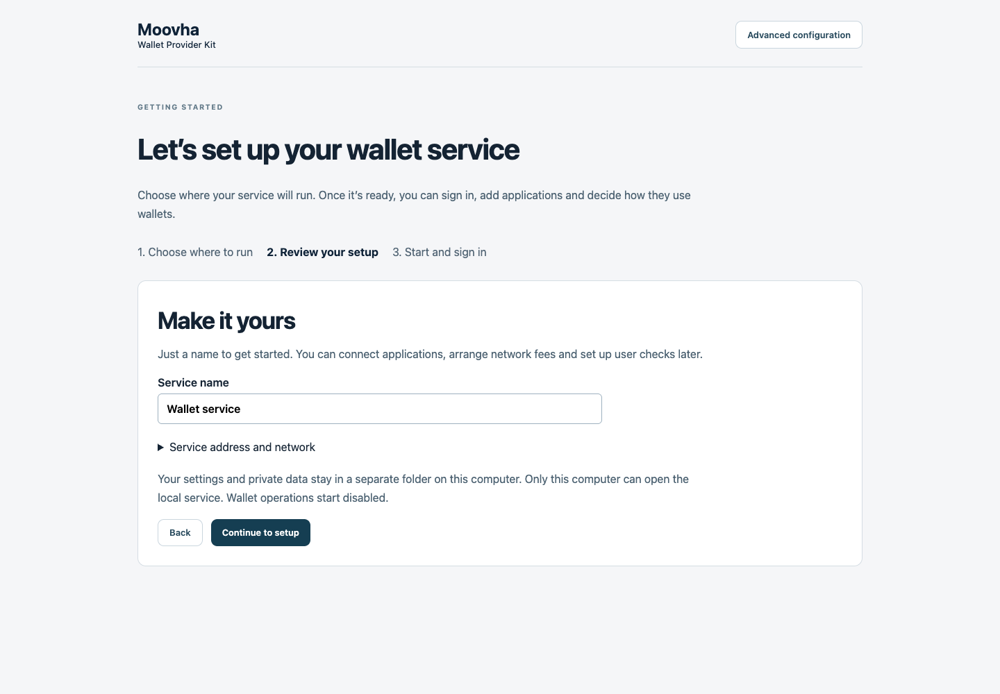
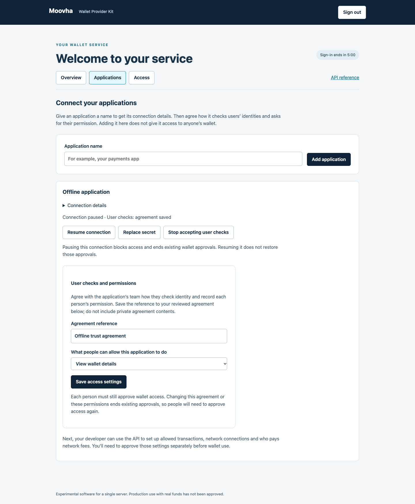

# Install and administer a provider

A provider can run with zero connected applications. Install the service, claim
administrator access and then register applications through the console or API.
Installation needs no application RPC credentials, sponsorship funding or external
identity provider. Wallet operations start disabled.

The service is experimental and supports one active host with persistent local
POSIX storage. Installation does not establish production custody readiness.
The [installation design](provider-installation-design.md) records the research,
authority contracts and implementation acceptance criteria.

## Choose a destination

| Destination           | Installation path                                                                                                                            |
| --------------------- | -------------------------------------------------------------------------------------------------------------------------------------------- |
| This computer         | Use a reviewed release bundle with Docker/Compose, or the source setup tool for contributor evaluation. Access stays on loopback.            |
| Existing Linux server | Run the release installer as a dedicated service account with access to its local Docker runtime. Choose the final HTTPS origin first.       |
| AWS                   | Review the supplied CloudFormation template, network rules, encrypted retained disk and instance costs in AWS. Cloud acceptance is separate. |

The **Package provider release** workflow prepares versioned container images,
build provenance, SBOM metadata and a downloadable installer bundle. It runs only
when explicitly dispatched on main. A merged change does not run it, publish npm
or create cloud resources. Check [available releases](https://github.com/Moovha/wallet-provider-kit/releases)
for an actual bundle before following the release installation path. An
unpublished version cannot be installed from a container registry.

## Install a release bundle

Obtain `provider-release.tgz` and its checksum from the selected release. Verify
publisher provenance before extraction when your release policy requires it:

```sh
gh attestation verify provider-release.tgz \
  --repo Moovha/wallet-provider-kit \
  --signer-workflow Moovha/wallet-provider-kit/.github/workflows/provider-release.yml
```

A matching checksum detects corruption; it does not independently authenticate
the publisher. Retain the verified archive and version for recovery. Extract it
into an empty directory, inspect the files, then run:

```sh
bash install.sh
```

The installer requires a running local Linux Docker engine and Compose v2, at
least two runtime CPUs, 2 GiB runtime memory and 5 GiB free host storage. These
are installation floors, not production capacity estimates. It
shows the destination, provider origin and immutable service image before asking
to deploy. It uses prebuilt images; Node, npm, Git and source builds are not
operator prerequisites. It does not install an operating-system package manager
or replace an existing Docker installation.

For an existing server, set non-secret installation settings before running it:

```sh
export WPK_LOCAL=false
export WPK_ORIGIN=https://wallet.example.com
export WPK_PRIVACY_URL=https://example.com/privacy
export WPK_NAME='Example wallet provider'
export WPK_DIRECTORY=/home/wallet-provider/provider
bash install.sh
```

Arrange DNS for the selected origin and reachability on ports 80 and 443 before
public use. Bundled Caddy manages public HTTPS. Keep SSH restricted to trusted
operator networks. Application execution still needs its own configuration and
acceptance. Do not use a browser certificate warning as a setup step.

For unattended installation, set `WPK_ACCEPT_PLAN=true` only after reviewing the
same resource and exposure choices. Private files use the service account's
ownership and restrictive permissions. Secrets never appear in installation
URLs, cloud stack outputs or installer messages.

The source setup tool remains available through [local setup](local-setup.md).
Its default flow is **Choose where to run → Review your setup → Start and sign in**. The advanced configuration editor remains available for explicit
static configuration and source integrations.



_Offline setup preview. This image does not establish container or cloud readiness._

## Claim administrator access

Open the administration address printed by the installer. For local evaluation,
use `http://127.0.0.1:8080/admin/`. This exception is restricted to configured
loopback administration; remote access requires HTTPS or an authenticated private
connection.

1. Read the private `installation-claim` file on the installation host.
2. Select **First-time setup** and enter the code in **Setup code**.
3. Choose an administrator username and a password of at least 14 characters.
4. Save the password in your password manager.

Claiming expires 30 minutes after first service initialization and succeeds
atomically once. Restarting never reopens registration. Wrong, expired and replayed
claims fail. The console creates a separate provider administrator, then signs in;
it does not create an application, grant wallet access or enable spending.

Administrator sessions use short-lived bearer tokens retained only in page memory.
Reloading or signing out clears them. Sign in again when the session expires.
The console stores no token in localStorage or sessionStorage. Maintain the same
access protections for the console, management API and API explorer.

## Connect an application after installation

Open **Applications** and select **Add application**, or call
`POST /v1/provider/identities` with a provider operator token and an idempotency key.
The API supports application and provider-automation registrations. Client IDs and
secrets are generated by the provider; a secret is shown once. Retain it privately.
Replaying creation returns metadata without the secret. Use **Replace secret** if its original response was lost.

Registration alone does not trust identity assertions. Configure the application's
identity/consent agreement and permitted owner actions separately through its
trust form or `PATCH /v1/provider/identities/{id}`. The update API also changes
the allowed OAuth scopes for application and automation identities within their
role limits. Trust, suspension and credential
changes require the current registration revision. Rotation invalidates obsolete
credentials and tokens while preserving owner grants. Renaming is a metadata
change. Suspension, trust changes and owner-permission changes revoke related
grants and deny old access requests; scope changes invalidate obsolete tokens.
Admitted operations retain their original identities and financial checks; token
rotation does not erase an external effect. Other applications'
registrations and policy revisions remain independent.

Then use the [application configuration APIs](runtime-configuration.md) for
versioned action policies, RPC/service credentials and bounded sponsorship.
Provider acceptance, infrastructure funding, backend/recovery acceptance and
current owner authority remain distinct prerequisites. See [application
obligations](application-obligations.md) and [application access](application-access.md).

Application token requests use the bundled `/oauth/token` endpoint with
`grant_type=client_credentials`, the generated client ID and secret, and explicitly
requested permitted scopes. Credentials authenticate callers; OAuth scopes alone
never authorize financial actions. There is no anonymous registration endpoint.



_Offline transactional fixture with invented identities and no financial effects._

## Automate provider administration

In **Access**, create a provider automation identity. Its role is separate from
application credentials. Automation can use the same management APIs as the
console. Provider management requires `provider:manage` and a current configured
operator identity; runtime policy publication additionally requires its documented
configuration scope. The supplied console requests the full provider management
scope set. The API can issue a narrower allowed subset for automation.

Use `GET /v1/provider/identities`, `GET /v1/provider/status`, the identity update
endpoint and `POST /v1/provider/identities/{id}/credentials` for inventory,
suspension and rotation. Writes require an idempotency key; updates and rotation
also require `expected_revision`. Stale revisions conflict. Idempotency metadata is retained for 24 hours; use a new
key for a new operation. The current service bounds installations to 100 management
identities and 10,000 management commands within that retention window. Secrets and password
verifiers are not returned in inventories. Current credential revisions are
checked when admitting tokens and when checking live application authority.

Provider identities cannot bypass owner, grant, KYC, consent, immutable action,
durable attempt or chain checks. Management does not expose arbitrary shell,
Docker control, raw signing or key-export operations.

## Interpret health correctly

- `/health/live` reports process liveness.
- `/health/management` reports storage-backed management availability even before
  claiming and with zero applications. Public probes contain no identity details.
- `/health/ready` retains the wallet-execution activation gate.
- The protected overview reports management availability, registered applications
  and wallet activation separately. Application readiness is additionally governed
  by its policy, service and sponsorship APIs.

An available management service with disabled wallet operations is a successful
installation. Funding and policy gaps must not be repaired by bypassing authority.

## Recover an interrupted or expired setup

The release installer retains a private preparation record until initialization
finishes. Repeat it with the same reviewed settings and release to resume without
replacing secrets. Existing differing files cause a failure requiring explicit
repair. A completed installation reuses its retained configuration, secrets and
storage. A different image digest requires a reviewed upgrade; rerunning the
installer is not an upgrade or reset.

For an expired unclaimed installation, stop the API and run the host-only command
using its existing environment and configuration:

```sh
docker compose --env-file /dev/null --file /path/to/provider/compose.json stop api
docker compose --env-file /dev/null --file /path/to/provider/compose.json run --rm --no-deps api \
  renew-claim --config /config/provider.json
```

The command saves `renewed-installation-claim` privately beside the configuration.
Restart the API and use that credential within 30 minutes. It cannot reopen an
already claimed installation. Preserve any existing recovery output before a
subsequent explicit recovery; output files are never overwritten.

For lost administrator access, use the same stopped-API procedure with
`recover-admin --config /config/provider.json`. It creates or rotates the separate
`operator-recovery` administrator and saves its client ID and secret in the private
`recovery-administrator` file. Possession of private host storage is a powerful
recovery authority; restrict and audit it. Recovery does not activate wallets. A current administrator can suspend an obsolete
administrator through the identity API once another enabled administrator exists;
the last administrator cannot be suspended. Provider automation cannot modify
administrator credentials or status. Administrators can rotate their own credential
through the protected API; save its response before signing in again.

## AWS template limits

The release includes `aws-cloudformation.json`. Supply a VPC, public subnet,
operator SSH key, restricted administrator CIDR, final domain, privacy URL,
release version and verified archive SHA-256. The template starts an Ubuntu 24.04
VM, installs Docker/Compose and runs the same release installer as a dedicated
service account. It requires internet egress for packages, images and the release.
No cloud credentials or wallet secrets belong in template parameters.

The encrypted root EBS volume is retained when the instance is deleted. Retained
volumes continue to incur charges. Preserve backups independently; a retained disk
is not a tested recovery process. Stack creation alone proves neither DNS/TLS
readiness nor provider readiness. Verify the public endpoint and private claim
path on the created host. The template has offline structural evidence; live AWS
acceptance and performance sizing remain separate requirements.

For backups, restores and upgrades, follow [provider maintenance](provider-maintenance.md).
