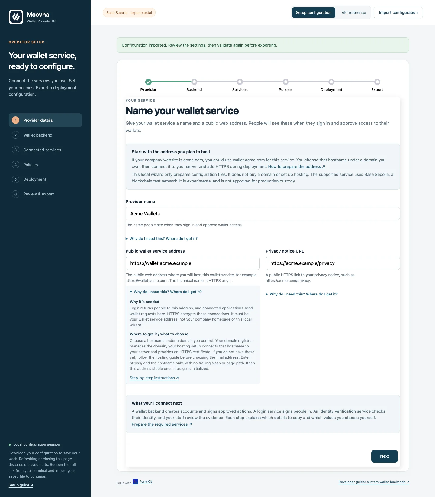
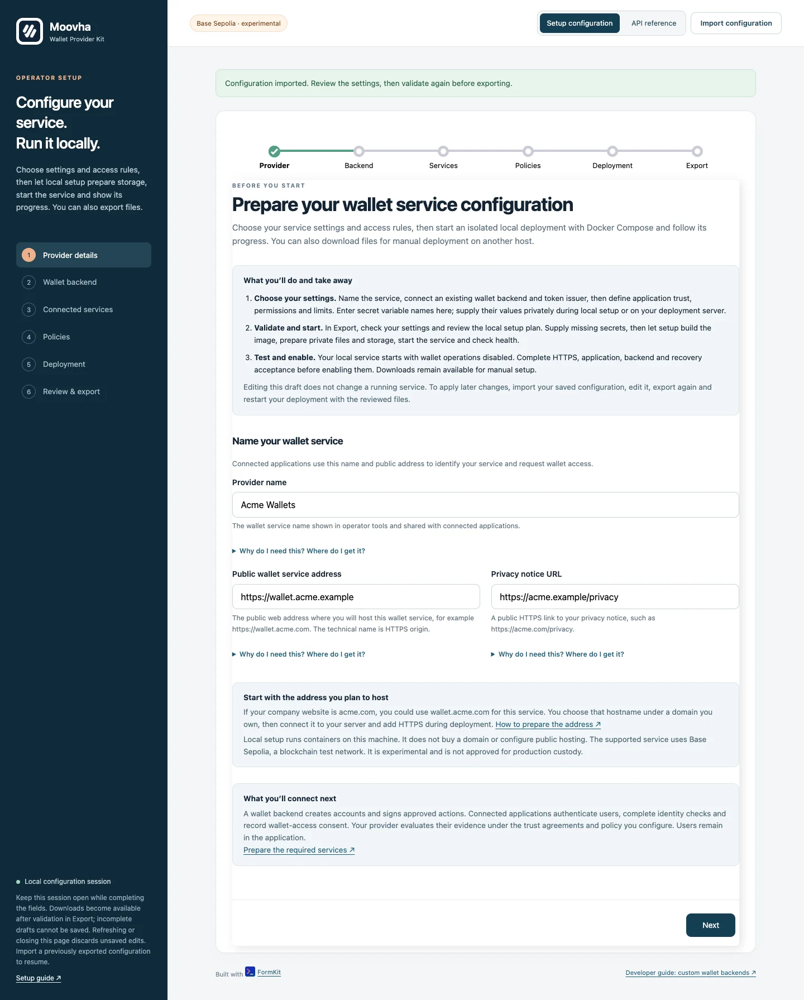
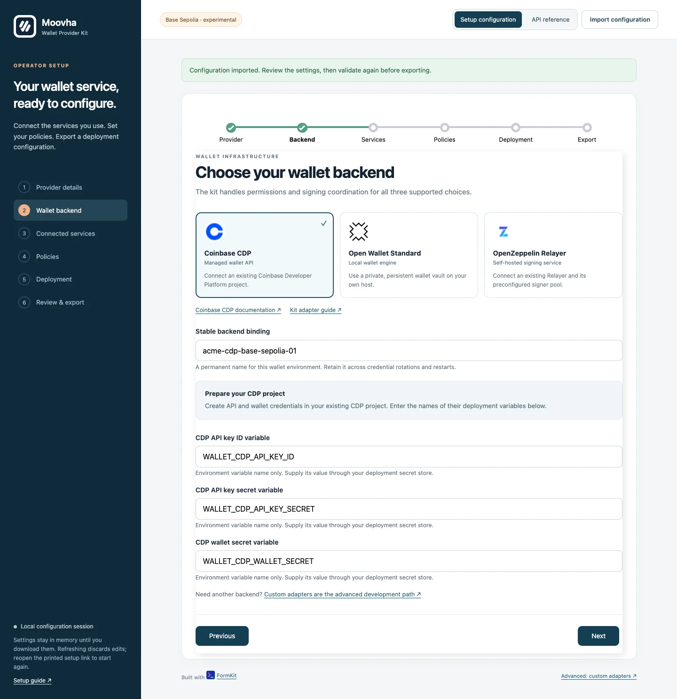
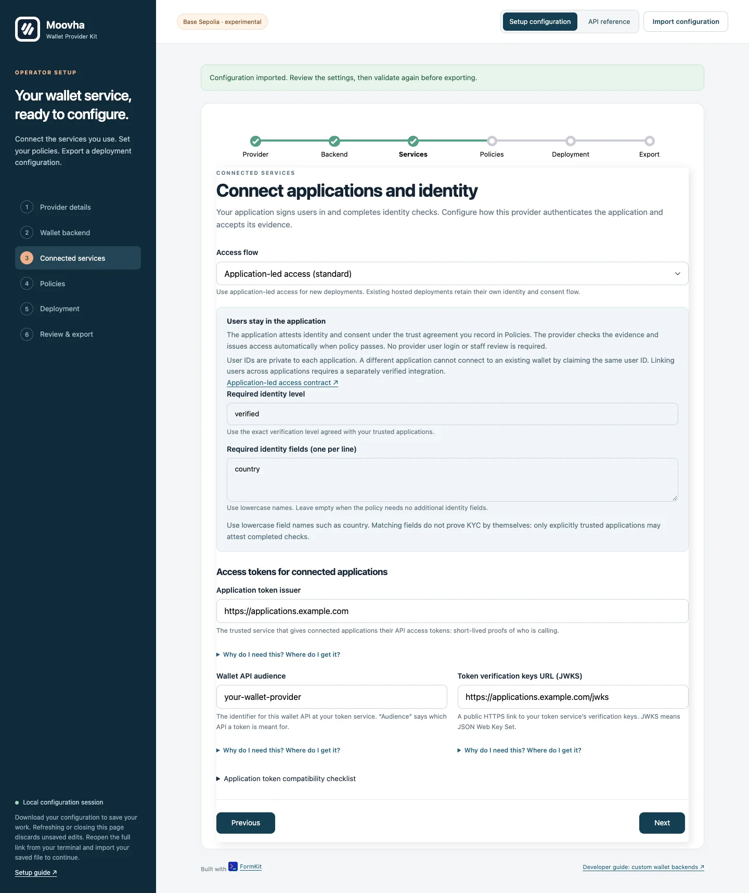
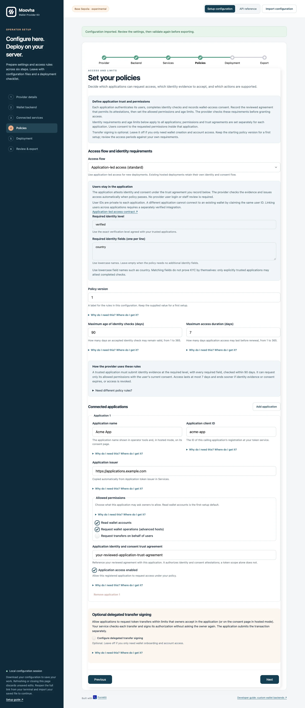
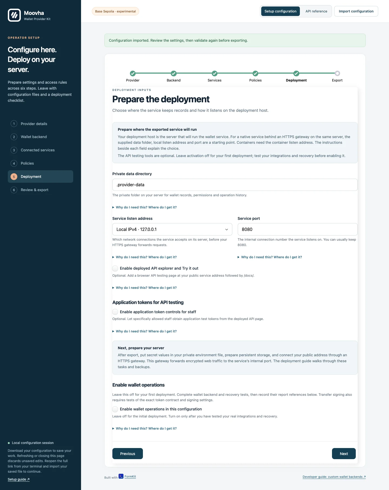
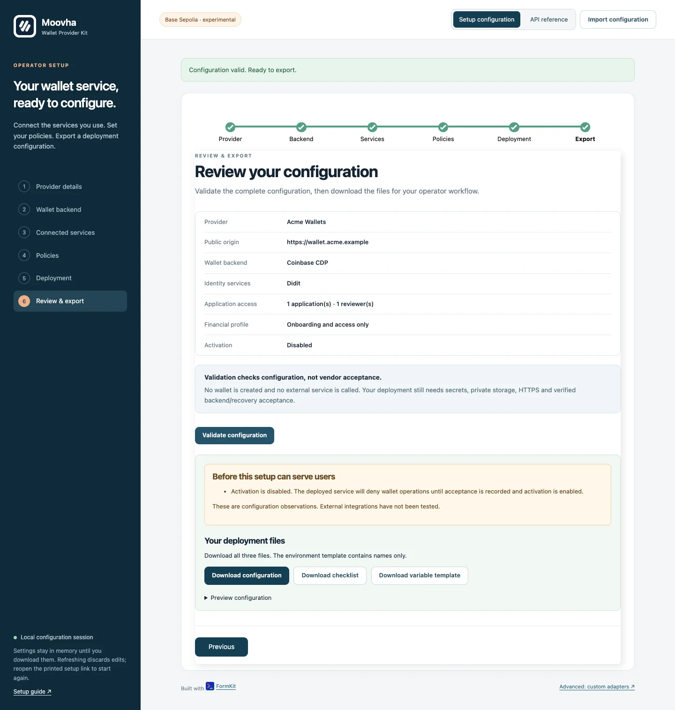
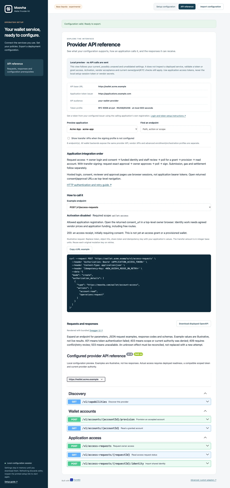
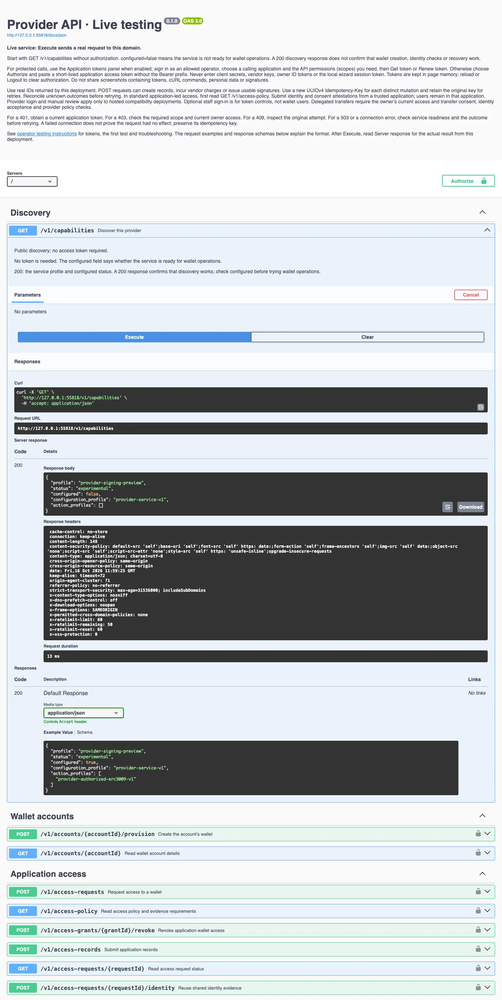

# Set up through the operator wizard

The FormKit wizard configures the supported provider service through labelled
forms. Operators do not implement callbacks, policies in code, database adapters
or signing journals. Product developers still consume the HTTP API. Unsupported
backends use the separate [custom adapter path](custom-adapters.md).

## Open the wizard

Install a [reviewed package](package.md), then run:

```sh
npx --no-install wallet-provider-kit setup
```

From a source checkout, run `npm ci`, `npm run build`, then
`npm start -- setup`. The command opens the default browser on macOS/Linux, or
prints a local URL to open manually. Use `setup --no-open` to print the URL only,
or `setup --port 4319 --no-open` to choose an available port. The URL includes a
private, temporary setup-session token. Do not share it.

Run this on your operator workstation. The wizard always binds to `127.0.0.1`,
regardless of `HOST`, `PORT` or the provider service's listen settings. The session
expires after one hour; press Ctrl+C when finished. It is a separate local tool,
not an unauthenticated administrative screen on the deployed provider API.

## Before you begin

Use [getting started](README.md#install-and-open-the-local-wizard) if Node, npm,
Git or the terminal commands are new to you. Prepare the accounts and policy
inputs in [Services, registrations and secrets](operator-services.md). For a fresh
login/token service use the [Auth0 dashboard recipe](auth0-setup.md). Those guides
explain each required ID, secret, URL, agreement and reviewer subject, including
where to obtain it. You can explore with placeholders, but they cannot run a service.

The screenshots below are captured from the actual wizard with invented example
values and explicitly fictional free-test terms. They show the interface, not a
vendor account, real commercial agreement or accepted deployment. Never copy their
IDs, domains or zero prices into a live configuration.

## Understand a setting before entering it

Each page explains the decision you are making. Every setting has a short
explanation beside it. Open **Why do I need this? Where do I get it?** for its
purpose, the source of the value, examples and a link to the relevant instructions.
You can open these explanations with a keyboard using Tab and Enter or Space.
Opening help does not contact vendors or change your settings.

Some values are yours to choose; others must match a registration elsewhere:

| Kind of setting                | What to do                                                                                  | Examples                                                                   |
| ------------------------------ | ------------------------------------------------------------------------------------------- | -------------------------------------------------------------------------- |
| Your service details           | Choose a value for your own service.                                                        | Provider name; public address under a domain you control.                  |
| Issued registration details    | Copy the exact value from the service that issued it.                                       | Login client ID; application API audience; Didit workflow ID.              |
| Secret variable names          | Keep the supplied names for a first setup. Supply the actual values privately after export. | `PROVIDER_LOGIN_SECRET`; `DIDIT_API_KEY`.                                  |
| Rules and agreement references | Decide the rule and record the real agreement or evidence behind it.                        | Identity cost cap; funding agreement; reviewer access; acceptance reports. |
| Deployment settings            | Match how your server runs. Use the field instructions to assess the supplied values.       | Persistent data folder; internal listen address and port.                  |
| Optional features              | Leave off unless you need and have prepared the feature.                                    | Transfer signing; deployed API testing; operator token controls.           |

For example, **Public wallet service address** asks where you will host the wallet
service. If you control `your-company.com`, you could choose
`wallet.your-company.com`. Connect that hostname to your server through your domain
provider’s DNS settings, then configure your hosting platform or HTTPS gateway to
serve it securely. Enter `https://wallet.your-company.com` in the wizard. This
scheme and hostname together are called an **HTTPS origin**. The kit needs it for
login return addresses and application requests. It does not register the domain
or configure hosting. Follow [publish through HTTPS](operator-deployment.md#publish-through-https)
to complete those tasks before onboarding users.



[Open full-size setting guidance screenshot](public/screenshots/provider-guidance.webp)

## Complete the six steps

### 1. Provider



[Open full-size Provider screenshot](public/screenshots/provider.webp)

Enter your provider display name, **Public wallet service address** and published
privacy notice URL. The address is where owners reach your deployed wallet service,
for example `https://wallet.your-company.com`, without a trailing slash or path.
It is not the temporary local wizard address. The name appears on consent screens.
Set up the [domain and notice](operator-services.md#provider-domain-and-privacy-notice)
before onboarding users. Changing the persisted origin later requires a migration review.

### 2. Backend



[Open full-size Backend screenshot](public/screenshots/backend.webp)

Choose **Coinbase CDP**, **Open Wallet Standard** or **OpenZeppelin Relayer**.
Their logos identify the integration; the linked vendor guides explain the external
service. Choose a **Wallet environment name** (the configuration’s backend binding),
such as `acme-cdp-base-sepolia-01`. You create this name; no vendor issues it.
Keep it unchanged through restarts and credential rotation.

- **CDP:** keep or choose names for the API key ID, API key secret and wallet-secret
  environment variables. Get their actual values from the [CDP registration steps](operator-services.md#coinbase-cdp).
- **OWS:** set a persistent private vault path and owner-passphrase variable name.
  Prepare the [engine and vault](operator-deployment.md#prepare-the-optional-ows-vault)
  on the deployment host. The reference container does not include them.
- **Relayer:** enter its HTTPS origin and API-key variable name, then add the existing
  pool's Relayer IDs, Signer IDs, addresses and revision `1`. Follow
  [signer-pool preparation](operator-services.md#openzeppelin-relayer); a pool entry
  supports one account and cannot be reused for another owner.

**Enter variable names only**, never keys, secret values or seed phrases. Changing
the selected backend discards the prior backend fields. It does not migrate an
existing deployment or its accounts.

### 3. Services



[Open full-size Services screenshot](public/screenshots/services.webp)

Configure the owner-login issuer, confidential client ID, client-secret variable
name and matching ID-token algorithm. Register the exact callback displayed in the
callout. Configure the application's token issuer, dedicated API audience and public
JWKS URL separately. These can use the same compatible issuer but have different
registrations. Follow the [Auth0 field mapping](auth0-setup.md#_5-copy-the-values-into-formkit)
or [issuer requirements](operator-services.md#register-owner-login); URLs alone are insufficient.

Select Didit, Sumsub or both. Enter your recipient workflow ID/level and credential
variable names. For each intended route, enable its **agreed price bound**, supply
the maximum in USD cents and reference the actual terms. Import and new verification
have separate bounds. Even free work needs an explicit agreed zero. Obtain these
from the [identity/vendor setup guide](operator-services.md#prepare-identity-verification).
Sumsub requires Reusable KYC Share to be enabled externally; selecting it does not
turn on that product. Provider staff still decide identity acceptance.

### 4. Policies



[Open full-size Policies screenshot](public/screenshots/policies.webp)

Set a deliberate **policy version**, plus identity-acceptance and application-access
ages in days (1–365). The former bounds how old accepted identity may be; the latter
bounds an application's access grant. The example's 90/7 values are examples, not
a recommendation for your compliance policy. Publish a new version deliberately;
policy changes can invalidate grants and approvals.

For each connected application, enter its display name and registered API client
ID. Its issuer inherits Services. Choose **Read wallet accounts** and, where needed,
**Request transfers on behalf of users** (`transfers:request`) for the configured
transfer profile. **Request wallet operations (advanced hosts)** remains available
for custom financial hosts. These consent permissions differ from the
[token scopes](operator-services.md#register-the-application-api-and-clients).
Keep access enabled only for admitted applications. A client ID is not an owner ID.

Enable the application's identity funding agreement, enter its real agreement
reference and monthly USD-cent cap. Without it, new identity verification/import
pauses even when a route's configured price is zero. Enter each staff reviewer's
exact login subject from the owner-login issuer. The
[funding](operator-services.md#prices-terms-and-application-funding) and
[reviewer instructions](operator-services.md#identify-reviewers) explain their sources.

Leave **Configure provider-authorized transfer signing** off for onboarding/provisioning
only. If required, use the [token policy preparation](operator-services.md#optional-token-signing-policy)
to supply the verified Base Sepolia contract/domain, symbol, decimals, recipient
allowlist, integer base-unit limits and 60–3600-second validity. Users explicitly
consent to transfer delegation during onboarding. The provider then authorises
each exact application request against those terms without a second user prompt.
Ordinary account access and `operations:request` do not grant this delegation.
Changed transfer terms require renewed delegation consent.

### 5. Deployment



[Open full-size Deployment screenshot](public/screenshots/deployment.webp)

Choose private persistent SQLite storage. Relative paths resolve beside the exported
configuration on the deployment host. For native deployment behind a local proxy,
use `127.0.0.1`, port `8080`. For the reference Compose deployment, use `0.0.0.0`,
port `8080`, data directory `.provider-data`. The
[deployment guide](operator-deployment.md) supplies private directory and volume setup.
The **Enable deployed API explorer and Try it out** checkbox exposes Swagger on the deployed
service; it is separate from this setup wizard and the public documentation site.

Keep **Enable service activation in this export** off initially. Activation requires
real backend and recovery acceptance evidence; signing also requires token evidence.
These are references to reviewed reports/tickets, not automatically issued codes
or tests performed by the wizard. Follow [acceptance and activation](operator-deployment.md#acceptance-and-explicit-activation)
before enabling an export. Disabled readiness is expected during preparation.

### 6. Export



[Open full-size Export screenshot](public/screenshots/export.webp)

Click **Validate configuration**. The service applies its strict schema and semantic
checks to all steps. Correct reported errors, then review observations and the
summary. Every edit invalidates the prior validation. Validation does not test
credentials, initialize storage, contact services, create wallets or deploy.

Download **configuration**, **variable template** and **checklist**. A warning that
activation is disabled is expected initially. Missing prices or funding are useful
configuration observations: a valid export can still lack those operational inputs.
Use the [next-stage deployment walkthrough](operator-deployment.md), not only the
fact that the download buttons are available, to determine readiness.

Step tabs allow returning to any section. Their position indicates navigation,
not proof of operational readiness. Every edit invalidates the validated export.
The final validator catches cross-field errors, duplicate bindings, missing
required configuration and financial bounds; frontend validation alone cannot
approve an export.

The wizard distinguishes a structurally valid configuration from a usable
onboarding flow. Missing vendor prices or application funding pause new identity
work. Disabled applications, read-only permissions, unavailable secrets, unprepared
storage and incompatible external services can also prevent the intended flow.
The review screen and checklist call out configuration prerequisites; they do not
claim to test services remotely.

## Explore the provider API

Choose **API reference** in the top bar at any point. **Setup configuration** returns
to the same form without losing edits or its current step. The viewer uses bundled
[Swagger UI](https://swagger.io/tools/swagger-ui/) and the kit's implemented OpenAPI,
with explanatory notes and fictional, schema-checked examples. It does not use the
separate orchestration draft or expose vendor APIs as provider endpoints.



[Open full-size API reference screenshot](public/screenshots/api-reference.webp)

Select an application to preview its configured permissions, then search by endpoint,
action or OAuth scope. Onboarding-only setups initially show six endpoints; enabling
the transfer profile adds its three endpoints. Use the checkbox to inspect those
three while they are not configured. Each operation explains its required scope,
activation/permission prerequisites, owner/grant/identity checks and successful
response. Expand a Swagger row to see parameters, required headers, example JSON,
response status codes and schemas.

The viewer shows the API origin, application token issuer and audience. **Copy cURL
example** copies an illustrative request; replace its token, IDs, any share token
and the mutation's UUIDv4 idempotency key before using it in your application tooling.
Preserve the original key when retrying that same mutation. **Download displayed
OpenAPI** exports the currently displayed endpoints and their reference notes;
search and the transfer visibility checkbox affect that export. It is a reference
snapshot, not a runtime capability or acceptance report.

This is a **local preview of possibly unsaved and unvalidated configuration**.
It does not inspect live tokens, stored grants, deployed readiness or vendor status.
No provider request is executed: Try it out and token-entry controls are disabled.
The setup-session token is never an application credential. Example responses,
consent URLs, hashes and signatures are fictional and confer no authority.
For real responses after deployment, use the **Try it out · real service responses**
card. Enable the deployed explorer in your draft, validate/export it and restart
the service, then choose **Open deployed Try it out**. This opens Swagger on your
configured HTTPS domain in a separate tab. No local configuration, credential or
application permission preview is sent with the link. It does not check deployment
status. The [live testing guide](http-api.md#try-deployed-apis) explains enabling
`/docs/`, obtaining a token, the first request, real effects and troubleshooting.



This screenshot uses a local offline fixture with readiness closed. It demonstrates
response rendering, not vendor connectivity or an accepted deployment.

### Optional application token controls

Deployment also offers **Enable operator token controls**. Enter allowed token
operator login subjects, select the registered applications, set secret variable
names and limit scopes. The [operator token guide](operator-tokens.md) explains
what each identifier/secret means, where to obtain it, deployment and the signed-in
Get token/Renew token flow. Reviewers are not implicitly token operators. The local
wizard does not fetch or store application tokens.

## Use the exported files

- `provider.config.json`: version-1 provider service configuration.
- `provider.env.example`: required variable names with empty values. Supply actual
  values through your deployment's secret store; the CLI does not automatically
  load an environment file.
- `provider-setup.md`: selected backend instructions, login callback, outstanding
  configuration observations, initialization, diagnostics and run commands.

Move the files to your private deployment directory and follow the checklist and
[deployment walkthrough](operator-deployment.md). Relative data/vault paths resolve beside the config
on the deployment host. A container must use an appropriate listen address and
volume mapping; the [reference Compose file](../ops/provider.compose.yaml) has
explicit private mounts and UID/GID inputs. It omits the optional OWS engine/vault.

For a new empty deployment, run `init-storage`, then `doctor`, then `run --config`
using the exported configuration. For an existing store, preserve its origin,
backend binding and signer assignments; follow reviewed migration procedures
instead of reinitializing or replacing wallets. The wizard does not apply config
to a running service, initialize storage, deploy containers or create wallets.

## Resume and privacy

Use **Import configuration** to review a saved, valid supported configuration.
Unknown fields, plaintext credentials, oversized files and custom adapter modules
are rejected. Import never executes a module. Imported activation settings are
preserved; review acceptance again before deploying any changes.

The wizard holds edits in browser memory. It does not save them in localStorage,
sessionStorage, cookies or server files, and does not request external scripts,
fonts, analytics or logos. Refreshing discards edits; reopen the terminal's full
setup link to start again. Download configuration before closing to retain work.
Local API access requires the session token and exact local host/origin. Assets
are bundled with the installable package; no FormKit Pro subscription is needed.
Third-party marks identify integrations and do not imply endorsement. Asset
sources are recorded in the source checkout's `setup-ui/ASSETS.md`.

## Verification and limits

The wizard validates configuration structure and policy. Before activation,
verify vendor registration, login compatibility, identity-sharing agreements,
wallet recovery and token acceptance on your deployment using the
[staging walkthrough](staging-walkthrough.md) and [integration checks](conformance.md).
Offline UI and package tests do not establish those external properties.

The configured service is experimental, single-host and Base Sepolia EOA only.
Signing does not broadcast, sponsor gas or establish settlement.

## Screenshot maintenance

The screenshots use fictional settings and offline fixtures to illustrate the
interface. To update them, follow the
[contributor screenshot instructions](../CONTRIBUTING.md#maintain-wizard-screenshots).
