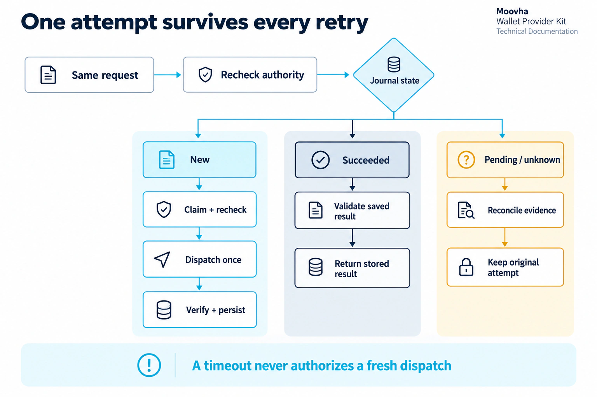

# Use the built-in SQLite database

The toolkit includes persistent SQLite storage for its supported
onboarding, signing and Relayer execution profiles. It runs inside your Node.js
process and requires no database server or additional npm dependency. Use it on
one host with a private directory on persistent local POSIX storage.

| Records                                                                                             | Built-in implementation                                    |
| --------------------------------------------------------------------------------------------------- | ---------------------------------------------------------- |
| Access requests, application-attested consent/identity, optional hosted review, accounts and grants | `database.onboardingStore` with `OnboardingService`        |
| Login sessions, OIDC state/nonces and short-lived PKCE verifiers                                    | The same onboarding store with `createOwnerLogin`          |
| Identity-vendor cost reservations and onboarding audit                                              | The same onboarding store                                  |
| Exact approved signing and execution actions, caller/owner bindings and revocation                  | `approveAction`, `revokeAction` and `financialAuthority`   |
| Stable attempts, HTTP idempotency bindings, exact request fingerprints and usage budgets            | Financial authority admission and the database journal     |
| Dispatch claims, fencing tokens, signatures, provider transaction IDs and uncertain outcomes        | `database.journal`, including read-only status lookup      |
| Financial audit events and reconciliation evidence fingerprints                                     | Committed with the corresponding state transition          |
| Alternative OIDC Identity Assurance enrollment                                                      | `database.enrollmentAuthority`, with host policy callbacks |

SQLite stores the records needed by these profiles. It
does not implement the orchestration draft, on-chain settlement, a relayer's nonce
database, vendor key storage or a user's recovery vault. Your chosen wallet
backend continues to own keys. No private keys, seed phrases, API tokens, identity
tokens or identity documents belong in this database. Login references and
signatures remain sensitive private data.

## Initialize and open

For the configured service, initialize storage with the
[deployment CLI](operator-deployment.md#validate-initialize-once-then-diagnose).
For an embedded integration, [install the package](package.md) and initialize a
dedicated empty directory once from trusted setup code:

```ts
import { resolve } from 'node:path';
import { openProviderDatabase } from '@moovha/wallet-provider-kit/storage';

const database = openProviderDatabase({
  directory: resolve('.provider-data'),
  initialize: true,
});
console.assert(await database.ready());
database.close();
```

Normal startup omits `initialize`. It refuses missing, empty, foreign, changed or
newer schemas rather than silently creating/replacing a database or running an
upgrade:

```ts
const database = openProviderDatabase({ directory: resolve('.provider-data') });
```

The fixed file name is `provider.sqlite`. Initialization first inspects the actual
SQLite catalog and schema/application versions. Version 1 is created only in an
empty database. Opening verifies the complete table/index definitions, including
types, defaults, primary/unique/foreign keys and checks, and runs foreign-key and
integrity checks. Unexpected triggers or other catalog objects are rejected.
SQLite has no server roles, RLS policies or RPCs; filesystem ownership and private
permissions form the database access boundary. This schema belongs exclusively
to the toolkit; it does not assume or alter a Supabase/PostgreSQL schema.

The directory must be owned by the running user with mode 0700; the database and
existing SQLite sidecar files must be private regular files, with no symlinks or
hard links. Newly created database files use mode 0600. Protect the containing
path from replacement by other users. Close the database after stopping all work
that uses it; a host that supplies the store owns its lifetime.

## Use it for onboarding

Standard [application-led access](application-access.md) uses these same transactional collections and journals. Its assertion/grant fields are additive JSON records, with no SQLite schema migration. Login sessions and vendor reservations are used only when their optional hosted/staff features are configured.

Pass `storage: database.onboardingStore` to `createOnboardingProvider` instead of
`storageDirectory`. Supply exactly one of those fields. The existing file-store
configuration stays supported. Include `database.ready()` in your host's readiness
check and close the database in the host's shutdown hook. The
[configuration example](provider.config.example.ts) shows the SQLite composition.

You can also compose `OnboardingService`, `createOwnerLogin` and
`createOnboardingJournal` directly over `database.onboardingStore`. The onboarding
journal remains provisioning-only. Choosing SQLite does not enable signing in
`createOnboardingProvider`; the financial integration below is explicit.

Onboarding retains its existing synchronous whole-state transaction interface.
SQLite stores individual collection entries and append-only audit records rather
than rewriting one JSON file. The adapter still loads onboarding state for each
transaction; it is not a promise of high-volume indexed onboarding queries.
Existing `state.json` files are not imported automatically. Back up existing
state and arrange a reviewed import before switching an active file-store host;
do not initialize empty state as a shortcut for a migration.

## Store an exact financial approval

Your host's trusted review flow prepares the exact supported action, obtains the
owner's approval and supplies `FinancialApproval` to `database.approveAction`.
This library method is not an HTTP route and must never be exposed as a way for
an application to approve its own payload. Store the exact account, action,
owner, issuer/subject/client, grant, consent and policy revision that were approved.

First configure the budget referenced by that approval:

```ts
await database.setBudget('owner-period-limit', '100');
// trustedApproval is constructed by your host after exact-action consent.
await database.approveAction(trustedApproval);
```

`units` and the budget maximum are nonnegative decimal integers, evaluated with
`BigInt`; they are never floating-point amounts. Your policy defines what a unit
means and binds the exact debit/risk to it. Separate assets or accounting periods
need deliberate separate budgets. A budget change preserves all reservations and
cannot reduce the maximum below reserved usage. No automatic reset or release
occurs, including after rejected/unknown effects.

An action ID is immutable. Exact insertion replay succeeds; changed content or
reuse of a revoked ID conflicts. `revokeAction(id)` is permanent for that ID and
blocks further dispatch and stored-result replay. Revocation cannot undo a
signature or transaction already issued. Prepare a new action ID for new approval.

## Compose signing and current host policy

```ts
import {
  EmbeddedWalletService,
  createJournaledWalletProvider,
} from '@moovha/wallet-provider-kit/core';

const financial = database.financialAuthority({
  namespace: 'your-provider-test',
  provider: backend.provider,
  authorize: checkCurrentFinancialPermission,
});
const signer = createJournaledWalletProvider(backend, {
  namespace: 'your-provider-test',
  journal: financial.journal,
  authorizeAttempt: financial.authorizeAttempt,
});
const wallets = new EmbeddedWalletService(financial.authority, signer);
```

`backend` is your selected raw wallet backend. Adapters that already journal their
own effects must use the same `financial.journal`/authorization callbacks directly
rather than double-wrapping their backend calls. Namespaces and backend IDs must
remain stable across restarts and upgrades; changing them cannot be used to escape
pending work. The supported signing payload remains Base Sepolia EOA EIP-712.

`checkCurrentFinancialPermission(context, approval, purpose)` is required. It must
read current account ownership, application grant, KYC, exact consent, unchanged
binding/capability/plan, dependencies and any step-up proof. Return `null` to deny;
throw when policy storage is uncertain. On success, return `FinancialAuthorization`
from those current records. The toolkit compares its owner, account/address, grant, consent and
policy/plan revisions to the immutable approval, requires `ID VERIFIED` and a
future authorization expiry, and repeats these checks before dispatch and cached
success replay. Returning the approval's fields unconditionally bypasses your own
policy and is not an integration.

For bundled onboarding, call `onboarding.authorize(context.principal,
approval.account.accountId, 'operations:request')` within that callback and match
its current owner/grant to the approval, alongside the financial checks. This
permission alone is not approval of an exact action. External policy systems are
not in the SQLite transaction; preserve their revocation/step-up guarantees at
this callback boundary.

The supplied financial authority's `provision` method denies. Compose provisioning
with `onboarding.walletAuthority().provision` or your existing trusted account
authority. Financial approvals do not create account ownership.

Admission keeps one stable attempt per namespace/backend/action, even when an
authorized caller changes its HTTP idempotency key. Reusing a key for another
action conflicts. Claiming dispatch atomically reserves usage, records a fresh
fencing token and appends an audit event. Exactly one process can claim dispatch.
Completion records the result and audit event in one transaction. A failed or
expired claim is never reset for another dispatch.

Existing hosts may use `database.admitAttempt({ request, budgetId, units })` with
their own trusted authority and `authorizeAttempt` callback. A claim without an
exact admission is rejected. Most new financial integrations should use
`financialAuthority` so admission and approval binding are supplied together.

## Relayer execution and alternative enrollment

For `createOpenZeppelinRelayerExecutor`, create a financial authority with provider
`openzeppelin-relayer-execution-v1`; pass its journal, `authorizeAttempt` and
`authorizeStatus` to the executor, and its `executionAuthority` to
`RelayerExecutionService`. Store a supported `RelayerExecutionAction` approval.
For the Relayer wallet signer, the provider ID is `openzeppelin-relayer-v1`.
See the [Relayer guide](openzeppelin-relayer.md) for backend ownership and fees.

`journal.read` is strictly read-only and never claims work or reserves budget.
Current status permission is still required. Status reads can inspect the original
accepted transaction after action expiry; that expiry never permits resubmission.
A provider transaction ID is acceptance, not financial settlement.

Hosts choosing [OIDC Identity Assurance enrollment](enrollment.md) can supply
`database.enrollmentAuthority({ authorize, decide })` to `EnrollmentService`.
`authorize` checks the current caller, object, consent and policy for the indicated
purpose. `decide` returns the provider's independent acceptance decision after
verified identity evidence. The adapter stores challenge/nonces, idempotency
bindings, identity-to-account ownership and allowlisted decision references;
raw verified claims are not stored. Changed proofs conflict; consumed nonces and
revoked enrollment IDs are not reused. `revokeEnrollment` blocks acceptance reads.
Choose this or bundled onboarding as documented; database storage does not merge
their separate acceptance policies.

## Recovery, backup and operations

<figure class="wallet-visual">
  
  <figcaption>The journal preserves attempts and verified results across restarts. A timeout never justifies replacement effects.</figcaption>
</figure>

[View full-size diagram](public/diagrams/durable-attempts.webp)

SQLite uses WAL journaling, `synchronous=FULL`, foreign keys and `BEGIN IMMEDIATE`
writer transactions. Independent processes on the same host serialize through
SQLite's locks. Lock waits are bounded at two seconds. Database/commit uncertainty
returns a sanitized unavailable error without automatic retries; an uncertain
commit poisons that connection until it is closed and reopened.

Dispatch claims last 30 seconds. Expiry is an unknown outcome, never permission
for a replacement attempt. An expired completion token cannot overwrite state.
Use read-only backend evidence to reconcile the original attempt. The trusted
operator method `reconcileAttempt(request, result, evidenceReference, verify)`
requires a successful independent verification callback, validates the exact
request/result and only changes an unknown/expired original attempt to succeeded.
It preserves reservations, records an evidence fingerprint and never dispatches.
Signature reconciliation independently checks the approved digest and signer.
Never expose reconciliation as a public result-submission endpoint.

Use Node's [SQLite backup API](https://nodejs.org/api/sqlite.html) or an equivalent
SQLite-aware backup while the host is running. A live copy of `provider.sqlite`
alone can omit committed WAL data. Stop dispatchers before restoring; make the
restored directory/files private and run catalog/integrity checks before resuming.
A backup can predate a real effect: restoring it is not proof that an absent
attempt was never dispatched. Reconcile the backup window against provider
evidence before admitting new work. Keep a single active authoritative copy;
cloning it into multiple active environments can duplicate effects.

SQLite does not encrypt these files. Use encrypted local storage/backups and
least-privilege access appropriate to signatures and login material. There is no
automatic pruning, external audit delivery, or schema upgrade in version 1.
Never log database state, action payloads or signatures.

The Node 24 `node:sqlite` API is experimental. Its synchronous calls can block the
event loop during disk/lock waits; size the host and measure latency. Network
filesystems, independent hosts/shared replicas, ephemeral disks and Windows are
unsupported. See SQLite's [WAL requirements](https://www.sqlite.org/wal.html) and
[durability settings](https://www.sqlite.org/pragma.html#pragma_synchronous).

Offline checks cover real temporary SQLite files, independent-process claims,
restart/replay, exact integer budgets, current-permission denial, fencing,
uncertainty, online backup/restore, enrollment and the Relayer HTTP profile.
They do not establish power-loss behavior on your filesystem, live-provider
acceptance or production financial authorization. Keep host readiness false
until those deployment-specific checks pass.
